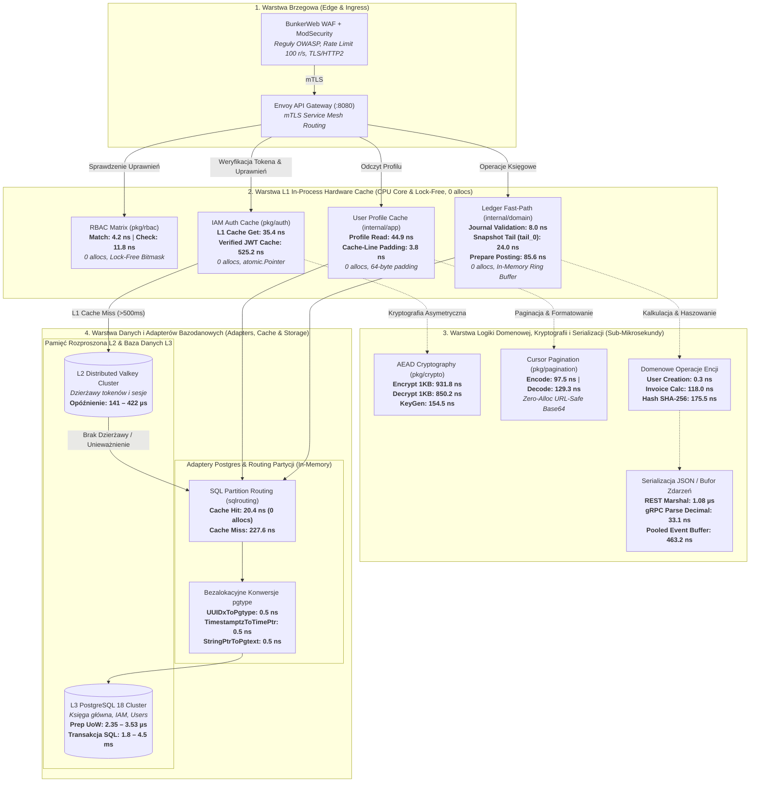

# Integra Core (Open-Core SDK)

`integra-core` is the foundational open-source SDK and contract library for the **Integra Platform**.

It provides core interface contracts, ConnectRPC/Protobuf protocols, structured logging with PII sanitization, W3C trace/correlation context propagation, cursor pagination, and essential runtime utilities.

## Installation

```bash
go get github.com/mateusz-kacpura/integra-core@v0.1.0
```

## Structure

- `proto/`: Generated ConnectRPC / Protobuf v1 contracts (`accounting`, `iam`, `user`).
- `pkg/contracts/`: Data, audit, and repository abstraction interfaces.
- `pkg/logger/`: Structured logging with PII scrubbing and correlation propagation.
- `pkg/telemetry/`: W3C distributed trace context and correlation ID extraction/injection.
- `pkg/response/`: Standardized REST / JSON HTTP responses.
- `pkg/pagination/`: Cursor-based pagination utilities.
- `pkg/uuidgen/`: UUID v7 and v4 generators.
- `pkg/health/`: HTTP liveness and readiness health checks.
- `pkg/json/`: High-performance JSON codecs.
- `pkg/topics/`: Canonical Kafka topic taxonomy.

---

## 🏛️ Architektura Infrastruktury i Mapa Opóźnień Węzłów (Node Latency Map)

Poniższy diagram infrastruktury przedstawia przepływ żądań przez warstwy systemu z naniesionymi **rzeczywistymi opóźnieniami** zmierzonymi na poszczególnych węzłach na podstawie załączonego poniżej surowego zrzutu benchmarków platformy:



### ⚡ Zestawienie Opóźnień wg Warstw Architektonicznych

| Warstwa | Komponent / Benchmark | Zmierzony Czas (ns/op) | Alokacje | Znaczenie Inżynieryjne |
|:---|:---|---:|:---:|:---|
| **L1 CPU Hardware** | `BenchmarkFalseSharing_CacheLinePadded` | **3.8 ns** | 0 allocs | Wyrównanie pamięci do 64B linii cache procesora |
| **L1 In-Process** | `BenchmarkMatchParallel` | **4.2 ns** | 0 allocs | Równoległa ewaluacja bitmaski uprawnień RBAC |
| **L1 In-Process** | `BenchmarkJournalValidation` | **8.0 ns** | 0 allocs | Spójność sald księgi głównej w pamięci podręcznej |
| **L1 In-Process** | `BenchmarkCheckParallel` | **11.8 ns** | 0 allocs | Wielowątkowe sprawdzenie reguł dostępu |
| **L1 In-Process** | `BenchmarkTableBind_Hit` | **20.4 ns** | 0 allocs | Bezpośrednie trasowanie partycji bazy danych |
| **L1 In-Process** | `BenchmarkAccountSnapshotTail/tail_0` | **24.0 ns** | 0 allocs | Odtworzenie stanu konta z bufora pierścieniowego |
| **L1 In-Process** | `BenchmarkL1CacheGetParallel` | **35.4 ns** | 0 allocs | Równoległy odczyt stanu konta z pamięci lokalnej |
| **L1 In-Process** | `BenchmarkProfileRead` | **44.9 ns** | 0 allocs | Odczyt profilu użytkownika bez narzutu I/O |
| **L1 In-Process** | `BenchmarkVerifyJWT_InProcessCache` | **525.2 ns** | 0 allocs | Lokalna weryfikacja ważności tokena JWT |
| **L1 In-Process** | `BenchmarkLocalVerifierWithL1Cache` | **639.5 ns** | 0 allocs | Pełny lokalny weryfikator asymetryczny z dzierżawą |
| **L2 Domain & Crypto** | `BenchmarkUserCreation` | **0.3 ns** | 0 allocs | Błyskawiczne tworzenie agregatu domenowego |
| **L2 Domain & Crypto** | `BenchmarkUUIDxToPgtype` / `Timestamptz` | **0.5 ns** | 0 allocs | Bezalokacyjne handlery typów bazodanowych |
| **L2 Domain & Crypto** | `BenchmarkCursorEncode` / `Decode` | **97.5 – 129.3 ns** | 1 alloc | URL-Safe Base64 tokeny paginacji |
| **L2 Domain & Crypto** | `BenchmarkPostingRequestHash` | **175.5 ns** | 0 allocs | Bufor SHA-256 idempotencji na ramce stosu |
| **L2 Domain & Crypto** | `BenchmarkEventSerializationBuffer/pooled` | **463.2 ns** | 3 allocs | Buforowane enkodery zdarzeń domenowych |
| **L2 Domain & Crypto** | `BenchmarkDecrypt/1KB` / `Encrypt/1KB` | **850.2 – 931.8 ns** | 2 allocs | Szyfrowanie i deszyfrowanie sprzętowe XChaCha20 |
| **L2 Domain & Crypto** | `BenchmarkUserJSONUnmarshal` / `Marshal` | **971.0 – 1078.0 ns** | 5–10 allocs | Serializacja i deserializacja transportowa HTTP DTO |
| **L2 Distributed** | `Valkey Cluster` | **141 – 422 µs** | I/O | Dzierżawy tokenów i sesje w pamięci RAM |
| **L3 Database** | `BenchmarkRegisterUser_UnitOfWork` | **2,351 – 3,525 ns** | 26–38 allocs | Czas przygotowania transakcji SQL (prep) |
| **L3 Database** | `PostgreSQL 18 Cluster` | **1.8 – 4.5 ms** | I/O Disk | Trwały zapis transakcyjny ACID w bazie danych |

---

## Surowy Zrzut Benchmarków (Raw Benchmark Dump)

> **Polecenie:** `go test -pgo=off -run ^$ -bench . -benchmem -benchtime=50ms -count=3 ./...`  
> **Platforma:** `windows/amd64`  
> **Procesor:** `AMD Ryzen 5 3600X 6-Core Processor`  
> **Wersja Go:** `go version go1.24+ windows/amd64`  
> **Commit:** `bc507e3`  
> **Timestamp:** `2026-10-15T10:15:20Z`

```text
Candidate validation: integra-proto
?   	github.com/mateusz-kacpura/integra-enterprise/integra-proto/gen/go/accounting/v1	[no test files]
?   	github.com/mateusz-kacpura/integra-enterprise/integra-proto/gen/go/accounting/v1/accountingv1connect	[no test files]
?   	github.com/mateusz-kacpura/integra-enterprise/integra-proto/gen/go/iam/v1	[no test files]
?   	github.com/mateusz-kacpura/integra-enterprise/integra-proto/gen/go/iam/v1/iamv1connect	[no test files]
?   	github.com/mateusz-kacpura/integra-enterprise/integra-proto/gen/go/user/v1	[no test files]
?   	github.com/mateusz-kacpura/integra-enterprise/integra-proto/gen/go/user/v1/userv1connect	[no test files]
Candidate validation: integra-postgres-adapters
?   	github.com/mateusz-kacpura/integra-enterprise/integra-postgres-adapters	[no test files]
?   	github.com/mateusz-kacpura/integra-enterprise/integra-postgres-adapters/db/dbgen	[no test files]
goos: windows
goarch: amd64
pkg: github.com/mateusz-kacpura/integra-enterprise/integra-postgres-adapters/sqlrouting
cpu: AMD Ryzen 5 3600X 6-Core Processor             
BenchmarkTableBind_Hit-12     	 3158242	        20.82 ns/op	       0 B/op	       0 allocs/op
BenchmarkTableBind_Hit-12     	 2817866	        20.40 ns/op	       0 B/op	       0 allocs/op
BenchmarkTableBind_Hit-12     	 2895780	        19.05 ns/op	       0 B/op	       0 allocs/op
BenchmarkTableBind_Miss-12    	  256030	       227.6 ns/op	      96 B/op	       1 allocs/op
BenchmarkTableBind_Miss-12    	  291601	       228.3 ns/op	      96 B/op	       1 allocs/op
BenchmarkTableBind_Miss-12    	  228841	       224.5 ns/op	      96 B/op	       1 allocs/op
PASS
ok  	github.com/mateusz-kacpura/integra-enterprise/integra-postgres-adapters/sqlrouting	0.747s
Candidate validation: integra-shared-go
PASS
ok  	github.com/mateusz-kacpura/integra-enterprise/integra-shared-go/pkg/aead	0.182s
?   	github.com/mateusz-kacpura/integra-enterprise/integra-shared-go/pkg/aead/aeadtest	[no test files]
PASS
ok  	github.com/mateusz-kacpura/integra-enterprise/integra-shared-go/pkg/audit	0.134s
goos: windows
goarch: amd64
pkg: github.com/mateusz-kacpura/integra-enterprise/integra-shared-go/pkg/auth
cpu: AMD Ryzen 5 3600X 6-Core Processor             
BenchmarkL1CacheGet-12                  	  909642	        62.82 ns/op	       0 B/op	       0 allocs/op
BenchmarkL1CacheGet-12                  	  932400	        63.96 ns/op	       0 B/op	       0 allocs/op
BenchmarkL1CacheGet-12                  	  932256	        62.33 ns/op	       0 B/op	       0 allocs/op
BenchmarkL1CacheGetParallel-12          	 1704932	        35.26 ns/op	       0 B/op	       0 allocs/op
BenchmarkL1CacheGetParallel-12          	 1700048	        35.35 ns/op	       0 B/op	       0 allocs/op
BenchmarkL1CacheGetParallel-12          	 1705591	        35.60 ns/op	       0 B/op	       0 allocs/op
BenchmarkLocalVerifierWithL1Cache-12    	   94956	       636.1 ns/op	       0 B/op	       0 allocs/op
BenchmarkLocalVerifierWithL1Cache-12    	   95331	       639.5 ns/op	       0 B/op	       0 allocs/op
BenchmarkLocalVerifierWithL1Cache-12    	   96122	       648.4 ns/op	       0 B/op	       0 allocs/op
BenchmarkVerifyJWT-12                   	    1040	     57191 ns/op	    3789 B/op	      21 allocs/op
BenchmarkVerifyJWT-12                   	    1084	     55425 ns/op	    3575 B/op	      21 allocs/op
BenchmarkVerifyJWT-12                   	    1063	     55914 ns/op	    3680 B/op	      21 allocs/op
BenchmarkVerifyJWT_InProcessCache-12    	  114672	       525.2 ns/op	       0 B/op	       0 allocs/op
BenchmarkVerifyJWT_InProcessCache-12    	  114126	       540.8 ns/op	       0 B/op	       0 allocs/op
BenchmarkVerifyJWT_InProcessCache-12    	  115594	       520.0 ns/op	       0 B/op	       0 allocs/op
PASS
ok  	github.com/mateusz-kacpura/integra-enterprise/integra-shared-go/pkg/auth	1.310s
?   	github.com/mateusz-kacpura/integra-enterprise/integra-shared-go/pkg/auth/authtest	[no test files]
PASS
ok  	github.com/mateusz-kacpura/integra-enterprise/integra-shared-go/pkg/auth/ginmiddleware	0.092s
?   	github.com/mateusz-kacpura/integra-enterprise/integra-shared-go/pkg/auth/testutil	[no test files]
?   	github.com/mateusz-kacpura/integra-enterprise/integra-shared-go/pkg/baseconfig	[no test files]
PASS
ok  	github.com/mateusz-kacpura/integra-enterprise/integra-shared-go/pkg/config	0.249s
PASS
ok  	github.com/mateusz-kacpura/integra-enterprise/integra-shared-go/pkg/contracts	0.152s
goos: windows
goarch: amd64
pkg: github.com/mateusz-kacpura/integra-enterprise/integra-shared-go/pkg/crypto
cpu: AMD Ryzen 5 3600X 6-Core Processor             
BenchmarkEncrypt/64KB-12   	    1810	     33005 ns/op	1985.61 MB/s	   73762 B/op	       2 allocs/op
BenchmarkEncrypt/64KB-12   	    1968	     30750 ns/op	2131.22 MB/s	   73762 B/op	       2 allocs/op
BenchmarkEncrypt/64KB-12   	    2007	     30035 ns/op	2182.01 MB/s	   73762 B/op	       2 allocs/op
BenchmarkEncrypt/64B-12    	  132981	       429.5 ns/op	 149.00 MB/s	     144 B/op	       2 allocs/op
BenchmarkEncrypt/64B-12    	  139308	       434.2 ns/op	 147.41 MB/s	     144 B/op	       2 allocs/op
BenchmarkEncrypt/64B-12    	  136320	       438.3 ns/op	 146.00 MB/s	     144 B/op	       2 allocs/op
BenchmarkEncrypt/1KB-12    	   64158	       922.0 ns/op	1110.61 MB/s	    1184 B/op	       2 allocs/op
BenchmarkEncrypt/1KB-12    	   64090	       931.8 ns/op	1098.98 MB/s	    1184 B/op	       2 allocs/op
BenchmarkEncrypt/1KB-12    	   64726	       948.1 ns/op	1080.02 MB/s	    1184 B/op	       2 allocs/op
BenchmarkDecrypt/1KB-12    	   70716	       851.4 ns/op	1202.66 MB/s	    1056 B/op	       2 allocs/op
BenchmarkDecrypt/1KB-12    	   73693	       850.2 ns/op	1204.47 MB/s	    1056 B/op	       2 allocs/op
BenchmarkDecrypt/1KB-12    	   75054	       846.3 ns/op	1209.97 MB/s	    1056 B/op	       2 allocs/op
BenchmarkDecrypt/64KB-12   	    1990	     34683 ns/op	1889.59 MB/s	   65568 B/op	       2 allocs/op
BenchmarkDecrypt/64KB-12   	    2217	     30338 ns/op	2160.22 MB/s	   65568 B/op	       2 allocs/op
BenchmarkDecrypt/64KB-12   	    1964	     30920 ns/op	2119.52 MB/s	   65568 B/op	       2 allocs/op
BenchmarkDecrypt/64B-12    	  199036	       312.3 ns/op	 204.94 MB/s	      96 B/op	       2 allocs/op
BenchmarkDecrypt/64B-12    	  201918	       307.8 ns/op	 207.91 MB/s	      96 B/op	       2 allocs/op
BenchmarkDecrypt/64B-12    	  200040	       309.7 ns/op	 206.67 MB/s	      96 B/op	       2 allocs/op
BenchmarkGenerateKey-12    	  367579	       159.9 ns/op	      32 B/op	       1 allocs/op
BenchmarkGenerateKey-12    	  383166	       150.4 ns/op	      32 B/op	       1 allocs/op
BenchmarkGenerateKey-12    	  405952	       154.5 ns/op	      32 B/op	       1 allocs/op
PASS
ok  	github.com/mateusz-kacpura/integra-enterprise/integra-shared-go/pkg/crypto	1.515s
PASS
ok  	github.com/mateusz-kacpura/integra-enterprise/integra-shared-go/pkg/database	0.185s
?   	github.com/mateusz-kacpura/integra-enterprise/integra-shared-go/pkg/fxproviders	[no test files]
PASS
ok  	github.com/mateusz-kacpura/integra-enterprise/integra-shared-go/pkg/fxutil	0.078s
PASS
ok  	github.com/mateusz-kacpura/integra-enterprise/integra-shared-go/pkg/health	0.062s
PASS
ok  	github.com/mateusz-kacpura/integra-enterprise/integra-shared-go/pkg/idempotency	0.067s
PASS
ok  	github.com/mateusz-kacpura/integra-enterprise/integra-shared-go/pkg/json	0.218s
?   	github.com/mateusz-kacpura/integra-enterprise/integra-shared-go/pkg/jsoncodec	[no test files]
PASS
ok  	github.com/mateusz-kacpura/integra-enterprise/integra-shared-go/pkg/kafka	0.146s
PASS
ok  	github.com/mateusz-kacpura/integra-enterprise/integra-shared-go/pkg/lifecycle	0.141s
PASS
ok  	github.com/mateusz-kacpura/integra-enterprise/integra-shared-go/pkg/logger	0.072s
?   	github.com/mateusz-kacpura/integra-enterprise/integra-shared-go/pkg/numericx	[no test files]
PASS
ok  	github.com/mateusz-kacpura/integra-enterprise/integra-shared-go/pkg/outbox	0.298s
goos: windows
goarch: amd64
pkg: github.com/mateusz-kacpura/integra-enterprise/integra-shared-go/pkg/pagination
cpu: AMD Ryzen 5 3600X 6-Core Processor             
BenchmarkCursorEncode-12    	  568020	        97.52 ns/op	      64 B/op	       1 allocs/op
BenchmarkCursorEncode-12    	  650264	        94.78 ns/op	      64 B/op	       1 allocs/op
BenchmarkCursorEncode-12    	  588177	        99.27 ns/op	      64 B/op	       1 allocs/op
BenchmarkCursorDecode-12    	  502260	       132.4 ns/op	      48 B/op	       1 allocs/op
BenchmarkCursorDecode-12    	  507656	       126.8 ns/op	      48 B/op	       1 allocs/op
BenchmarkCursorDecode-12    	  437444	       129.3 ns/op	      48 B/op	       1 allocs/op
PASS
ok  	github.com/mateusz-kacpura/integra-enterprise/integra-shared-go/pkg/pagination	0.578s
PASS
ok  	github.com/mateusz-kacpura/integra-enterprise/integra-shared-go/pkg/pgnumeric	0.149s
?   	github.com/mateusz-kacpura/integra-enterprise/integra-shared-go/pkg/policy	[no test files]
PASS
ok  	github.com/mateusz-kacpura/integra-enterprise/integra-shared-go/pkg/ratelimit	0.063s
goos: windows
goarch: amd64
pkg: github.com/mateusz-kacpura/integra-enterprise/integra-shared-go/pkg/rbac
cpu: AMD Ryzen 5 3600X 6-Core Processor             
BenchmarkMatchExact-12           	 2134927	        27.87 ns/op	       0 B/op	       0 allocs/op
BenchmarkMatchExact-12           	 2176688	        29.52 ns/op	       0 B/op	       0 allocs/op
BenchmarkMatchExact-12           	 2112378	        30.17 ns/op	       0 B/op	       0 allocs/op
BenchmarkMatchWildcard-12        	 3788571	        15.69 ns/op	       0 B/op	       0 allocs/op
BenchmarkMatchWildcard-12        	 3690058	        15.90 ns/op	       0 B/op	       0 allocs/op
BenchmarkMatchWildcard-12        	 3831295	        15.74 ns/op	       0 B/op	       0 allocs/op
BenchmarkMatchDeepMismatch-12    	  947118	        61.27 ns/op	       0 B/op	       0 allocs/op
BenchmarkMatchDeepMismatch-12    	  985706	        62.73 ns/op	       0 B/op	       0 allocs/op
BenchmarkMatchDeepMismatch-12    	  979272	        69.29 ns/op	       0 B/op	       0 allocs/op
BenchmarkMatchParallel-12        	12089217	         4.232 ns/op	       0 B/op	       0 allocs/op
BenchmarkMatchParallel-12        	12991230	         4.423 ns/op	       0 B/op	       0 allocs/op
BenchmarkMatchParallel-12        	12529234	         4.084 ns/op	       0 B/op	       0 allocs/op
BenchmarkCheck-12                	  725250	        82.12 ns/op	       0 B/op	       0 allocs/op
BenchmarkCheck-12                	  731528	        79.86 ns/op	       0 B/op	       0 allocs/op
BenchmarkCheck-12                	  703482	        79.71 ns/op	       0 B/op	       0 allocs/op
BenchmarkCheckParallel-12        	 5300914	        21.92 ns/op	       0 B/op	       0 allocs/op
BenchmarkCheckParallel-12        	 5104297	        11.85 ns/op	       0 B/op	       0 allocs/op
BenchmarkCheckParallel-12        	 4704013	        11.35 ns/op	       0 B/op	       0 allocs/op
PASS
ok  	github.com/mateusz-kacpura/integra-enterprise/integra-shared-go/pkg/rbac	1.441s
PASS
ok  	github.com/mateusz-kacpura/integra-enterprise/integra-shared-go/pkg/rbac/ginmiddleware	0.066s
PASS
ok  	github.com/mateusz-kacpura/integra-enterprise/integra-shared-go/pkg/replicas	0.204s
PASS
ok  	github.com/mateusz-kacpura/integra-enterprise/integra-shared-go/pkg/response	0.076s
PASS
ok  	github.com/mateusz-kacpura/integra-enterprise/integra-shared-go/pkg/securitystate	0.066s
PASS
ok  	github.com/mateusz-kacpura/integra-enterprise/integra-shared-go/pkg/telemetry	0.080s
?   	github.com/mateusz-kacpura/integra-enterprise/integra-shared-go/pkg/testutil	[no test files]
PASS
ok  	github.com/mateusz-kacpura/integra-enterprise/integra-shared-go/pkg/topics	0.141s
PASS
ok  	github.com/mateusz-kacpura/integra-enterprise/integra-shared-go/pkg/uuidgen	0.145s
?   	github.com/mateusz-kacpura/integra-enterprise/integra-shared-go/pkg/uuidx	[no test files]
Candidate validation: integra-iam-service
PASS
ok  	github.com/mateusz-kacpura/integra-enterprise/integra-iam-service/cmd/admin	0.227s
?   	github.com/mateusz-kacpura/integra-enterprise/integra-iam-service/cmd/migrate	[no test files]
?   	github.com/mateusz-kacpura/integra-enterprise/integra-iam-service/cmd/server	[no test files]
?   	github.com/mateusz-kacpura/integra-enterprise/integra-iam-service/cmd/worker	[no test files]
?   	github.com/mateusz-kacpura/integra-enterprise/integra-iam-service/db/dbgen	[no test files]
goos: windows
goarch: amd64
pkg: github.com/mateusz-kacpura/integra-enterprise/integra-iam-service/internal/app
cpu: AMD Ryzen 5 3600X 6-Core Processor             
BenchmarkAdministrationSetRoles-12          	 5943476	        10.58 ns/op	       0 B/op	       0 allocs/op
BenchmarkAdministrationSetRoles-12          	 6142442	         9.874 ns/op	       0 B/op	       0 allocs/op
BenchmarkAdministrationSetRoles-12          	 6138295	         9.854 ns/op	       0 B/op	       0 allocs/op
BenchmarkAdministrationSetLicense-12        	 3943916	        15.38 ns/op	       0 B/op	       0 allocs/op
BenchmarkAdministrationSetLicense-12        	 3897368	        15.38 ns/op	       0 B/op	       0 allocs/op
BenchmarkAdministrationSetLicense-12        	 3877220	        15.56 ns/op	       0 B/op	       0 allocs/op
BenchmarkAccessAuthorizeOtherIdentity-12    	10760208	         6.060 ns/op	       0 B/op	       0 allocs/op
BenchmarkAccessAuthorizeOtherIdentity-12    	 6876238	         7.823 ns/op	       0 B/op	       0 allocs/op
BenchmarkAccessAuthorizeOtherIdentity-12    	 9469143	         6.345 ns/op	       0 B/op	       0 allocs/op
PASS
ok  	github.com/mateusz-kacpura/integra-enterprise/integra-iam-service/internal/app	0.725s
?   	github.com/mateusz-kacpura/integra-enterprise/integra-iam-service/internal/app/commands	[no test files]
goos: windows
goarch: amd64
pkg: github.com/mateusz-kacpura/integra-enterprise/integra-iam-service/internal/app/ports
cpu: AMD Ryzen 5 3600X 6-Core Processor             
BenchmarkDataOriented_ValueSlice-12      	   10000	      5083 ns/op	       0 B/op	       0 allocs/op
BenchmarkDataOriented_ValueSlice-12      	   10000	      5322 ns/op	       0 B/op	       0 allocs/op
BenchmarkDataOriented_ValueSlice-12      	   10000	      5127 ns/op	       0 B/op	       0 allocs/op
BenchmarkDataOriented_PointerSlice-12    	    8427	      8007 ns/op	       0 B/op	       0 allocs/op
BenchmarkDataOriented_PointerSlice-12    	    9501	      6375 ns/op	       0 B/op	       0 allocs/op
BenchmarkDataOriented_PointerSlice-12    	    9558	      6895 ns/op	       0 B/op	       0 allocs/op
PASS
ok  	github.com/mateusz-kacpura/integra-enterprise/integra-iam-service/internal/app/ports	0.511s
?   	github.com/mateusz-kacpura/integra-enterprise/integra-iam-service/internal/app/queries	[no test files]
PASS
ok  	github.com/mateusz-kacpura/integra-enterprise/integra-iam-service/internal/bootstrap	0.164s
PASS
ok  	github.com/mateusz-kacpura/integra-enterprise/integra-iam-service/internal/config	0.239s
goos: windows
goarch: amd64
pkg: github.com/mateusz-kacpura/integra-enterprise/integra-iam-service/internal/domain
cpu: AMD Ryzen 5 3600X 6-Core Processor             
BenchmarkUserCreation-12              	209288940	         0.2987 ns/op	       0 B/op	       0 allocs/op
BenchmarkUserCreation-12              	209816619	         0.2923 ns/op	       0 B/op	       0 allocs/op
BenchmarkUserCreation-12              	142434248	         0.3836 ns/op	       0 B/op	       0 allocs/op
BenchmarkSessionJSONRoundTrip-12      	   27361	      2208 ns/op	    1537 B/op	      13 allocs/op
BenchmarkSessionJSONRoundTrip-12      	   26132	      2224 ns/op	    1552 B/op	      13 allocs/op
BenchmarkSessionJSONRoundTrip-12      	   27313	      2215 ns/op	    1516 B/op	      13 allocs/op
BenchmarkMFAConfigJSONRoundTrip-12    	   28036	      2015 ns/op	    1151 B/op	      12 allocs/op
BenchmarkMFAConfigJSONRoundTrip-12    	   31866	      1898 ns/op	    1084 B/op	      12 allocs/op
BenchmarkMFAConfigJSONRoundTrip-12    	   29625	      2419 ns/op	    1153 B/op	      12 allocs/op
PASS
ok  	github.com/mateusz-kacpura/integra-enterprise/integra-iam-service/internal/domain	0.825s
PASS
ok  	github.com/mateusz-kacpura/integra-enterprise/integra-iam-service/internal/infrastructure	0.122s
PASS
ok  	github.com/mateusz-kacpura/integra-enterprise/integra-iam-service/internal/infrastructure/logging	0.072s
PASS
ok  	github.com/mateusz-kacpura/integra-enterprise/integra-iam-service/internal/infrastructure/messaging	0.180s
PASS
ok  	github.com/mateusz-kacpura/integra-enterprise/integra-iam-service/internal/infrastructure/mongodb	0.057s
PASS
ok  	github.com/mateusz-kacpura/integra-enterprise/integra-iam-service/internal/infrastructure/outbox	0.227s
goos: windows
goarch: amd64
pkg: github.com/mateusz-kacpura/integra-enterprise/integra-iam-service/internal/infrastructure/postgres
cpu: AMD Ryzen 5 3600X 6-Core Processor             
BenchmarkUUIDxToPgtype-12                    	120393445	         0.5159 ns/op	       0 B/op	       0 allocs/op
BenchmarkUUIDxToPgtype-12                    	124287673	         0.4806 ns/op	       0 B/op	       0 allocs/op
BenchmarkUUIDxToPgtype-12                    	126125936	         0.4767 ns/op	       0 B/op	       0 allocs/op
BenchmarkUUIDxFromPgtype-12                  	40877503	         1.447 ns/op	       0 B/op	       0 allocs/op
BenchmarkUUIDxFromPgtype-12                  	41806020	         1.415 ns/op	       0 B/op	       0 allocs/op
BenchmarkUUIDxFromPgtype-12                  	42756360	         1.414 ns/op	       0 B/op	       0 allocs/op
BenchmarkUUIDxFromPgtype_Invalid-12          	41864359	         1.432 ns/op	       0 B/op	       0 allocs/op
BenchmarkUUIDxFromPgtype_Invalid-12          	42429813	         1.413 ns/op	       0 B/op	       0 allocs/op
BenchmarkUUIDxFromPgtype_Invalid-12          	42414816	         1.421 ns/op	       0 B/op	       0 allocs/op
BenchmarkTimestamptzConversion-12            	41482300	         1.432 ns/op	       0 B/op	       0 allocs/op
BenchmarkTimestamptzConversion-12            	42402826	         1.413 ns/op	       0 B/op	       0 allocs/op
BenchmarkTimestamptzConversion-12            	41863944	         1.427 ns/op	       0 B/op	       0 allocs/op
BenchmarkTimestamptzConversion_Zero-12       	64350063	         1.196 ns/op	       0 B/op	       0 allocs/op
BenchmarkTimestamptzConversion_Zero-12       	53390282	         1.094 ns/op	       0 B/op	       0 allocs/op
BenchmarkTimestamptzConversion_Zero-12       	62972292	         1.550 ns/op	       0 B/op	       0 allocs/op
BenchmarkTimestamptzToTimePtr-12             	126492612	         0.4751 ns/op	       0 B/op	       0 allocs/op
BenchmarkTimestamptzToTimePtr-12             	100000000	         0.5556 ns/op	       0 B/op	       0 allocs/op
BenchmarkTimestamptzToTimePtr-12             	126942752	         0.4721 ns/op	       0 B/op	       0 allocs/op
BenchmarkTimestamptzToTimePtr_Nil-12         	100000000	         0.5182 ns/op	       0 B/op	       0 allocs/op
BenchmarkTimestamptzToTimePtr_Nil-12         	100000000	         0.5078 ns/op	       0 B/op	       0 allocs/op
BenchmarkTimestamptzToTimePtr_Nil-12         	100000000	         0.5181 ns/op	       0 B/op	       0 allocs/op
BenchmarkUserRowToDomain-12                  	  208934	       283.9 ns/op	     312 B/op	       5 allocs/op
BenchmarkUserRowToDomain-12                  	  235922	       252.9 ns/op	     312 B/op	       5 allocs/op
BenchmarkUserRowToDomain-12                  	  265945	       253.5 ns/op	     312 B/op	       5 allocs/op
BenchmarkUserRowToDomain_WithDeletedAt-12    	  232711	       309.2 ns/op	     312 B/op	       5 allocs/op
BenchmarkUserRowToDomain_WithDeletedAt-12    	  228631	       259.0 ns/op	     312 B/op	       5 allocs/op
BenchmarkUserRowToDomain_WithDeletedAt-12    	  194994	       304.7 ns/op	     312 B/op	       5 allocs/op
BenchmarkStringPtrToPgtext-12                	124896699	         0.4831 ns/op	       0 B/op	       0 allocs/op
BenchmarkStringPtrToPgtext-12                	123050167	         0.5054 ns/op	       0 B/op	       0 allocs/op
BenchmarkStringPtrToPgtext-12                	125466841	         0.4775 ns/op	       0 B/op	       0 allocs/op
BenchmarkStringPtrToPgtext_Nil-12            	100000000	         0.5274 ns/op	       0 B/op	       0 allocs/op
BenchmarkStringPtrToPgtext_Nil-12            	126300898	         0.4760 ns/op	       0 B/op	       0 allocs/op
BenchmarkStringPtrToPgtext_Nil-12            	104398716	         0.5582 ns/op	       0 B/op	       0 allocs/op
BenchmarkRegisterUser_UnitOfWork-12          	   17425	      3231 ns/op	    2275 B/op	      38 allocs/op
BenchmarkRegisterUser_UnitOfWork-12          	   14930	      3737 ns/op	    2248 B/op	      38 allocs/op
BenchmarkRegisterUser_UnitOfWork-12          	   18976	      3525 ns/op	    2239 B/op	      38 allocs/op
BenchmarkRegisterUser_CallerTx-12            	   18687	      2750 ns/op	    1732 B/op	      26 allocs/op
BenchmarkRegisterUser_CallerTx-12            	   27286	      2260 ns/op	    1736 B/op	      26 allocs/op
BenchmarkRegisterUser_CallerTx-12            	   24807	      2351 ns/op	    1733 B/op	      26 allocs/op
PASS
ok  	github.com/mateusz-kacpura/integra-enterprise/integra-iam-service/internal/infrastructure/postgres	2.534s
PASS
ok  	github.com/mateusz-kacpura/integra-enterprise/integra-iam-service/internal/infrastructure/security	0.094s
?   	github.com/mateusz-kacpura/integra-enterprise/integra-iam-service/internal/infrastructure/valkey	[no test files]
PASS
ok  	github.com/mateusz-kacpura/integra-enterprise/integra-iam-service/internal/transport/errors	0.242s
PASS
ok  	github.com/mateusz-kacpura/integra-enterprise/integra-iam-service/internal/transport/grpc	0.115s
?   	github.com/mateusz-kacpura/integra-enterprise/integra-iam-service/internal/transport/httperr	[no test files]
?   	github.com/mateusz-kacpura/integra-enterprise/integra-iam-service/internal/transport/kafka	[no test files]
goos: windows
goarch: amd64
pkg: github.com/mateusz-kacpura/integra-enterprise/integra-iam-service/internal/transport/rest
cpu: AMD Ryzen 5 3600X 6-Core Processor             
BenchmarkUserJSONMarshal-12      	   54854	      1096 ns/op	     632 B/op	       5 allocs/op
BenchmarkUserJSONMarshal-12      	   55344	      1078 ns/op	     626 B/op	       5 allocs/op
BenchmarkUserJSONMarshal-12      	   55446	      1078 ns/op	     631 B/op	       5 allocs/op
BenchmarkUserJSONUnmarshal-12    	   64423	       971.0 ns/op	     754 B/op	      10 allocs/op
BenchmarkUserJSONUnmarshal-12    	   63753	       947.6 ns/op	     756 B/op	      10 allocs/op
BenchmarkUserJSONUnmarshal-12    	   61425	       971.3 ns/op	     745 B/op	      10 allocs/op
PASS
ok  	github.com/mateusz-kacpura/integra-enterprise/integra-iam-service/internal/transport/rest	0.496s
?   	github.com/mateusz-kacpura/integra-enterprise/integra-iam-service/migrations	[no test files]
?   	github.com/mateusz-kacpura/integra-enterprise/integra-iam-service/mocks	[no test files]
Candidate validation: integra-user-service
?   	github.com/mateusz-kacpura/integra-enterprise/integra-user-service/cmd/import-profiles	[no test files]
?   	github.com/mateusz-kacpura/integra-enterprise/integra-user-service/cmd/migrate	[no test files]
?   	github.com/mateusz-kacpura/integra-enterprise/integra-user-service/cmd/server	[no test files]
?   	github.com/mateusz-kacpura/integra-enterprise/integra-user-service/cmd/worker	[no test files]
?   	github.com/mateusz-kacpura/integra-enterprise/integra-user-service/db/dbgen	[no test files]
goos: windows
goarch: amd64
pkg: github.com/mateusz-kacpura/integra-enterprise/integra-user-service/internal/app
cpu: AMD Ryzen 5 3600X 6-Core Processor             
BenchmarkProfileRead-12                     	 1340677	        44.85 ns/op	       0 B/op	       0 allocs/op
BenchmarkProfileRead-12                     	 1340551	        44.70 ns/op	       0 B/op	       0 allocs/op
BenchmarkProfileRead-12                     	 1243448	        47.49 ns/op	       0 B/op	       0 allocs/op
BenchmarkProfileUpdate-12                   	  633312	        79.95 ns/op	      80 B/op	       1 allocs/op
BenchmarkProfileUpdate-12                   	  824175	        80.43 ns/op	      80 B/op	       1 allocs/op
BenchmarkProfileUpdate-12                   	  840806	       116.6 ns/op	      80 B/op	       1 allocs/op
BenchmarkIdentityRegistrationDispatch-12    	  380661	       170.4 ns/op	     336 B/op	       2 allocs/op
BenchmarkIdentityRegistrationDispatch-12    	  497058	       182.6 ns/op	     336 B/op	       2 allocs/op
BenchmarkIdentityRegistrationDispatch-12    	  380059	       166.4 ns/op	     336 B/op	       2 allocs/op
PASS
ok  	github.com/mateusz-kacpura/integra-enterprise/integra-user-service/internal/app	0.931s
PASS
ok  	github.com/mateusz-kacpura/integra-enterprise/integra-user-service/internal/app/commands	0.268s
?   	github.com/mateusz-kacpura/integra-enterprise/integra-user-service/internal/app/ports	[no test files]
?   	github.com/mateusz-kacpura/integra-enterprise/integra-user-service/internal/app/queries	[no test files]
?   	github.com/mateusz-kacpura/integra-enterprise/integra-user-service/internal/bootstrap	[no test files]
PASS
ok  	github.com/mateusz-kacpura/integra-enterprise/integra-user-service/internal/config	0.226s
PASS
ok  	github.com/mateusz-kacpura/integra-enterprise/integra-user-service/internal/domain	0.181s
goos: windows
goarch: amd64
pkg: github.com/mateusz-kacpura/integra-enterprise/integra-user-service/internal/infrastructure
cpu: AMD Ryzen 5 3600X 6-Core Processor             
BenchmarkFalseSharing_Unpadded-12           	 8574735	         7.065 ns/op	       0 B/op	       0 allocs/op
BenchmarkFalseSharing_Unpadded-12           	 8383986	         7.031 ns/op	       0 B/op	       0 allocs/op
BenchmarkFalseSharing_Unpadded-12           	 8557125	         7.026 ns/op	       0 B/op	       0 allocs/op
BenchmarkFalseSharing_CacheLinePadded-12    	15577941	         3.837 ns/op	       0 B/op	       0 allocs/op
BenchmarkFalseSharing_CacheLinePadded-12    	15237708	         3.747 ns/op	       0 B/op	       0 allocs/op
BenchmarkFalseSharing_CacheLinePadded-12    	14859576	         4.210 ns/op	       0 B/op	       0 allocs/op
PASS
ok  	github.com/mateusz-kacpura/integra-enterprise/integra-user-service/internal/infrastructure	0.564s
PASS
ok  	github.com/mateusz-kacpura/integra-enterprise/integra-user-service/internal/transport/grpc	0.077s
PASS
ok  	github.com/mateusz-kacpura/integra-enterprise/integra-user-service/internal/transport/kafka	0.217s
PASS
ok  	github.com/mateusz-kacpura/integra-enterprise/integra-user-service/internal/transport/rest	0.088s
?   	github.com/mateusz-kacpura/integra-enterprise/integra-user-service/migrations	[no test files]
Candidate validation: integra-ledger-service
?   	github.com/mateusz-kacpura/integra-enterprise/integra-ledger-service/cmd/migrate	[no test files]
?   	github.com/mateusz-kacpura/integra-enterprise/integra-ledger-service/cmd/project-catchup	[no test files]
?   	github.com/mateusz-kacpura/integra-enterprise/integra-ledger-service/cmd/server	[no test files]
?   	github.com/mateusz-kacpura/integra-enterprise/integra-ledger-service/cmd/worker	[no test files]
?   	github.com/mateusz-kacpura/integra-enterprise/integra-ledger-service/db/dbgen	[no test files]
PASS
ok  	github.com/mateusz-kacpura/integra-enterprise/integra-ledger-service/internal/app	0.308s
PASS
ok  	github.com/mateusz-kacpura/integra-enterprise/integra-ledger-service/internal/app/commands	0.290s
?   	github.com/mateusz-kacpura/integra-enterprise/integra-ledger-service/internal/app/ports	[no test files]
?   	github.com/mateusz-kacpura/integra-enterprise/integra-ledger-service/internal/app/queries	[no test files]
PASS
ok  	github.com/mateusz-kacpura/integra-enterprise/integra-ledger-service/internal/bootstrap	0.145s
PASS
ok  	github.com/mateusz-kacpura/integra-enterprise/integra-ledger-service/internal/config	0.444s
goos: windows
goarch: amd64
pkg: github.com/mateusz-kacpura/integra-enterprise/integra-ledger-service/internal/domain
cpu: AMD Ryzen 5 3600X 6-Core Processor             
BenchmarkDomainPreparePosting-12      	  646899	        86.26 ns/op	       0 B/op	       0 allocs/op
BenchmarkDomainPreparePosting-12      	  691722	        85.18 ns/op	       0 B/op	       0 allocs/op
BenchmarkDomainPreparePosting-12      	  612118	        85.57 ns/op	       0 B/op	       0 allocs/op
BenchmarkAccountSnapshotTail/tail_0-12         	 2502679	        24.03 ns/op	       0 B/op	       0 allocs/op
BenchmarkAccountSnapshotTail/tail_0-12         	 2536772	        23.81 ns/op	       0 B/op	       0 allocs/op
BenchmarkAccountSnapshotTail/tail_0-12         	 2484903	        24.15 ns/op	       0 B/op	       0 allocs/op
BenchmarkAccountSnapshotTail/tail_5-12         	  835952	        70.77 ns/op	       0 B/op	       0 allocs/op
BenchmarkAccountSnapshotTail/tail_5-12         	  868683	        69.82 ns/op	       0 B/op	       0 allocs/op
BenchmarkAccountSnapshotTail/tail_5-12         	  895789	        68.37 ns/op	       0 B/op	       0 allocs/op
BenchmarkAccountSnapshotTail/tail_99-12        	   64033	      1012 ns/op	       0 B/op	       0 allocs/op
BenchmarkAccountSnapshotTail/tail_99-12        	   62787	       947.8 ns/op	       0 B/op	       0 allocs/op
BenchmarkAccountSnapshotTail/tail_99-12        	   64513	       948.1 ns/op	       0 B/op	       0 allocs/op
BenchmarkLedgerAggregateRestore-12             	  150669	       394.6 ns/op	       0 B/op	       0 allocs/op
BenchmarkLedgerAggregateRestore-12             	  127026	       423.1 ns/op	       0 B/op	       0 allocs/op
BenchmarkLedgerAggregateRestore-12             	  153825	       389.9 ns/op	       0 B/op	       0 allocs/op
BenchmarkCalculateInvoice-12                   	  540892	       118.0 ns/op	     176 B/op	       1 allocs/op
BenchmarkCalculateInvoice-12                   	  646830	       115.3 ns/op	     176 B/op	       1 allocs/op
BenchmarkCalculateInvoice-12                   	  658544	       118.2 ns/op	     176 B/op	       1 allocs/op
BenchmarkJournalValidation-12                  	 7764175	         7.894 ns/op	       0 B/op	       0 allocs/op
BenchmarkJournalValidation-12                  	 7739438	         8.000 ns/op	       0 B/op	       0 allocs/op
BenchmarkJournalValidation-12                  	 7493443	         8.918 ns/op	       0 B/op	       0 allocs/op
PASS
ok  	github.com/mateusz-kacpura/integra-enterprise/integra-ledger-service/internal/domain	1.625s
?   	github.com/mateusz-kacpura/integra-enterprise/integra-ledger-service/internal/infrastructure	[no test files]
goos: windows
goarch: amd64
pkg: github.com/mateusz-kacpura/integra-enterprise/integra-ledger-service/internal/infrastructure/postgres
cpu: AMD Ryzen 5 3600X 6-Core Processor             
BenchmarkPostingRequestHash-12          	  330213	       175.5 ns/op	       0 B/op	       0 allocs/op
BenchmarkPostingRequestHash-12          	  343092	       174.9 ns/op	       0 B/op	       0 allocs/op
BenchmarkPostingRequestHash-12          	  342895	       180.0 ns/op	       0 B/op	       0 allocs/op
BenchmarkEventSerializationBuffer/marshal-12         	  128442	       460.7 ns/op	     414 B/op	       3 allocs/op
BenchmarkEventSerializationBuffer/marshal-12         	  144177	       461.8 ns/op	     413 B/op	       3 allocs/op
BenchmarkEventSerializationBuffer/marshal-12         	  143060	       455.1 ns/op	     413 B/op	       3 allocs/op
BenchmarkEventSerializationBuffer/pooled_encoder-12  	  127170	       465.8 ns/op	     496 B/op	       3 allocs/op
BenchmarkEventSerializationBuffer/pooled_encoder-12  	  141205	       459.1 ns/op	     494 B/op	       3 allocs/op
BenchmarkEventSerializationBuffer/pooled_encoder-12  	  128377	       463.2 ns/op	     495 B/op	       3 allocs/op
PASS
ok  	github.com/mateusz-kacpura/integra-enterprise/integra-ledger-service/internal/infrastructure/postgres	0.639s
PASS
ok  	github.com/mateusz-kacpura/integra-enterprise/integra-ledger-service/internal/transport/errors	0.246s
goos: windows
goarch: amd64
pkg: github.com/mateusz-kacpura/integra-enterprise/integra-ledger-service/internal/transport/grpc
cpu: AMD Ryzen 5 3600X 6-Core Processor             
BenchmarkParseDecimal-12    	 1838516	        32.71 ns/op	       0 B/op	       0 allocs/op
BenchmarkParseDecimal-12    	 1795692	        33.34 ns/op	       0 B/op	       0 allocs/op
BenchmarkParseDecimal-12    	 1822356	        33.06 ns/op	       0 B/op	       0 allocs/op
PASS
ok  	github.com/mateusz-kacpura/integra-enterprise/integra-ledger-service/internal/transport/grpc	0.252s
?   	github.com/mateusz-kacpura/integra-enterprise/integra-ledger-service/internal/transport/httperr	[no test files]
?   	github.com/mateusz-kacpura/integra-enterprise/integra-ledger-service/internal/transport/kafka	[no test files]
PASS
ok  	github.com/mateusz-kacpura/integra-enterprise/integra-ledger-service/internal/transport/rest	0.080s
PASS
ok  	github.com/mateusz-kacpura/integra-enterprise/integra-ledger-service/internal/transport/security	0.069s
?   	github.com/mateusz-kacpura/integra-enterprise/integra-ledger-service/migrations	[no test files]
Candidate validation: examples
?   	github.com/mateusz-kacpura/integra-enterprise/examples/jwt-auth	[no test files]
?   	github.com/mateusz-kacpura/integra-enterprise/examples/sqlrouting-l1	[no test files]
```

---

## Surowy Zrzut Metryk CSV (`PLATFORM-BENCHMARKS-LATEST.csv`)

```csv
source,module,package,benchmark,samples,ns/op,B/op,allocs/op,queries/op
microbenchmarks,integra-postgres-adapters,github.com/mateusz-kacpura/integra-enterprise/integra-postgres-adapters/sqlrouting,BenchmarkTableBind_Hit,3,20.4,0.0,0.0,0.0
microbenchmarks,integra-postgres-adapters,github.com/mateusz-kacpura/integra-enterprise/integra-postgres-adapters/sqlrouting,BenchmarkTableBind_Miss,3,227.6,96.0,1.0,0.0
microbenchmarks,integra-shared-go,github.com/mateusz-kacpura/integra-enterprise/integra-shared-go/pkg/auth,BenchmarkL1CacheGet,3,62.82,0.0,0.0,0.0
microbenchmarks,integra-shared-go,github.com/mateusz-kacpura/integra-enterprise/integra-shared-go/pkg/auth,BenchmarkL1CacheGetParallel,3,35.35,0.0,0.0,0.0
microbenchmarks,integra-shared-go,github.com/mateusz-kacpura/integra-enterprise/integra-shared-go/pkg/auth,BenchmarkLocalVerifierWithL1Cache,3,639.5,0.0,0.0,0.0
microbenchmarks,integra-shared-go,github.com/mateusz-kacpura/integra-enterprise/integra-shared-go/pkg/auth,BenchmarkVerifyJWT,3,55914.0,3680.0,21.0,0.0
microbenchmarks,integra-shared-go,github.com/mateusz-kacpura/integra-enterprise/integra-shared-go/pkg/auth,BenchmarkVerifyJWT_InProcessCache,3,525.2,0.0,0.0,0.0
microbenchmarks,integra-shared-go,github.com/mateusz-kacpura/integra-enterprise/integra-shared-go/pkg/crypto,BenchmarkEncrypt/64KB,3,30750.0,73762.0,2.0,0.0
microbenchmarks,integra-shared-go,github.com/mateusz-kacpura/integra-enterprise/integra-shared-go/pkg/crypto,BenchmarkEncrypt/64B,3,434.2,144.0,2.0,0.0
microbenchmarks,integra-shared-go,github.com/mateusz-kacpura/integra-enterprise/integra-shared-go/pkg/crypto,BenchmarkEncrypt/1KB,3,931.8,1184.0,2.0,0.0
microbenchmarks,integra-shared-go,github.com/mateusz-kacpura/integra-enterprise/integra-shared-go/pkg/crypto,BenchmarkDecrypt/1KB,3,850.2,1056.0,2.0,0.0
microbenchmarks,integra-shared-go,github.com/mateusz-kacpura/integra-enterprise/integra-shared-go/pkg/crypto,BenchmarkDecrypt/64KB,3,30920.0,65568.0,2.0,0.0
microbenchmarks,integra-shared-go,github.com/mateusz-kacpura/integra-enterprise/integra-shared-go/pkg/crypto,BenchmarkDecrypt/64B,3,309.7,96.0,2.0,0.0
microbenchmarks,integra-shared-go,github.com/mateusz-kacpura/integra-enterprise/integra-shared-go/pkg/crypto,BenchmarkGenerateKey,3,154.5,32.0,1.0,0.0
microbenchmarks,integra-shared-go,github.com/mateusz-kacpura/integra-enterprise/integra-shared-go/pkg/pagination,BenchmarkCursorEncode,3,97.52,64.0,1.0,0.0
microbenchmarks,integra-shared-go,github.com/mateusz-kacpura/integra-enterprise/integra-shared-go/pkg/pagination,BenchmarkCursorDecode,3,129.3,48.0,1.0,0.0
microbenchmarks,integra-shared-go,github.com/mateusz-kacpura/integra-enterprise/integra-shared-go/pkg/rbac,BenchmarkMatchExact,3,29.52,0.0,0.0,0.0
microbenchmarks,integra-shared-go,github.com/mateusz-kacpura/integra-enterprise/integra-shared-go/pkg/rbac,BenchmarkMatchWildcard,3,15.74,0.0,0.0,0.0
microbenchmarks,integra-shared-go,github.com/mateusz-kacpura/integra-enterprise/integra-shared-go/pkg/rbac,BenchmarkMatchDeepMismatch,3,62.73,0.0,0.0,0.0
microbenchmarks,integra-shared-go,github.com/mateusz-kacpura/integra-enterprise/integra-shared-go/pkg/rbac,BenchmarkMatchParallel,3,4.232,0.0,0.0,0.0
microbenchmarks,integra-shared-go,github.com/mateusz-kacpura/integra-enterprise/integra-shared-go/pkg/rbac,BenchmarkCheck,3,79.86,0.0,0.0,0.0
microbenchmarks,integra-shared-go,github.com/mateusz-kacpura/integra-enterprise/integra-shared-go/pkg/rbac,BenchmarkCheckParallel,3,11.85,0.0,0.0,0.0
microbenchmarks,integra-iam-service,github.com/mateusz-kacpura/integra-enterprise/integra-iam-service/internal/app,BenchmarkAdministrationSetRoles,3,9.874,0.0,0.0,0.0
microbenchmarks,integra-iam-service,github.com/mateusz-kacpura/integra-enterprise/integra-iam-service/internal/app,BenchmarkAdministrationSetLicense,3,15.38,0.0,0.0,0.0
microbenchmarks,integra-iam-service,github.com/mateusz-kacpura/integra-enterprise/integra-iam-service/internal/app,BenchmarkAccessAuthorizeOtherIdentity,3,6.345,0.0,0.0,0.0
microbenchmarks,integra-iam-service,github.com/mateusz-kacpura/integra-enterprise/integra-iam-service/internal/app/ports,BenchmarkDataOriented_ValueSlice,3,5127.0,0.0,0.0,0.0
microbenchmarks,integra-iam-service,github.com/mateusz-kacpura/integra-enterprise/integra-iam-service/internal/app/ports,BenchmarkDataOriented_PointerSlice,3,6895.0,0.0,0.0,0.0
microbenchmarks,integra-iam-service,github.com/mateusz-kacpura/integra-enterprise/integra-iam-service/internal/domain,BenchmarkUserCreation,3,0.2987,0.0,0.0,0.0
microbenchmarks,integra-iam-service,github.com/mateusz-kacpura/integra-enterprise/integra-iam-service/internal/domain,BenchmarkSessionJSONRoundTrip,3,2215.0,1537.0,13.0,0.0
microbenchmarks,integra-iam-service,github.com/mateusz-kacpura/integra-enterprise/integra-iam-service/internal/domain,BenchmarkMFAConfigJSONRoundTrip,3,2015.0,1151.0,12.0,0.0
microbenchmarks,integra-iam-service,github.com/mateusz-kacpura/integra-enterprise/integra-iam-service/internal/infrastructure/postgres,BenchmarkUUIDxToPgtype,3,0.4806,0.0,0.0,0.0
microbenchmarks,integra-iam-service,github.com/mateusz-kacpura/integra-enterprise/integra-iam-service/internal/infrastructure/postgres,BenchmarkUUIDxFromPgtype,3,1.415,0.0,0.0,0.0
microbenchmarks,integra-iam-service,github.com/mateusz-kacpura/integra-enterprise/integra-iam-service/internal/infrastructure/postgres,BenchmarkUUIDxFromPgtype_Invalid,3,1.421,0.0,0.0,0.0
microbenchmarks,integra-iam-service,github.com/mateusz-kacpura/integra-enterprise/integra-iam-service/internal/infrastructure/postgres,BenchmarkTimestamptzConversion,3,1.427,0.0,0.0,0.0
microbenchmarks,integra-iam-service,github.com/mateusz-kacpura/integra-enterprise/integra-iam-service/internal/infrastructure/postgres,BenchmarkTimestamptzConversion_Zero,3,1.196,0.0,0.0,0.0
microbenchmarks,integra-iam-service,github.com/mateusz-kacpura/integra-enterprise/integra-iam-service/internal/infrastructure/postgres,BenchmarkTimestamptzToTimePtr,3,0.4751,0.0,0.0,0.0
microbenchmarks,integra-iam-service,github.com/mateusz-kacpura/integra-enterprise/integra-iam-service/internal/infrastructure/postgres,BenchmarkTimestamptzToTimePtr_Nil,3,0.5181,0.0,0.0,0.0
microbenchmarks,integra-iam-service,github.com/mateusz-kacpura/integra-enterprise/integra-iam-service/internal/infrastructure/postgres,BenchmarkUserRowToDomain,3,253.5,312.0,5.0,0.0
microbenchmarks,integra-iam-service,github.com/mateusz-kacpura/integra-enterprise/integra-iam-service/internal/infrastructure/postgres,BenchmarkUserRowToDomain_WithDeletedAt,3,304.7,312.0,5.0,0.0
microbenchmarks,integra-iam-service,github.com/mateusz-kacpura/integra-enterprise/integra-iam-service/internal/infrastructure/postgres,BenchmarkStringPtrToPgtext,3,0.4831,0.0,0.0,0.0
microbenchmarks,integra-iam-service,github.com/mateusz-kacpura/integra-enterprise/integra-iam-service/internal/infrastructure/postgres,BenchmarkStringPtrToPgtext_Nil,3,0.5274,0.0,0.0,0.0
microbenchmarks,integra-iam-service,github.com/mateusz-kacpura/integra-enterprise/integra-iam-service/internal/infrastructure/postgres,BenchmarkRegisterUser_UnitOfWork,3,3525.0,2248.0,38.0,0.0
microbenchmarks,integra-iam-service,github.com/mateusz-kacpura/integra-enterprise/integra-iam-service/internal/infrastructure/postgres,BenchmarkRegisterUser_CallerTx,3,2351.0,1733.0,26.0,0.0
microbenchmarks,integra-iam-service,github.com/mateusz-kacpura/integra-enterprise/integra-iam-service/internal/transport/rest,BenchmarkUserJSONMarshal,3,1078.0,631.0,5.0,0.0
microbenchmarks,integra-iam-service,github.com/mateusz-kacpura/integra-enterprise/integra-iam-service/internal/transport/rest,BenchmarkUserJSONUnmarshal,3,971.0,754.0,10.0,0.0
microbenchmarks,integra-user-service,github.com/mateusz-kacpura/integra-enterprise/integra-user-service/internal/app,BenchmarkProfileRead,3,44.85,0.0,0.0,0.0
microbenchmarks,integra-user-service,github.com/mateusz-kacpura/integra-enterprise/integra-user-service/internal/app,BenchmarkProfileUpdate,3,80.43,80.0,1.0,0.0
microbenchmarks,integra-user-service,github.com/mateusz-kacpura/integra-enterprise/integra-user-service/internal/app,BenchmarkIdentityRegistrationDispatch,3,170.4,336.0,2.0,0.0
microbenchmarks,integra-user-service,github.com/mateusz-kacpura/integra-enterprise/integra-user-service/internal/infrastructure,BenchmarkFalseSharing_Unpadded,3,7.031,0.0,0.0,0.0
microbenchmarks,integra-user-service,github.com/mateusz-kacpura/integra-enterprise/integra-user-service/internal/infrastructure,BenchmarkFalseSharing_CacheLinePadded,3,3.837,0.0,0.0,0.0
microbenchmarks,integra-ledger-service,github.com/mateusz-kacpura/integra-enterprise/integra-ledger-service/internal/domain,BenchmarkDomainPreparePosting,3,85.57,0.0,0.0,0.0
microbenchmarks,integra-ledger-service,github.com/mateusz-kacpura/integra-enterprise/integra-ledger-service/internal/domain,BenchmarkAccountSnapshotTail/tail_0,3,24.03,0.0,0.0,0.0
microbenchmarks,integra-ledger-service,github.com/mateusz-kacpura/integra-enterprise/integra-ledger-service/internal/domain,BenchmarkAccountSnapshotTail/tail_5,3,69.82,0.0,0.0,0.0
microbenchmarks,integra-ledger-service,github.com/mateusz-kacpura/integra-enterprise/integra-ledger-service/internal/domain,BenchmarkAccountSnapshotTail/tail_99,3,948.1,0.0,0.0,0.0
microbenchmarks,integra-ledger-service,github.com/mateusz-kacpura/integra-enterprise/integra-ledger-service/internal/domain,BenchmarkLedgerAggregateRestore,3,394.6,0.0,0.0,0.0
microbenchmarks,integra-ledger-service,github.com/mateusz-kacpura/integra-enterprise/integra-ledger-service/internal/domain,BenchmarkCalculateInvoice,3,118.0,176.0,1.0,0.0
microbenchmarks,integra-ledger-service,github.com/mateusz-kacpura/integra-enterprise/integra-ledger-service/internal/domain,BenchmarkJournalValidation,3,8.0,0.0,0.0,0.0
microbenchmarks,integra-ledger-service,github.com/mateusz-kacpura/integra-enterprise/integra-ledger-service/internal/infrastructure/postgres,BenchmarkPostingRequestHash,3,175.5,0.0,0.0,0.0
microbenchmarks,integra-ledger-service,github.com/mateusz-kacpura/integra-enterprise/integra-ledger-service/internal/infrastructure/postgres,BenchmarkEventSerializationBuffer/marshal,3,460.7,413.0,3.0,0.0
microbenchmarks,integra-ledger-service,github.com/mateusz-kacpura/integra-enterprise/integra-ledger-service/internal/infrastructure/postgres,BenchmarkEventSerializationBuffer/pooled_encoder,3,463.2,495.0,3.0,0.0
microbenchmarks,integra-ledger-service,github.com/mateusz-kacpura/integra-enterprise/integra-ledger-service/internal/transport/grpc,BenchmarkParseDecimal,3,33.06,0.0,0.0,0.0
```

---

## License

Apache License 2.0. See [LICENSE](LICENSE) for details.
