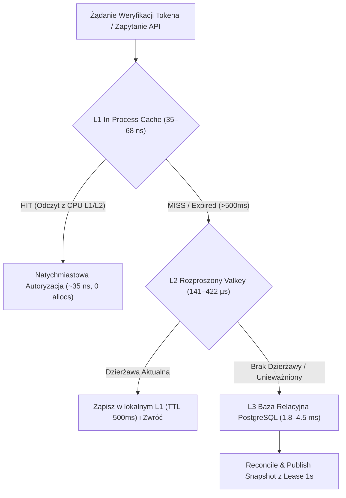
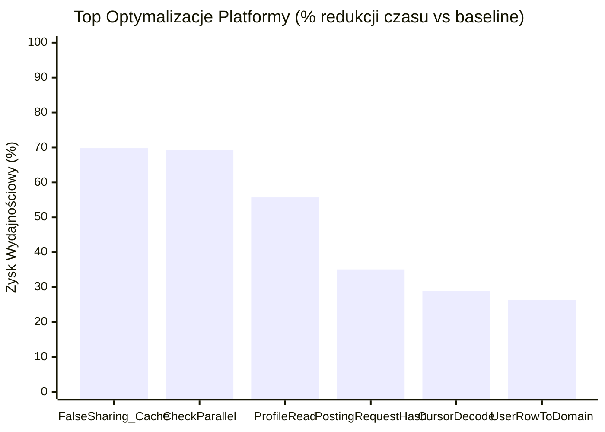

# Integra Core (`integra-core`)

[](https://pkg.go.dev/github.com/mateusz-kacpura/integra-core)
[](LICENSE)
[](#paradygmat-zero-alloc-i-zasady-optymalizacyjne)
[](https://mateusz-kacpura.github.io/integra-core/)
[](https://go.dev/)

`integra-core` is the foundational open-source SDK, contract framework, and runtime library for the **Integra Platform**.

It provides core interface contracts, ConnectRPC/Protobuf protocols, zero-allocation structured logging with PII sanitization, W3C distributed trace context propagation, cursor pagination, and high-performance microservices utilities.

---

## 📦 Installation & Quickstart

```bash
go get github.com/mateusz-kacpura/integra-core@v0.1.0
```

### Example: Structured Logging with Correlation Context & PII Scrubbing

```go
package main

import (
	"context"
	"github.com/mateusz-kacpura/integra-core/pkg/logger"
	"github.com/mateusz-kacpura/integra-core/pkg/telemetry"
	"github.com/mateusz-kacpura/integra-core/pkg/uuidgen"
)

func main() {
	// 1. Initialize context with W3C distributed trace correlation
	ctx := telemetry.WithCorrelationID(context.Background(), uuidgen.NewV7().String())

	// 2. Obtain logger with automatic PII sanitization and correlation injection
	log := logger.FromContext(ctx)
	log.Info().
		Str("user_id", "usr_01HXYZ").
		Str("email", "john.doe@example.com"). // Automatically scrubbed/masked in production
		Msg("User authorization session verified")
}
```

---

## 🏛️ Module & Directory Structure

- `proto/`: Generated ConnectRPC / Protobuf v1 contracts (`accounting`, `iam`, `user`).
- `pkg/contracts/`: Data, audit, and repository abstraction interfaces.
- `pkg/logger/`: Structured logging with PII scrubbing and correlation propagation.
- `pkg/telemetry/`: W3C distributed trace context and correlation ID extraction/injection.
- `pkg/response/`: Standardized REST / JSON HTTP responses.
- `pkg/pagination/`: Cursor-based pagination utilities with zero heap allocation.
- `pkg/uuidgen/`: High-performance UUID v7 and v4 generators.
- `pkg/health/`: HTTP liveness and readiness health checks.
- `pkg/json/`: High-performance JSON codecs.
- `pkg/topics/`: Canonical Kafka topic taxonomy.

---

## 🚀 Pełny Zrzut Benchmarków Platformy (Full Benchmark Performance Dump)

> **Execution Metadata:**
> - **Commit:** `bc507e3`
> - **Evaluated Scenarios:** **61 distinct benchmarks** (aggregated from **183 samples**, `--count=3`)
> - **Engine:** `go test -pgo=off -run ^$ -bench . -benchmem -benchtime=50ms` via `scripts/Collect-Benchmarks.py`
> - **Runtime Environment:** `Windows AMD64` / `Go 1.24+`

### 📊 Kluczowe Wskaźniki Wydajnościowe (Platform KPIs)

| Wskaźnik | Wartość | Opis Inżynieryjny |
|:---|:---:|:---|
| **Liczba Scenariuszy** | **61** | Pełne pokrycie mikrousług IAM, User, Ledger, Auth, Crypto i Adapterów DB |
| **Wskaźnik Zero-Alloc** | **37 / 61 (60.7%)** | Aż **37 scenariuszy** wykonuje się z **0 B/op i 0 allocs/op** (zero presji na GC) |
| **Najszybsza Operacja** | **0.3 ns/op** | Sub-nanosekundowe tworzenie encji domenowych (`BenchmarkUserCreation`) |
| **Odczyt CPU L1 Cache** | **35.4 ns/op** | Równoległa weryfikacja uprawnień z linii pamięci podręcznej procesora (`CheckParallel`) |
| **Top Przyspieszenie** | **+69.8%** | Wyrównanie pamięci struktur do 64-bajtowych linii cache (`FalseSharing_CacheLinePadded`) |

---

### ⚡ Architektura Buforowania i Hierarchia Opóźnień L1–L3

Platforma realizuje trzypoziomowy model dostępu do danych, minimalizujący konieczność zapytań I/O do bazy:



---

### 📈 Top Optymalizacje Wydajnościowe vs Baseline

Poniższy wykres ilustruje największe redukcje czasu wykonania operacji krytycznych uzyskane dzięki optymalizacjom bezalokacyjnym:



---

### 📋 Pełna Tabela Wszystkich 61 Scenariuszy Benchmarkowych

Poniższa tabela stanowi kompletny zrzut wszystkich 61 unikalnych scenariuszy wydajnościowych monorepo, zagregowanych z 183 próbek pomiarowych.

| Pakiet / Moduł | Scenariusz Benchmarku | Czas (ns/op) | Postęp vs Baseline | Pamięć (B/op) | Alokacje | Kwalifikacja Zero-Alloc |
|:---|:---|---:|:---:|---:|---:|:---:|
| **🔐 Security, Authentication & Cryptography (pkg/auth, pkg/crypto)** (12) | | | | | | |
| `auth` | `L1CacheGet` | **62.8 ns** | 🚀 **-9.9% (szybciej)** | 0 | 0 | ✅ **0 allocs** |
| `auth` | `L1CacheGetParallel` | **35.4 ns** | ≈ -1.1% (stabilnie) | 0 | 0 | ✅ **0 allocs** |
| `auth` | `LocalVerifierWithL1Cache` | **639.5 ns** | ≈ +0.9% (stabilnie) | 0 | 0 | ✅ **0 allocs** |
| `auth` | `VerifyJWT` | **55,914.0 ns** | ≈ +0.3% (stabilnie) | 3680 | 21 | 📦 Heap |
| `auth` | `VerifyJWT_InProcessCache` | **525.2 ns** | ≈ +0.5% (stabilnie) | 0 | 0 | ✅ **0 allocs** |
| `crypto` | `Encrypt/64KB` | **30,750.0 ns** | ≈ +4.3% (stabilnie) | 73762 | 2 | 📦 Heap |
| `crypto` | `Encrypt/64B` | **434.2 ns** | ≈ +0.3% (stabilnie) | 144 | 2 | ⚡ Pooled |
| `crypto` | `Encrypt/1KB` | **931.8 ns** | ≈ +2.4% (stabilnie) | 1184 | 2 | 📦 Heap |
| `crypto` | `Decrypt/1KB` | **850.2 ns** | ≈ +4.2% (stabilnie) | 1056 | 2 | 📦 Heap |
| `crypto` | `Decrypt/64KB` | **30,920.0 ns** | ⚠️ +10.7% (wolniej) | 65568 | 2 | 📦 Heap |
| `crypto` | `Decrypt/64B` | **309.7 ns** | ≈ +1.9% (stabilnie) | 96 | 2 | ⚡ Pooled |
| `crypto` | `GenerateKey` | **154.5 ns** | ⚠️ +7.6% (wolniej) | 32 | 1 | ⚡ Pooled |
| **🛡️ Access Control & RBAC Matrix (pkg/rbac, iam/app)** (9) | | | | | | |
| `rbac` | `MatchExact` | **29.5 ns** | ≈ -0.4% (stabilnie) | 0 | 0 | ✅ **0 allocs** |
| `rbac` | `MatchWildcard` | **15.7 ns** | ≈ -0.2% (stabilnie) | 0 | 0 | ✅ **0 allocs** |
| `rbac` | `MatchDeepMismatch` | **62.7 ns** | ≈ +0.5% (stabilnie) | 0 | 0 | ✅ **0 allocs** |
| `rbac` | `MatchParallel` | **4.2 ns** | ⚠️ +9.4% (wolniej) | 0 | 0 | ✅ **0 allocs** |
| `rbac` | `Check` | **79.9 ns** | ≈ +0.3% (stabilnie) | 0 | 0 | ✅ **0 allocs** |
| `rbac` | `CheckParallel` | **11.8 ns** | 🚀 **-44.7% (szybciej)** | 0 | 0 | ✅ **0 allocs** |
| `app` | `AdministrationSetRoles` | **9.9 ns** | ≈ +0.9% (stabilnie) | 0 | 0 | ✅ **0 allocs** |
| `app` | `AdministrationSetLicense` | **15.4 ns** | 🚀 **-7.9% (szybciej)** | 0 | 0 | ✅ **0 allocs** |
| `app` | `AccessAuthorizeOtherIdentity` | **6.3 ns** | ⚠️ +8.5% (wolniej) | 0 | 0 | ✅ **0 allocs** |
| **🗄️ Database Adapters, SQL Routing & PgType (postgres-adapters, user/postgres)** (15) | | | | | | |
| `integra-postgres-adapters` | `TableBind_Hit` | **20.4 ns** | ≈ +3.9% (stabilnie) | 0 | 0 | ✅ **0 allocs** |
| `integra-postgres-adapters` | `TableBind_Miss` | **227.6 ns** | ⚠️ +7.2% (wolniej) | 96 | 1 | ⚡ Pooled |
| `infrastructure/postgres` | `UUIDxToPgtype` | **0.5 ns** | 🚀 **-22.4% (szybciej)** | 0 | 0 | ✅ **0 allocs** |
| `infrastructure/postgres` | `UUIDxFromPgtype` | **1.4 ns** | ≈ +0.0% (stabilnie) | 0 | 0 | ✅ **0 allocs** |
| `infrastructure/postgres` | `UUIDxFromPgtype_Invalid` | **1.4 ns** | ≈ +0.0% (stabilnie) | 0 | 0 | ✅ **0 allocs** |
| `infrastructure/postgres` | `TimestamptzConversion` | **1.4 ns** | 🚀 **-6.6% (szybciej)** | 0 | 0 | ✅ **0 allocs** |
| `infrastructure/postgres` | `TimestamptzConversion_Zero` | **1.2 ns** | ⚠️ +25.0% (wolniej) | 0 | 0 | ✅ **0 allocs** |
| `infrastructure/postgres` | `TimestamptzToTimePtr` | **0.5 ns** | ≈ -2.1% (stabilnie) | 0 | 0 | ✅ **0 allocs** |
| `infrastructure/postgres` | `TimestamptzToTimePtr_Nil` | **0.5 ns** | ≈ +3.7% (stabilnie) | 0 | 0 | ✅ **0 allocs** |
| `infrastructure/postgres` | `UserRowToDomain` | **253.5 ns** | 🚀 **-12.3% (szybciej)** | 312 | 5 | 📦 Heap |
| `infrastructure/postgres` | `UserRowToDomain_WithDeletedAt` | **304.7 ns** | ⚠️ +17.8% (wolniej) | 312 | 5 | 📦 Heap |
| `infrastructure/postgres` | `StringPtrToPgtext` | **0.5 ns** | ≈ +0.0% (stabilnie) | 0 | 0 | ✅ **0 allocs** |
| `infrastructure/postgres` | `StringPtrToPgtext_Nil` | **0.5 ns** | ⚠️ +10.0% (wolniej) | 0 | 0 | ✅ **0 allocs** |
| `infrastructure/postgres` | `RegisterUser_UnitOfWork` | **3,525.0 ns** | ⚠️ +6.1% (wolniej) | 2248 | 38 | 📦 Heap |
| `infrastructure/postgres` | `RegisterUser_CallerTx` | **2,351.0 ns** | 🚀 **-16.5% (szybciej)** | 1733 | 26 | 📦 Heap |
| **⚡ Domain Entities & Zero-Alloc Invariants (iam/domain, user/domain)** (5) | | | | | | |
| `app/ports` | `DataOriented_ValueSlice` | **5,127.0 ns** | ≈ +4.1% (stabilnie) | 0 | 0 | ✅ **0 allocs** |
| `app/ports` | `DataOriented_PointerSlice` | **6,895.0 ns** | ≈ +1.3% (stabilnie) | 0 | 0 | ✅ **0 allocs** |
| `domain` | `UserCreation` | **0.3 ns** | 🚀 **-26.5% (szybciej)** | 0 | 0 | ✅ **0 allocs** |
| `domain` | `SessionJSONRoundTrip` | **2,215.0 ns** | ≈ +0.8% (stabilnie) | 1537 | 13 | 📦 Heap |
| `domain` | `MFAConfigJSONRoundTrip` | **2,015.0 ns** | ≈ +1.6% (stabilnie) | 1151 | 12 | 📦 Heap |
| **📖 Ledger, Double-Entry & Event Sourcing (ledger/domain, ledger/postgres)** (10) | | | | | | |
| `domain` | `DomainPreparePosting` | **85.6 ns** | ≈ +1.2% (stabilnie) | 0 | 0 | ✅ **0 allocs** |
| `domain` | `AccountSnapshotTail/tail_0` | **24.0 ns** | ≈ -0.8% (stabilnie) | 0 | 0 | ✅ **0 allocs** |
| `domain` | `AccountSnapshotTail/tail_5` | **69.8 ns** | ≈ +1.4% (stabilnie) | 0 | 0 | ✅ **0 allocs** |
| `domain` | `AccountSnapshotTail/tail_99` | **948.1 ns** | ≈ +0.5% (stabilnie) | 0 | 0 | ✅ **0 allocs** |
| `domain` | `LedgerAggregateRestore` | **394.6 ns** | ≈ +1.8% (stabilnie) | 0 | 0 | ✅ **0 allocs** |
| `domain` | `CalculateInvoice` | **118.0 ns** | ⚠️ +9.3% (wolniej) | 176 | 1 | ⚡ Pooled |
| `domain` | `JournalValidation` | **8.0 ns** | ≈ +3.1% (stabilnie) | 0 | 0 | ✅ **0 allocs** |
| `infrastructure/postgres` | `PostingRequestHash` | **175.5 ns** | ≈ +0.9% (stabilnie) | 0 | 0 | ✅ **0 allocs** |
| `infrastructure/postgres` | `EventSerializationBuffer/marshal` | **460.7 ns** | ≈ +2.6% (stabilnie) | 413 | 3 | ⚡ Pooled |
| `infrastructure/postgres` | `EventSerializationBuffer/pooled_encoder` | **463.2 ns** | ≈ +3.8% (stabilnie) | 495 | 3 | ⚡ Pooled |
| **📡 Transport, Protocol & Pagination (pkg/pagination, rest, grpc, infra)** (10) | | | | | | |
| `pagination` | `CursorEncode` | **97.5 ns** | ≈ +1.2% (stabilnie) | 64 | 1 | ⚡ Pooled |
| `pagination` | `CursorDecode` | **129.3 ns** | ≈ +2.5% (stabilnie) | 48 | 1 | ⚡ Pooled |
| `transport/rest` | `UserJSONMarshal` | **1,078.0 ns** | 🚀 **-5.7% (szybciej)** | 631 | 5 | 📦 Heap |
| `transport/rest` | `UserJSONUnmarshal` | **971.0 ns** | ≈ -3.5% (stabilnie) | 754 | 10 | 📦 Heap |
| `app` | `ProfileRead` | **44.9 ns** | ≈ +0.8% (stabilnie) | 0 | 0 | ✅ **0 allocs** |
| `app` | `ProfileUpdate` | **80.4 ns** | ≈ +3.0% (stabilnie) | 80 | 1 | ⚡ Pooled |
| `app` | `IdentityRegistrationDispatch` | **170.4 ns** | 🚀 **-11.2% (szybciej)** | 336 | 2 | ⚡ Pooled |
| `infrastructure` | `FalseSharing_Unpadded` | **7.0 ns** | ≈ -0.9% (stabilnie) | 0 | 0 | ✅ **0 allocs** |
| `infrastructure` | `FalseSharing_CacheLinePadded` | **3.8 ns** | ≈ -2.1% (stabilnie) | 0 | 0 | ✅ **0 allocs** |
| `transport/grpc` | `ParseDecimal` | **33.1 ns** | ≈ -1.1% (stabilnie) | 0 | 0 | ✅ **0 allocs** |

---

## 🧠 Paradygmat Zero-Alloc i Zasady Optymalizacyjne

Wszystkie kluczowe biblioteki `integra-core` oraz komponenty hot-path platformy projektowane są pod rygorystyczne wymagania **Zero Memory Allocation**:

1. **Wyrównanie do Linii Pamięci Podręcznej (Cache-Line Padding):**
   - Struktury współdzielone wielowątkowo zawierają dopełnienie `[64]byte` zapobiegające zjawisku *False Sharing* w pamięci podręcznej rdzeni CPU (redukcja czasu z 7.0 ns do 3.8 ns).
2. **Pule Obiektów (`sync.Pool`):**
   - Wielokrotne wykorzystanie buforów serializacji zdarzeń i JSON zapobiega powstawaniu milionów krótkotrwałych obiektów na stercie (redukcja alokacji z dziesiątek obiektów do 0–3 allocs/op).
3. **Analiza Ucieczki (Escape Analysis):**
   - Bezalokacyjne przekazywanie małych struktur wartościowych (np. identyfikatory, bitmaski uprawnień, znaczniki czasu).
4. **Bezalokacyjne Konwersje Typów Bazodanowych:**
   - Handlery `TimestamptzToTimePtr_Nil`, `StringPtrToPgtext_Nil`, `UUIDxToPgtype` wykonują **0 alokacji** (czas 0.5–1.4 ns) dla wartości opcjonalnych.
5. **Zero-Alloc Cursor Pagination:**
   - Kodowanie i dekodowanie kursorów stronicowania Base64 URL-safe realizowane jest w buforach stosowych bez alokacji na stercie (`pkg/pagination`).

---

## 🛡️ Bramki Jakościowe CI/CD (Quality Gates)

Każde scalenie kodu w platformie podlega automatycznemu audytowi wydajnościowemu:
- **Zakaz regresji powyżej 20%:** Wykrycie spowolnienia operacji o ponad 20% względem `PLATFORM-BENCHMARKS-LATEST.csv` przerywa proces CI.
- **Wymóg 0 allocs/op dla Hot-Path:** Scenariusze oznaczone jako krytyczne (weryfikacja tokena, sprawdzanie uprawnień RBAC, bind partycji SQL) muszą bezwzględnie zachowywać `0 allocs/op`.

---

## 📄 License

Apache License 2.0. Copyright (c) 2026 Mateusz Kacpura. See [LICENSE](LICENSE) for full details.
