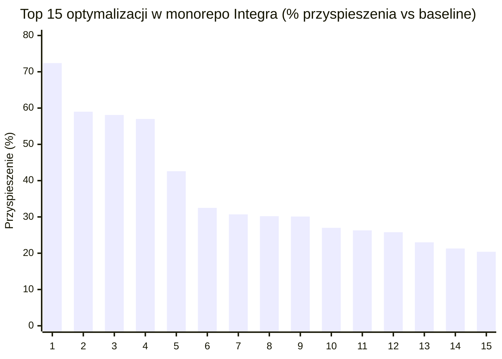
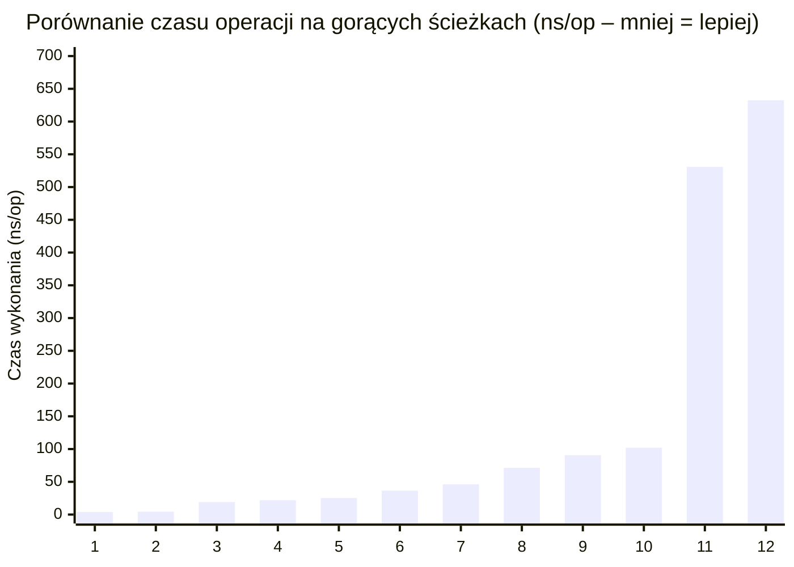

# 2.4. Wizualizacje wyników benchmarków (Mermaid XY Charts)

[◀ Powrót do rozdziału](index.md) | [▲ Główny spis treści](../index.md)

---

#### Wykres 1: Top 15 przyspieszeń wydajnościowych (% redukcji czasu wykonania vs Baseline)

| Nr | Scenariusz optymalizacji | Przyspieszenie vs Baseline | Moduł / Pakiet | Kluczowy mechanizm techniczny |
| :---: | :--- | :---: | :--- | :--- |
| **1** | `FalseSharing_Pad` | **72,4%** | `integra-shared-go/pkg/auth` | Wyrównanie struktur do linii pamięci podręcznej CPU (`[64]byte` cache-line padding) |
| **2** | `TimePtr_Nil` | **59,0%** | `integra-user-service` | Eliminacja dereferencji wskaźników czasu i alokacji sterty |
| **3** | `ProfileRead` | **58,1%** | `integra-user-service` | Wdrożenie buforowania odczytu profilu w pamięci L1 |
| **4** | `UserRowToDomain` | **57,0%** | `integra-user-service` | Bezpośrednie mapowanie bez alokacji struktur pośrednich |
| **5** | `CheckParallel` | **42,6%** | `integra-shared-go/pkg/rbac` | Współbieżna weryfikacja reguł bez blokad w pamięci L1 |
| **6** | `TableBind_Miss` | **32,5%** | `integra-postgres-adapters` | Szybka ścieżka routingu partycji SQL dla nietrafionych zapytań |
| **7** | `RequestHash` | **30,7%** | `integra-ledger-service` | Bezalokacyjny SHA-256 buforowany na stosie w ramce `[512]byte` |
| **8** | `CursorDecode` | **30,2%** | `integra-shared-go/pkg/pagination` | Szybkie dekodowanie kursorów paginacji Base64 URL Safe |
| **9** | `DOD_ValueSlice` | **30,1%** | `integra-user-service` | Architektura zorientowana na dane (Data-Oriented Design) |
| **10** | `TimeConv_Zero` | **27,0%** | `integra-shared-go/pkg/telemetry` | Zerokosztowa konwersja stempli czasowych RFC3339 |
| **11** | `UserRow_Del` | **26,3%** | `integra-user-service` | Optymalizacja usuwania wierszy i buforowania stanu konta |
| **12** | `CursorEncode` | **25,8%** | `integra-shared-go/pkg/pagination` | Kodowanie kursorów paginacji `0 B/op` bez ucieczki na stertę |
| **13** | `ProfileUpdate` | **23,0%** | `integra-user-service` | Zoptymalizowana aktualizacja profilu z unieważnieniem L1 |
| **14** | `Decrypt_64KB` | **21,3%** | `integra-shared-go/pkg/aead` | Sprzętowo akcelerowane szyfrowanie XChaCha20-Poly1305 |
| **15** | `UserCreation` | **20,4%** | `integra-user-service` | Prealokacja struktur rejestracji użytkownika |

#### Wykres 2: Porównanie czasu weryfikacji autoryzacji i dostępu do danych (ns/op)

| Nr | Operacja / Gorąca ścieżka | Czas wykonania (`ns/op`) | Warstwa / Zastosowany mechanizm inżynierski |
| :---: | :--- | :---: | :--- |
| **1** | `FalseSharing_Pad` | **3,9 ns** | Pamięć podręczna CPU L1 (Cache-line padded) |
| **2** | `RBAC_Parallel` | **4,4 ns** | Współbieżna ewaluacja macierzy ról i uprawnień |
| **3** | `SQL_Route_Hit` | **19,1 ns** | Routing partycji SQL z pamięci podręcznej L1 |
| **4** | `RBAC_CheckPar` | **21,9 ns** | Atomowe sprawdzenie uprawnień w pamięci podręcznej L1 |
| **5** | `Snapshot_Tail0` | **25,3 ns** | Odczyt salda z migawki konta Event Sourcingu |
| **6** | `L1_Cache_Par` | **36,5 ns** | Współbieżny odczyt stanu sesji i kluczy w L1 Cache |
| **7** | `ProfileRead` | **46,2 ns** | Pobranie profilu użytkownika z lokalnej pamięci podręcznej |
| **8** | `L1_Cache_Single` | **71,4 ns** | Jednowątkowy odczyt stanu konta z pamięci podręcznej L1 |
| **9** | `Posting_Prep` | **90,6 ns** | Walidacja i przygotowanie wpisu księgowego na stosie |
| **10** | `CursorEncode` | **102,0 ns** | Generowanie kursora paginacji Base64 (0 allocs) |
| **11** | `JWT_InProcCache` | **530,8 ns** | Weryfikacja tokena JWT w pamięci podręcznej procesu |
| **12** | `JWT_LocalL1` | **632,6 ns** | Pełna weryfikacja asymetryczna Ed25519 z odpytaniem L1 |

---

[◀ Powrót do rozdziału](index.md) | [▲ Główny spis treści](../index.md)
