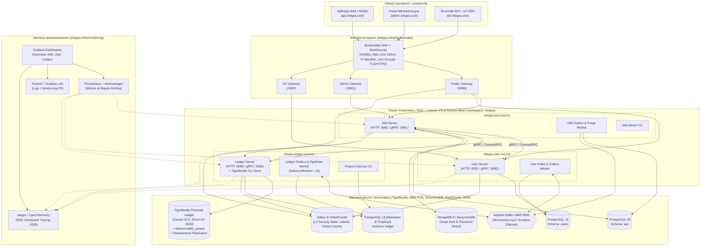

# 3.1. Architektura ekosystemu i infrastruktury (Edge, Gateways, Services, Data & Observability)

[◀ Powrót do rozdziału](index.md) | [▲ Główny spis treści](../index.md)

---

Poniższy diagram przedstawia pełną topologię wdrożeniową zdefiniowaną w katalogu `integra-infra/` (obejmującą klaster brzegowy WAF **BunkerWeb + ModSecurity**, trzy odseparowane bramy **Envoy/Gateway**, siatkę usług **Linkerd Service Mesh**, mikroserwisy Go oraz klastry bazodanowe i telemetrię):

---

[◀ Powrót do rozdziału](index.md) | [▲ Główny spis treści](../index.md)
