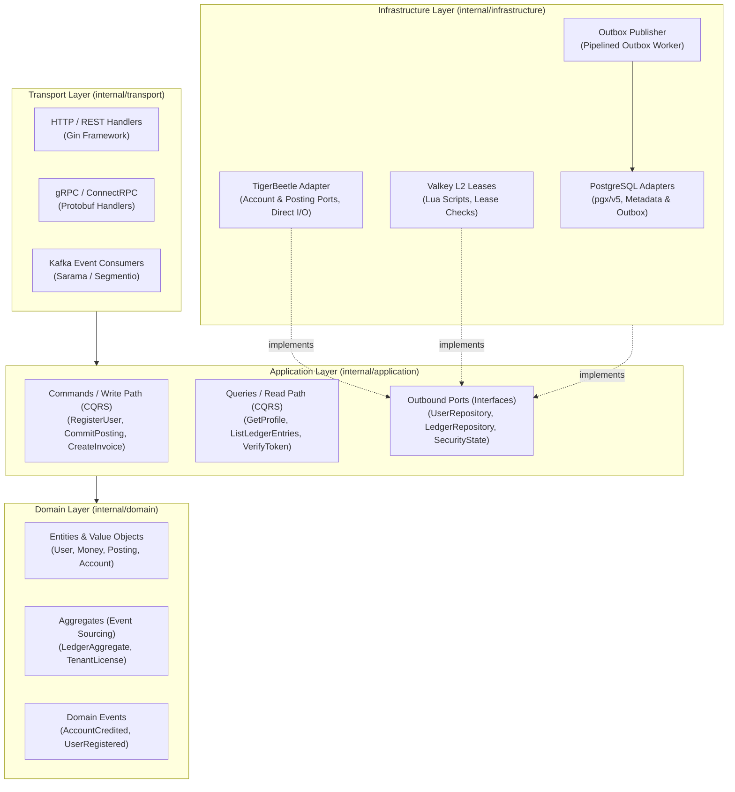

# 3.3. Internal Clean / Hexagonal Architecture + CQRS of Microservices

[◀ Back to Chapter](index.md) | [▲ Master Table of Contents](../index.md)

---

Every microservice (`integra-iam-service`, `integra-user-service`, `integra-ledger-service`) enforces a strict Hexagonal / Clean Architecture model with CQRS command and query separation:

---

[◀ Back to Chapter](index.md) | [▲ Master Table of Contents](../index.md)
