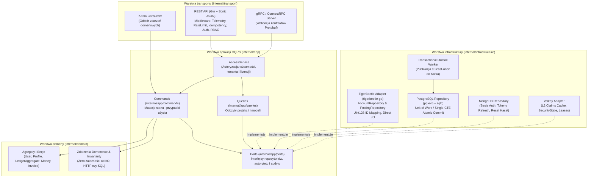

# 3.3. Wewnętrzna architektura czysta / heksagonalna + CQRS mikroserwisów

[◀ Powrót do rozdziału](index.md) | [▲ Główny spis treści](../index.md)

---

Każdy z trzech serwisów (`integra-iam-service`, `integra-user-service`, `integra-ledger-service`) rygorystycznie przestrzega podziału na warstwy w katalogu `internal/` (który w Go na poziomie kompilatora uniemożliwia importowanie pakietów spoza drzewa rodzica):

---

[◀ Powrót do rozdziału](index.md) | [▲ Główny spis treści](../index.md)
