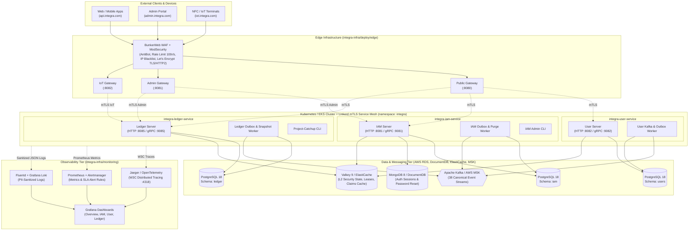
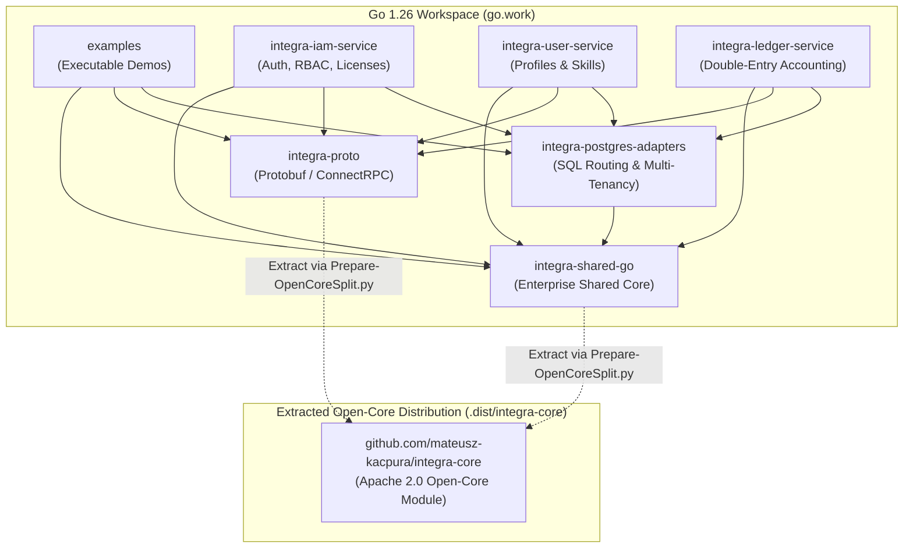
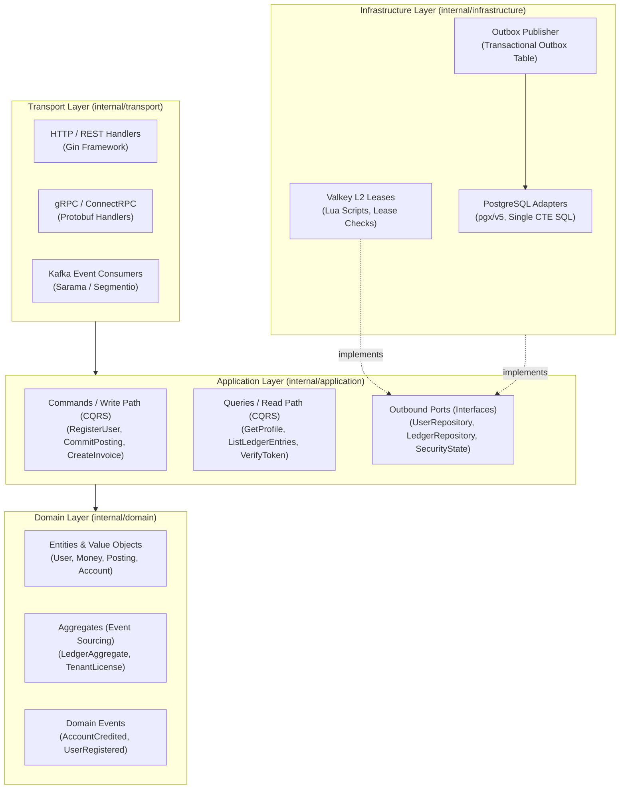

# 3. Global System Architecture and Mermaid Visualizations

[◀ Previous: Benchmark Analysis](../02-benchmark-analysis-and-performance/index.md) | [▲ Master Table of Contents](../index.md) | [Next: Key System Workflows ▶](../04-key-system-workflows/index.md)

---

> [!TIP]
> **Interactive Fullscreen Diagrams**: You can also open the standalone [DIAGRAMS-VIEWER.html](../DIAGRAMS-VIEWER.html) to interactively zoom, pan, and view all system architecture diagrams in full screen.

## 📑 Subsections in this Chapter

- [**3.1. Ecosystem and Infrastructure Architecture**](3.1-ecosystem-and-infrastructure.md)
- [**3.2. Go Workspace Dependencies and Open-Core Split**](3.2-go-workspace-and-open-core.md)
- [**3.3. Internal Clean Architecture + CQRS of Microservices**](3.3-clean-architecture-and-cqrs.md)

---

# 3.1. Ecosystem and Infrastructure Architecture (Edge, Gateways, Services, Data & Observability)

[◀ Back to Chapter](index.md) | [▲ Master Table of Contents](../index.md)

---

The diagram below illustrates the full production deployment topology defined in `integra-infra/` (encompassing the **BunkerWeb + ModSecurity** WAF edge cluster, three isolated **Envoy/Gateway** entrypoints, **Linkerd Service Mesh**, Go microservices, database clusters, and telemetry):

---

[◀ Back to Chapter](index.md) | [▲ Master Table of Contents](../index.md)

# 3.2. Go Workspace (`go.work`) Dependency Architecture and Open-Core Split

[◀ Back to Chapter](index.md) | [▲ Master Table of Contents](../index.md)

---

The diagram below details the module hierarchy inside the Go 1.26 Workspace (`go.work`) and the automated extraction barrier defining the Open-Core layer:

---

[◀ Back to Chapter](index.md) | [▲ Master Table of Contents](../index.md)

# 3.3. Internal Clean / Hexagonal Architecture + CQRS of Microservices

[◀ Back to Chapter](index.md) | [▲ Master Table of Contents](../index.md)

---

Every microservice (`integra-iam-service`, `integra-user-service`, `integra-ledger-service`) enforces a strict Hexagonal / Clean Architecture model with CQRS command and query separation:

---

[◀ Back to Chapter](index.md) | [▲ Master Table of Contents](../index.md)

---

[◀ Previous: Benchmark Analysis](../02-benchmark-analysis-and-performance/index.md) | [▲ Master Table of Contents](../index.md) | [Next: Key System Workflows ▶](../04-key-system-workflows/index.md)
