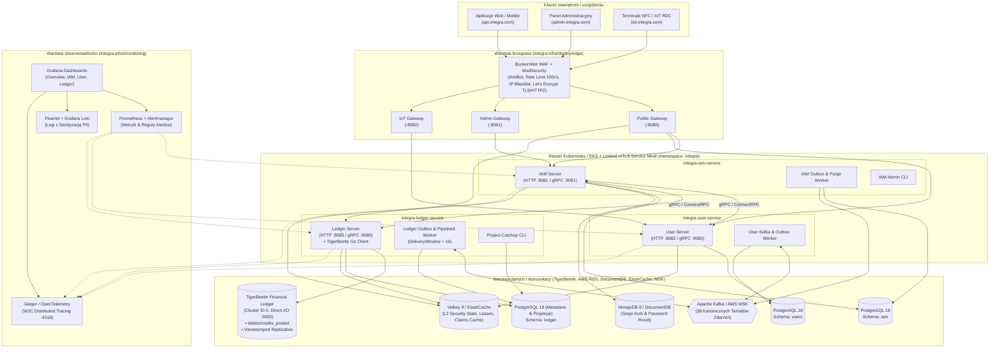
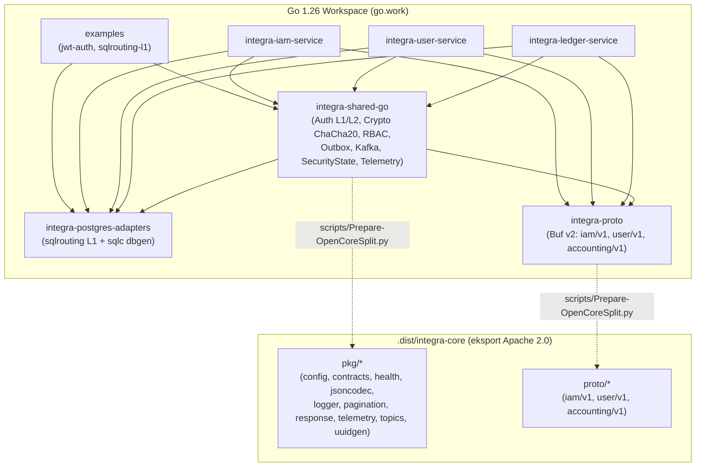
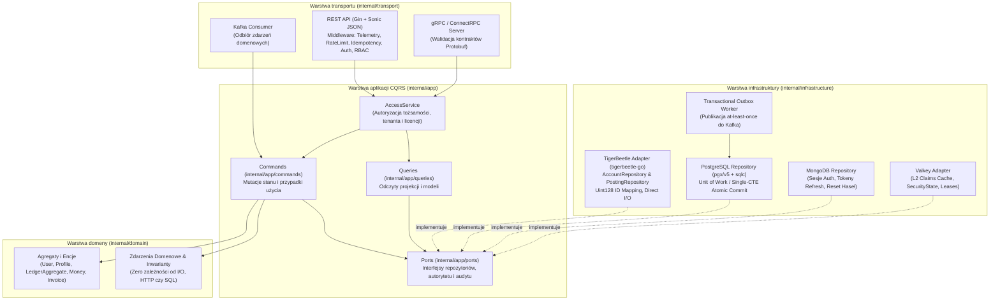

# 3. Globalna architektura systemu i wizualizacje Mermaid

[◀ Poprzedni: Analiza benchmarków i uzasadnienie wydajnościowe](../02-benchmark-analysis-and-performance/index.md) | [▲ Główny spis treści](../index.md) | [Następny: Kluczowe przepływy pracy ▶](../04-key-system-workflows/index.md)

---

## 📑 Podrozdziały w tym dziale

- [**3.1. Architektura ekosystemu i infrastruktury**](3.1-ecosystem-and-infrastructure.md)
- [**3.2. Architektura zależności modułów Go Workspace (go.work) i podział Open-Core**](3.2-go-workspace-and-open-core.md)
- [**3.3. Wewnętrzna architektura czysta / heksagonalna + CQRS mikroserwisów**](3.3-clean-architecture-and-cqrs.md)

---

> [!TIP]
> **Interaktywny podgląd na pełnym ekranie**: Dostępna jest dedykowana przeglądarka [DIAGRAMS-VIEWER.html](../DIAGRAMS-VIEWER.html) z obsługą trybu pełnoekranowego (przycisk *Pełny ekran* lub klawisz `F11`), płynnego przybliżania kółkiem myszy (zoom) oraz przesuwania (drag & pan) wszystkich 9 schematów.

### 3.1. Architektura ekosystemu i infrastruktury (Edge, Gateways, Services, Data & Observability)

Poniższy diagram przedstawia pełną topologię wdrożeniową zdefiniowaną w katalogu `integra-infra/` (obejmującą klaster brzegowy WAF **BunkerWeb + ModSecurity**, trzy odseparowane bramy **Envoy/Gateway**, siatkę usług **Linkerd Service Mesh**, mikroserwisy Go oraz klastry bazodanowe i telemetrię):

---

### 3.2. Architektura zależności modułów Go Workspace (`go.work`) i podział Open-Core

Wzorzec organizacji workspace'u w Go (`go.work`) pozwala na jednoczesną pracę nad wieloma powiązanymi modułami bez konieczności ich wcześniejszego publikowania w zdalnym repozytorium. Jednocześnie skrypty `scripts/Check-LocalModules.py` oraz `scripts/Audit-Project.py` weryfikują kompilację każdego modułu w izolacji z flagą `GOWORK=off`:

---

### 3.3. Wewnętrzna architektura czysta / heksagonalna + CQRS mikroserwisów

Każdy z trzech serwisów (`integra-iam-service`, `integra-user-service`, `integra-ledger-service`) rygorystycznie przestrzega podziału na warstwy w katalogu `internal/` (który w Go na poziomie kompilatora uniemożliwia importowanie pakietów spoza drzewa rodzica):

---

[◀ Poprzedni: Analiza benchmarków i uzasadnienie wydajnościowe](../02-benchmark-analysis-and-performance/index.md) | [▲ Główny spis treści](../index.md) | [Następny: Kluczowe przepływy pracy ▶](../04-key-system-workflows/index.md)
