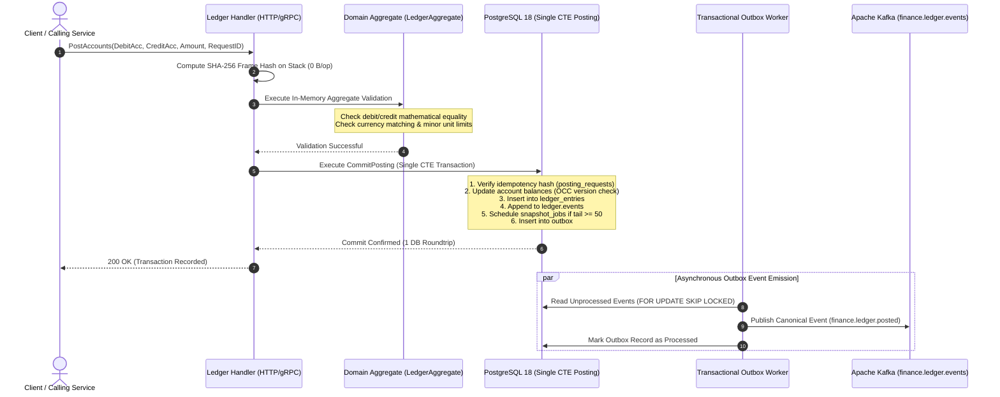

# 4.2. Workflow 2: Atomic Double-Entry Ledger Posting & Idempotency

[◀ Back to Chapter](index.md) | [▲ Master Table of Contents](../index.md)

---

---

[◀ Back to Chapter](index.md) | [▲ Master Table of Contents](../index.md)
