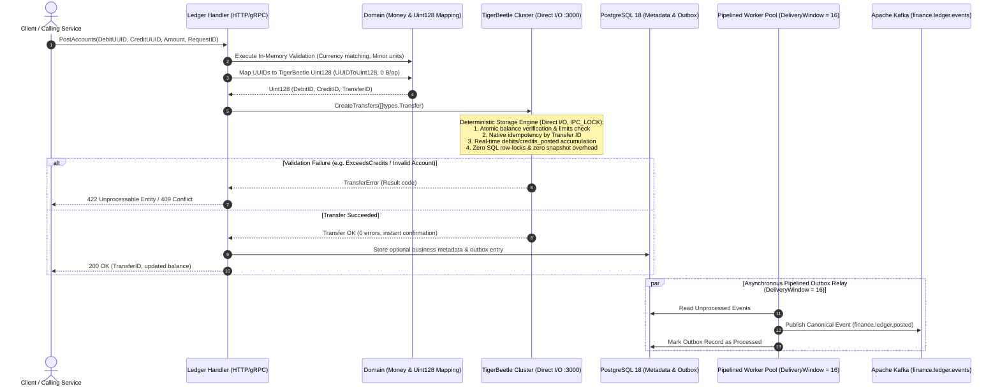

# 4.2. Workflow 2: Atomic Double-Entry Ledger Posting & Idempotency (TigerBeetle Engine)

[◀ Back to Chapter](index.md) | [▲ Master Table of Contents](../index.md)

---

In the modernized architecture of the Integra platform, **TigerBeetle** serves as the sole authoritative source of truth for double-entry accounts and transfers (*Financial Ledger Database*). PostgreSQL has been completely removed from the critical transaction path, eliminating row-level locking (`SELECT ... FOR UPDATE`), manual balance recalculation, and application snapshot jobs.

### Key Architectural Invariants:
1. **Single Source of Truth:** Account balances, transfer history, and multi-currency ledgers reside exclusively in TigerBeetle. Relational databases do not store duplicate ledger balances.
2. **Native 128-bit Representation:** Account and transfer IDs use native `types.Uint128` values, with zero-allocation mapping between RFC 4122 UUIDs and TigerBeetle integers.
3. **Zero Row-Lock Contention:** TigerBeetle executes transfers using a deterministic state machine and Viewstamped Replication, entirely avoiding SQL row lock queues and eliminating deadlocks on hot accounts.
4. **Instant Balance Tracking:** Account balances (`CreditsPosted - DebitsPosted`) are updated in real-time in memory and committed via asynchronous Direct I/O (`io_uring`).

---

[◀ Back to Chapter](index.md) | [▲ Master Table of Contents](../index.md)
