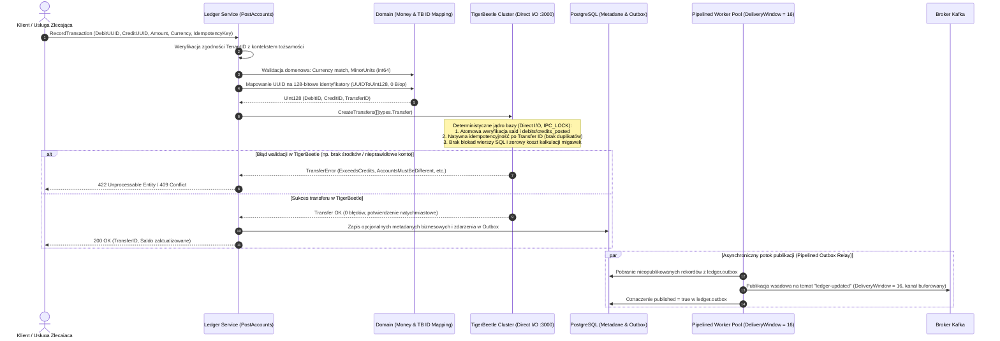

# 4.2. Przepływ 2: Atomowe księgowanie podwójnego zapisu (TigerBeetle Financial Ledger & Idempotency)

[◀ Powrót do rozdziału](index.md) | [▲ Główny spis treści](../index.md)

---

W nowoczesnej architekturze platformy Integra, **TigerBeetle** stanowi jedyne, autorytatywne źródło prawdy dla sald i transferów podwójnego zapisu (*Financial Ledger Database*). Baza PostgreSQL została całkowicie wyeliminowana ze ścieżki krytycznej transakcji finansowych (brak blokad `SELECT ... FOR UPDATE`, ręcznego przeliczania sald oraz generowania migawek aplikacji).

Przepływ pracy w `integra-ledger-service` podczas wykonywania operacji `PostAccounts` (`internal/infrastructure/tigerbeetle/repository.go` oraz `internal/app/commands/handlers.go`):

### Kluczowe Niezmienniki Nowej Architektury Księgi:
1. **Pojedyncze Źródło Prawdy:** Stan kont, historia transferów i rozliczenia dwustronne istnieją wyłącznie w TigerBeetle. Relacyjna baza PostgreSQL nie replikuje sald ani transferów, pełniąc jedynie rolę magazynu metadanych biznesowych poza ścieżką transakcyjną.
2. **Natywna Reprezentacja 128-bitowa:** Identyfikatory kont i transferów są reprezentowane przez natywny typ TigerBeetle `types.Uint128`. Konwersja z i do standardu RFC 4122 UUID (`UUIDToUint128` i `Uint128ToUUID`) jest bezalokacyjna i deterministyczna.
3. **Brak Rywalizacji o Blokady Wierszy:** TigerBeetle wykonuje transfery w deterministycznym, jednowątkowym automacie stanów z konsensusem Viewstamped Replication, co eliminuje konieczność stosowania blokad `SELECT ... FOR UPDATE` i wyklucza zakleszczenia (*deadlocks*).
4. **Wbudowane Liczniki Sald:** Saldo konta (`CreditsPosted - DebitsPosted`) jest aktualizowane atomowo w czasie rzeczywistym bezpośrednio w pamięci RAM jądra TigerBeetle z asynchronicznym utrwalaniem Direct I/O (`io_uring`).

---

[◀ Powrót do rozdziału](index.md) | [▲ Główny spis treści](../index.md)
