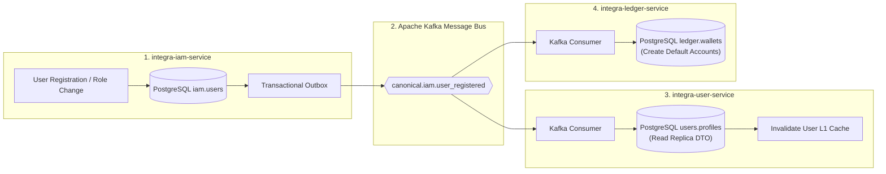

# 4.3. Workflow 3: Distributed User Registration Saga and Read Replica Synchronization

[◀ Back to Chapter](index.md) | [▲ Master Table of Contents](../index.md)

---

---

[◀ Back to Chapter](index.md) | [▲ Master Table of Contents](../index.md)
