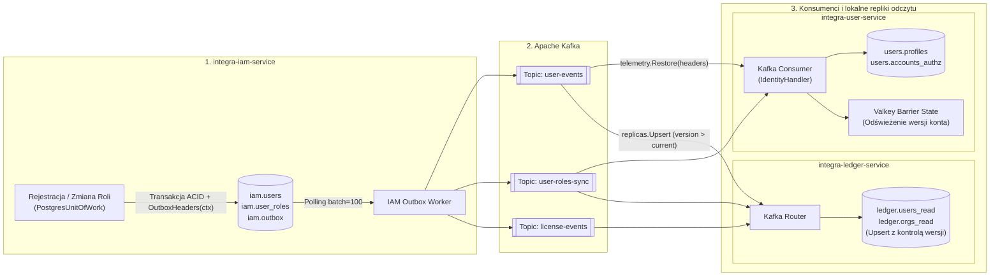

# 4.3. Przepływ 3: Rozproszona saga rejestracji użytkownika i synchronizacji replik odczytu (Outbox -> Kafka -> Read Replicas)

[◀ Powrót do rozdziału](index.md) | [▲ Główny spis treści](../index.md)

---

Przepływ zdarzeń pomiędzy `integra-iam-service`, `integra-user-service` oraz `integra-ledger-service` z zachowaniem pełnego kontekstu śledzenia `OpenTelemetry` (`traceparent`, `correlation_id`):

---

[◀ Powrót do rozdziału](index.md) | [▲ Główny spis treści](../index.md)
