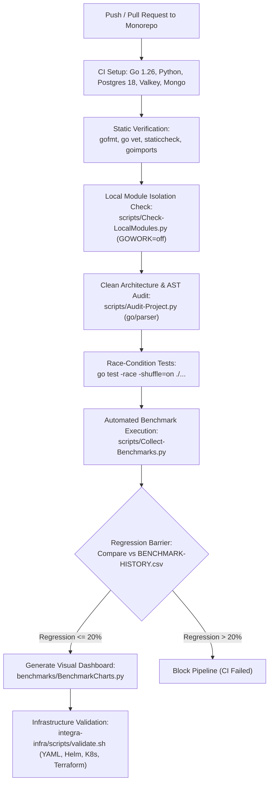

# 4.4. Workflow 4: CI/CD Quality Pipeline, Security Audit, and Benchmark Regression Gate

[◀ Back to Chapter](index.md) | [▲ Master Table of Contents](../index.md)

---

---

[◀ Back to Chapter](index.md) | [▲ Master Table of Contents](../index.md)
