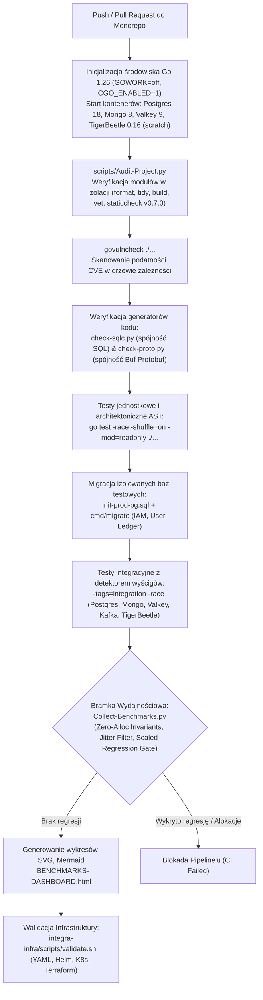

# 4.4. Przepływ 4: Potok jakości CI/CD, audyt bezpieczeństwa i bramka regresji benchmarków

[◀ Powrót do rozdziału](index.md) | [▲ Główny spis treści](../index.md)

---

Przepływ zdefiniowany w `.github/workflows/ci.yaml`, `scripts/Audit-Project.py`, `scripts/Check-LocalModules.py` oraz `scripts/Collect-Benchmarks.py`:

---

[◀ Powrót do rozdziału](index.md) | [▲ Główny spis treści](../index.md)
