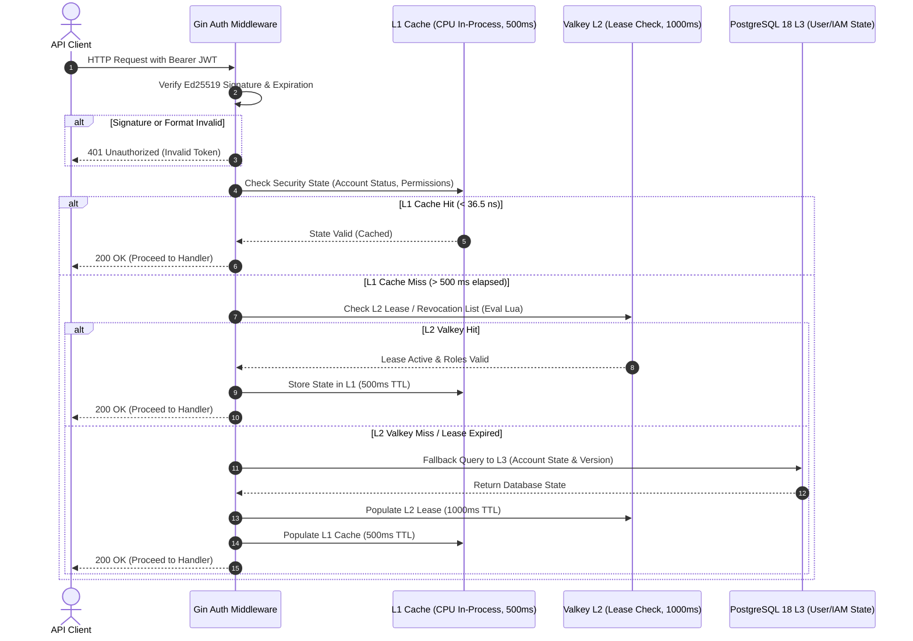
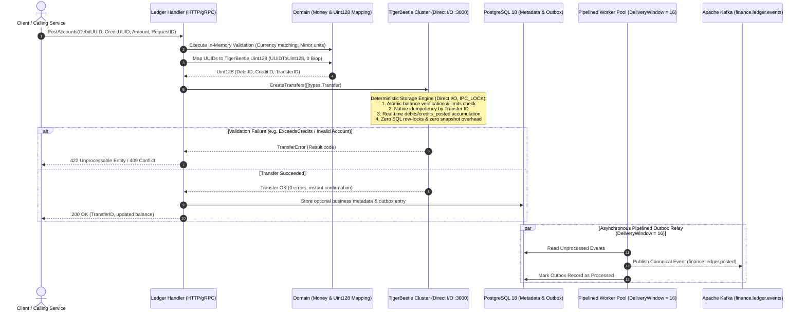
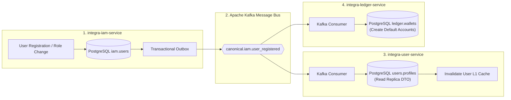
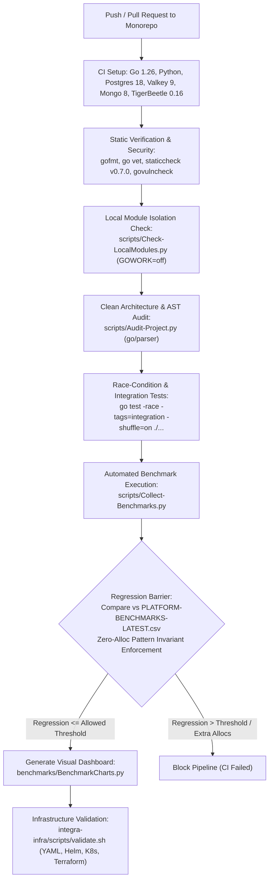

# 4. Key System Workflows

[◀ Previous: Global Architecture](../03-global-architecture/index.md) | [▲ Master Table of Contents](../index.md) | [Next: Directory Structure ▶](../05-directory-and-file-structure/index.md)

---

## 📑 Subsections in this Chapter

- [**4.1. Workflow 1: Multi-Tier JWT Token and Security State Verification**](4.1-jwt-and-security-verification.md)
- [**4.2. Workflow 2: Atomic Double-Entry Ledger Posting & Idempotency**](4.2-double-entry-ledger-posting.md)
- [**4.3. Workflow 3: Distributed User Registration Saga**](4.3-user-registration-saga.md)
- [**4.4. Workflow 4: CI/CD Quality Pipeline and Regression Gate**](4.4-cicd-quality-pipeline.md)

---

# 4.1. Workflow 1: Multi-Tier JWT Token and Security State Verification (L1 -> L2 -> L3)

[◀ Back to Chapter](index.md) | [▲ Master Table of Contents](../index.md)

---

---

[◀ Back to Chapter](index.md) | [▲ Master Table of Contents](../index.md)

# 4.2. Workflow 2: Atomic Double-Entry Ledger Posting & Idempotency

[◀ Back to Chapter](index.md) | [▲ Master Table of Contents](../index.md)

---

---

[◀ Back to Chapter](index.md) | [▲ Master Table of Contents](../index.md)

# 4.3. Workflow 3: Distributed User Registration Saga and Read Replica Synchronization

[◀ Back to Chapter](index.md) | [▲ Master Table of Contents](../index.md)

---

---

[◀ Back to Chapter](index.md) | [▲ Master Table of Contents](../index.md)

# 4.4. Workflow 4: CI/CD Quality Pipeline, Security Audit, and Benchmark Regression Gate

[◀ Back to Chapter](index.md) | [▲ Master Table of Contents](../index.md)

---

---

[◀ Back to Chapter](index.md) | [▲ Master Table of Contents](../index.md)

---

[◀ Previous: Global Architecture](../03-global-architecture/index.md) | [▲ Master Table of Contents](../index.md) | [Next: Directory Structure ▶](../05-directory-and-file-structure/index.md)
