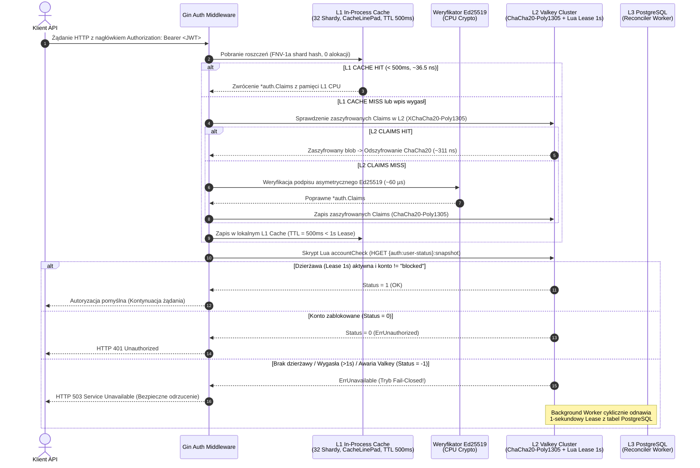
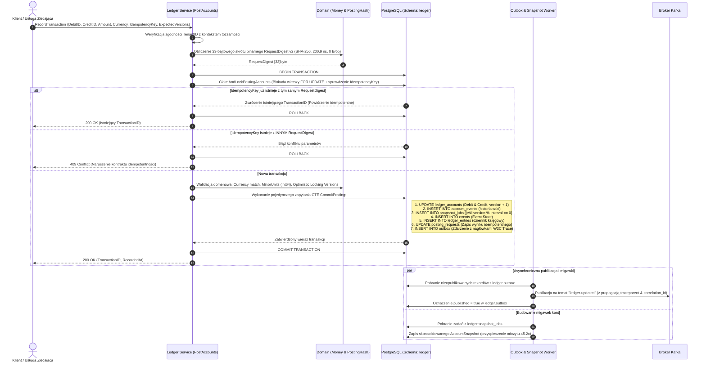
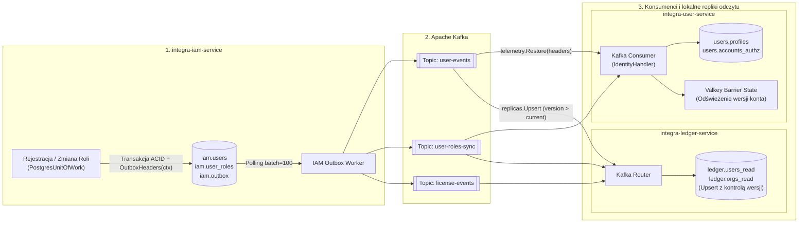
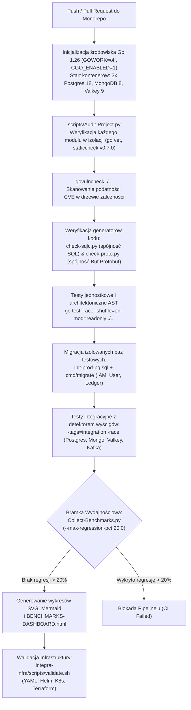

# 4. Kluczowe przepływy pracy (System Workflows)

[◀ Poprzedni: Globalna architektura systemu](../03-global-architecture/index.md) | [▲ Główny spis treści](../index.md) | [Następny: Dokumentacja katalogów i plików projektu ▶](../05-directory-and-file-structure/index.md)

---

## 📑 Podrozdziały w tym dziale

- [**4.1. Przepływ 1: Wielopoziomowa weryfikacja tokena JWT i stanu bezpieczeństwa (L1 -> L2 -> L3)**](4.1-jwt-and-security-verification.md)
- [**4.2. Przepływ 2: Atomowe księgowanie podwójnego zapisu (Double-Entry Ledger Posting & Idempotency)**](4.2-double-entry-ledger-posting.md)
- [**4.3. Przepływ 3: Rozproszona saga rejestracji użytkownika i synchronizacji replik odczytu**](4.3-user-registration-saga.md)
- [**4.4. Przepływ 4: Potok jakości CI/CD, audyt bezpieczeństwa i bramka regresji benchmarków**](4.4-cicd-quality-pipeline.md)

---

### 4.1. Przepływ 1: Wielopoziomowa weryfikacja tokena JWT i stanu bezpieczeństwa (L1 -> L2 -> L3)

Poniższy diagram sekwencji ilustruje działanie weryfikatora `auth.JWTVerifier` (`integra-shared-go/pkg/auth/verifier.go`), pamięci podręcznej `L1Cache` (`l1_cache.go`) oraz strażnika stanu konta i ról w `Valkey` (`account_state.go`, `securitystate/authority.go`):

---

### 4.2. Przepływ 2: Atomowe księgowanie podwójnego zapisu (Double-Entry Ledger Posting & Idempotency)

Przepływ pracy w `integra-ledger-service` podczas wykonywania operacji `PostAccounts` (`internal/infrastructure/postgres/posting.go` oraz `db/queries/posting_commit.sql`):

---

### 4.3. Przepływ 3: Rozproszona saga rejestracji użytkownika i synchronizacji replik odczytu (Outbox -> Kafka -> Read Replicas)

Przepływ zdarzeń pomiędzy `integra-iam-service`, `integra-user-service` oraz `integra-ledger-service` z zachowaniem pełnego kontekstu śledzenia `OpenTelemetry` (`traceparent`, `correlation_id`):

---

### 4.4. Przepływ 4: Potok jakości CI/CD, audyt bezpieczeństwa i bramka regresji benchmarków

Przepływ zdefiniowany w `.github/workflows/ci.yaml`, `scripts/Audit-Project.py`, `scripts/Check-LocalModules.py` oraz `scripts/Collect-Benchmarks.py`:

---

[◀ Poprzedni: Globalna architektura systemu](../03-global-architecture/index.md) | [▲ Główny spis treści](../index.md) | [Następny: Dokumentacja katalogów i plików projektu ▶](../05-directory-and-file-structure/index.md)
