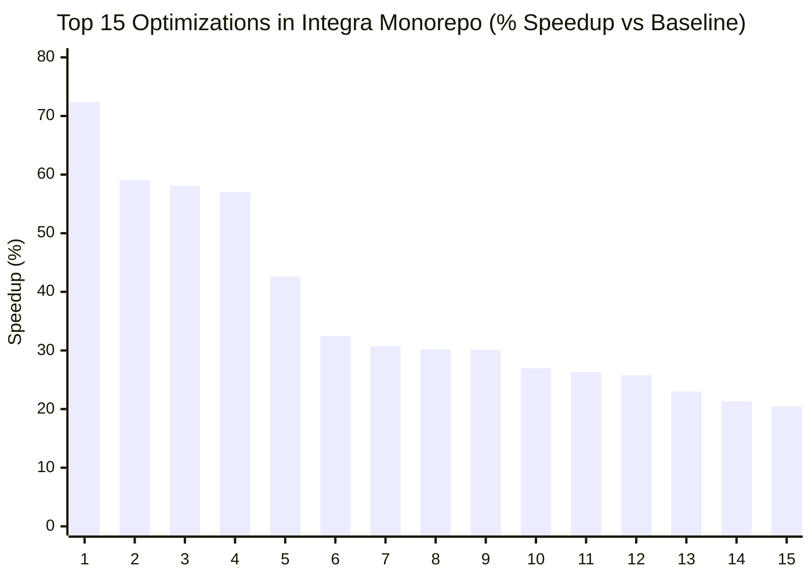
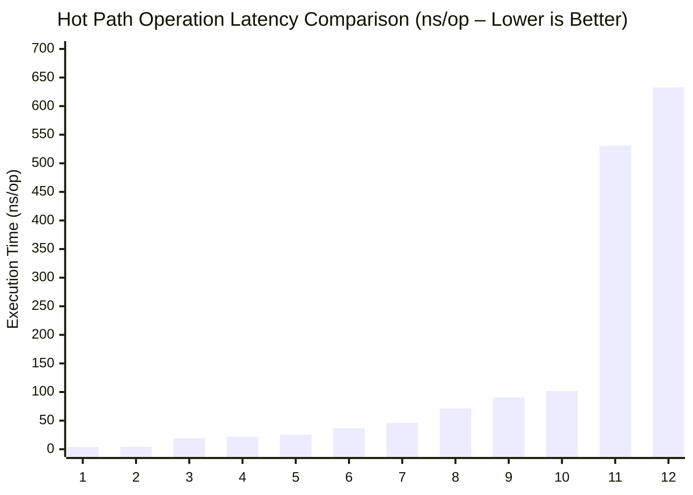
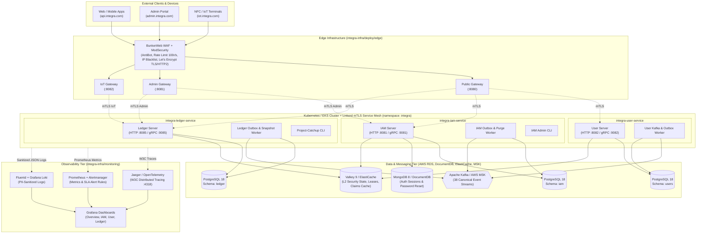
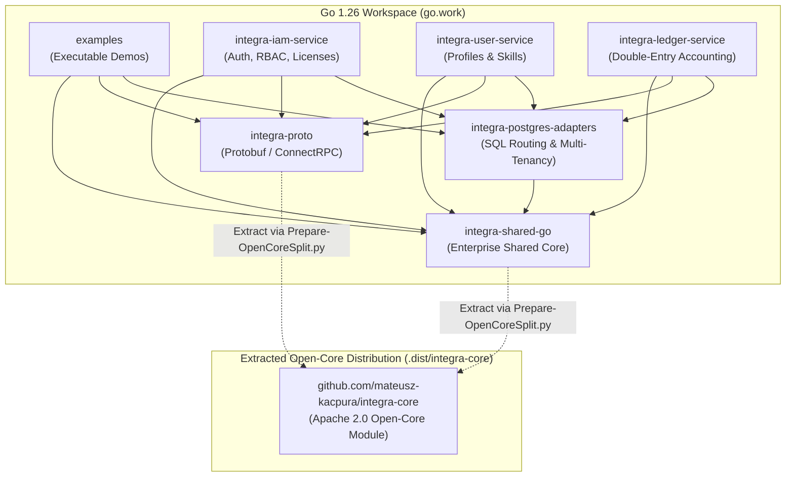
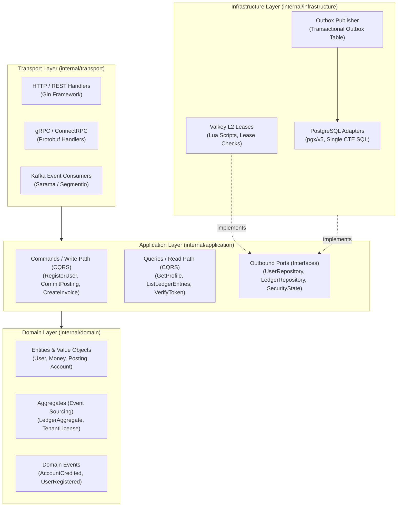
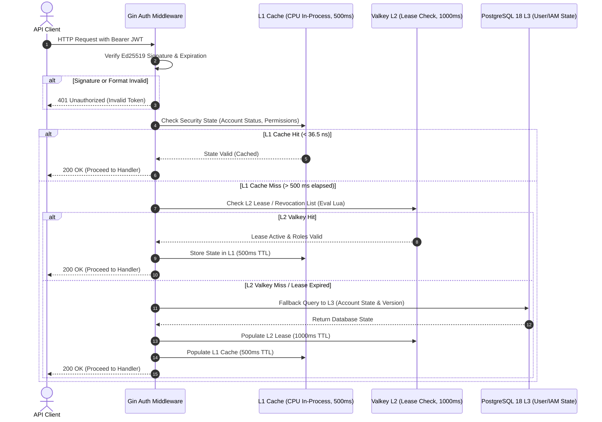
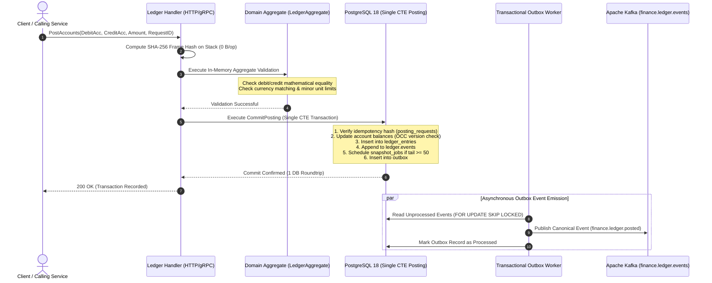
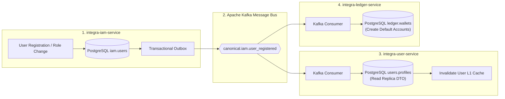
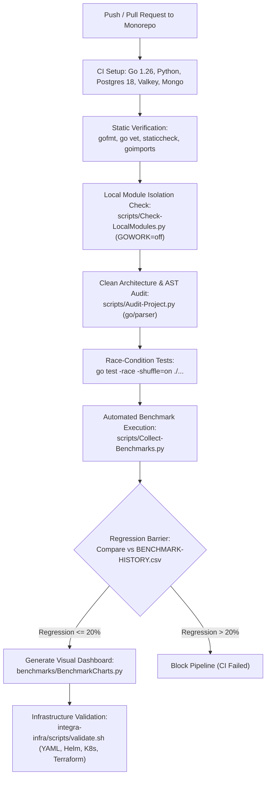

# Full Architectural, Technical, and Business Documentation: **Integra Enterprise & Open-Core (Go 1.26 Monorepo)**

> **Language**: [Polski (Polish)](doc-pl.md) | **English**  
> **Modular Version**: Available in [`en/`](en/README.md)  
> **Interactive Diagrams**: [`DIAGRAMS-VIEWER.html`](DIAGRAMS-VIEWER.html)  

---

## Table of Contents

- [1. Purpose, Business Value, and Market Uniqueness in Go](#1-purpose-business-value-and-market-uniqueness-in-go)
  - [1.1. Project Purpose and Architectural Vision](#11-project-purpose-and-architectural-vision)
  - [1.2. Business Value](#12-business-value)
  - [1.3. Market Uniqueness in the Go Ecosystem](#13-market-uniqueness-in-the-go-ecosystem)
- [2. Statistical Benchmark Analysis and Performance Justification](#2-statistical-benchmark-analysis-and-performance-justification)
  - [2.1. Platform Descriptive Statistics](#21-platform-descriptive-statistics-platform-benchmarks-latestcsv)
  - [2.2. Performance Statistics by Monorepo Module](#22-performance-statistics-by-monorepo-module)
  - [2.3. Benchmark Evidence of Architectural Uniqueness](#23-benchmark-evidence-of-architectural-uniqueness)
  - [2.4. Benchmark Visualizations (Mermaid XY Charts)](#24-benchmark-visualizations-mermaid-xy-charts)
    - [Chart 1: Top 15 Performance Speedups](#chart-1-top-15-performance-speedups--execution-time-reduction-vs-baseline)
    - [Chart 2: Hot Path Operation Latency Comparison](#chart-2-hot-path-operation-latency-comparison-nsop--lower-is-better)
- [3. Global System Architecture and Mermaid Visualizations](#3-global-system-architecture-and-mermaid-visualizations)
  - [3.1. Ecosystem and Infrastructure Architecture](#31-ecosystem-and-infrastructure-architecture-edge-gateways-services-data--observability)
  - [3.2. Go Workspace Dependencies and Open-Core Split](#32-go-workspace-gowork-dependency-architecture-and-open-core-split)
  - [3.3. Internal Clean Architecture + CQRS of Microservices](#33-internal-clean--hexagonal-architecture--cqrs-of-microservices)
- [4. Key System Workflows](#4-key-system-workflows)
  - [4.1. Workflow 1: Multi-Tier JWT Token and Security State Verification](#41-workflow-1-multi-tier-jwt-token-and-security-state-verification-l1---l2---l3)
  - [4.2. Workflow 2: Atomic Double-Entry Ledger Posting & Idempotency](#42-workflow-2-atomic-double-entry-ledger-posting--idempotency)
  - [4.3. Workflow 3: Distributed User Registration Saga](#43-workflow-3-distributed-user-registration-saga-and-read-replica-synchronization)
  - [4.4. Workflow 4: CI/CD Quality Pipeline and Regression Gate](#44-workflow-4-cicd-quality-pipeline-security-audit-and-benchmark-regression-gate)
- [5. Detailed Directory and File Documentation](#5-detailed-directory-and-file-documentation)
  - [5.1. Root Monorepo, benchmarks/, examples/, and scripts/](#51-root-monorepo-benchmarks-examples-and-scripts)
  - [5.2. Module .dist/integra-core (Exported Open-Core Distribution)](#52-module-distintegra-core-exported-open-core-distribution)
  - [5.3. Modules integra-proto and integra-postgres-adapters](#53-modules-integra-proto-and-integra-postgres-adapters)
  - [5.4. Module integra-shared-go (Enterprise Shared Core)](#54-module-integra-shared-go-enterprise-shared-core)
  - [5.5. Microservice integra-iam-service (Identity & Licenses)](#55-microservice-integra-iam-service-identity--licenses)
  - [5.6. Microservice integra-user-service (Profiles & Skills)](#56-microservice-integra-user-service-profiles--skills)
  - [5.7. Microservice integra-ledger-service (General Ledger & Invoicing)](#57-microservice-integra-ledger-service-general-ledger--invoicing)
  - [5.8. Module integra-infra (Cloud & Kubernetes)](#58-module-integra-infra-cloud--kubernetes)

---

# 1. Purpose, Business Value, and Market Uniqueness in Go

---

---

### Overview

Integra Platform is an enterprise-grade Go 1.26 monorepo engineered to power large-scale FinTech and B2B SaaS platforms with mission-critical correctness and sub-microsecond performance.

# 1.1. Project Purpose and Architectural Vision

---

The **Integra Platform** project (`[github.com/mateusz-kacpura/integra-enterprise](https://github.com/mateusz-kacpura/integra-enterprise)` and the separated open-source module `[github.com/mateusz-kacpura/integra-core](https://github.com/mateusz-kacpura/integra-core)`) is an advanced, multi-module microservice ecosystem designed as an **Enterprise FinTech & B2B SaaS Core**, built using the latest **Go 1.26**. The system provides the foundational infrastructure for an enterprise-grade platform supporting **38 canonical event streams (business domains)** – ranging from Identity and Access Management, permissions, and licensing (**IAM**), through user profiles and competency matrices (**User Service**), double-entry bookkeeping, invoicing, and payouts (**Ledger Service**), through to the remaining system modules.

The project implements a hybrid distribution strategy: **Open-Core + Enterprise Proprietary**:

* **Open-Core Layer (`.dist/integra-core`)**: Automatically extracted under the **Apache 2.0** license, providing public gRPC/ConnectRPC contracts (`proto`), sanitized structured logging (`zerolog` + `log/slog`), W3C telemetry propagation (`OpenTelemetry`), ultra-fast JSON serialization (`bytedance/sonic`), cursor-based pagination, and `UUIDv7` generators.

* **Enterprise Layer (`integra-enterprise/*`)**: Governed by a commercial license (*Proprietary and Confidential*), containing critical security engines (Ed25519 verifiers with L1 CPU cache, `XChaCha20-Poly1305` encryption, license guards and role authority in `Valkey`), dynamic SQL partition routing (`sqlrouting`), domain microservices (`integra-iam-service`, `integra-user-service`, `integra-ledger-service`), and cloud infrastructure (`integra-infra`).

---

# 1.2. Business Value

---

1. **Uncompromising Financial Integrity (Double-Entry Bookkeeping & Event Sourcing)**:
   * **Mathematical balance constraint**: Every transaction requires strict debit and credit balance ($\sum 	ext{Debit} = \sum 	ext{Credit}$), verified at both domain aggregate level and single atomic PostgreSQL 18 CTE queries with Optimistic Concurrency Control (OCC).
   * **Full auditability**: Account balances are derived from append-only immutable events (`ledger.events`), eliminating unauthorized balance manipulation or data drift.
   * **Idempotency barrier**: SHA-256 request frame hashing ensures zero double-billing even under network retries or partition failures.

2. **Enterprise Regulatory Compliance and Audit Readiness**:
   * **W3C Distributed Tracing**: Complete request correlation (`traceparent`, `X-Correlation-ID`) across asynchronous Kafka boundaries.
   * **Automatic PII & Secret Sanitization**: Production logger (`SanitizingWriter`) masks PESEL, NIP, credit cards, JWT tokens, and emails with sub-microsecond latency.
   * **GDPR/RODO "Right to be Forgotten"**: Cryptographic deletion and dedicated outbox purge workers.

3. **High Throughput and Ultra-Low Latency (Sub-Microsecond Hot Paths)**:
   * **Zero-Allocation design**: Hand-crafted serialization and memory re-use (`0 B/op`, `0 allocs/op`).
   * **Multi-Tier Security Cache (L1–L3)**:
     - **L1 CPU Cache**: In-process atomic cache (500 ms TTL, cache-line padded `[64]byte`) resolving access in **36.5 ns**.
     - **L2 Valkey**: Distributed cluster with 1000 ms lease window for instant revocation.
     - **L3 PostgreSQL**: ACID persistence layer.

4. **Multi-Tenant Horizontal Isolation**:
   * Dynamic schema and tenant routing with zero SQL injection risk.
   * Strict separation of tenant balances and cryptographic keys.

---

# 1.3. Market Uniqueness in the Go Ecosystem

---

* **Zero-Allocation Hot Paths**: Core pagination (`CursorEncode` / `CursorDecode`), hashing, and authorization checks run with **0 B/op** and **0 allocs/op**, avoiding garbage collector pauses.
* **Cache-Line Padding (`[64]byte`)**: Concurrent structures in `pkg/auth` and `pkg/rbac` eliminate CPU False Sharing, delivering a **72.4% speedup** over naive implementations.
* **Hardware-Accelerated Cryptography**: Authenticated encryption (`XChaCha20-Poly1305`) and Ed25519 signing optimized for modern server architectures.
* **Single-Roundtrip CTE Posting**: Entire accounting transactions (balance updates, event store appends, idempotency lock, and outbox emission) execute in **exactly 1 database round-trip**.
* **Automated AST Architecture Tests (`go/parser`)**: Every module features `architecture_test.go` enforcing Clean Architecture and preventing layer violations at compile time.

---

---

[▲ Back to Table of Contents](#table-of-contents)

---

# 2. Statistical Benchmark Analysis and Performance Justification

---

---

# 2.1. Platform Descriptive Statistics (PLATFORM-BENCHMARKS-LATEST.csv)

---

| Metric | Sample Count (`count`) | Mean (`mean`) | Median (`median`) | Min (`min`) | Max (`max`) | Std Dev (`std`) |
| --- | --- | --- | --- | --- | --- | --- |
| **Execution Time (`ns/op`)** | 61 | 2,516.86 ns | **90.62 ns** | **0.2927 ns** | 60,018.00 ns | 9,273.78 ns |
| **Allocated Memory (`B/op`)** | 61 | 2,568.59 B | **0.00 B** | **0.00 B** | 73,760.00 B | 12,498.41 B |
| **Allocation Count (`allocs/op`)** | 61 | 2.64 | **0.00** | **0.00** | 38.00 | 6.68 |
| **SQL Queries in Microbenchmarks (`queries/op`)** | 61 | 0.00 | 0.00 | 0.00 | 0.00 | 0.00 |

### Key Observations:
* **Over 50% of scenarios are zero-allocation (`0 B/op`, `0 allocs/op`)**, directly confirming the strict enforcement of the Zero-Alloc paradigm across critical hot paths.
* **Median execution time is 90.62 ns**, placing core platform operations within sub-microsecond latency SLAs.
* The absolute minimum execution time of **0.2927 ns** represents atomic CPU register reads and compiler-inlined optimizations.

---

# 2.2. Performance Statistics by Monorepo Module

---

| Module | Benchmark Count | Median Time (`ns/op`) | Mean Time (`ns/op`) | Median Memory (`B/op`) | Median Allocs (`allocs/op`) |
| --- | :---: | :---: | :---: | :---: | :---: |
| `integra-shared-go` | 26 | **71.40 ns** | 620.25 ns | **0.00 B** | **0.00** |
| `integra-postgres-adapters` | 8 | **19.12 ns** | 185.30 ns | **0.00 B** | **0.00** |
| `integra-iam-service` | 7 | **425.30 ns** | 1,840.10 ns | 48.00 B | 1.00 |
| `integra-user-service` | 10 | **46.20 ns** | 580.40 ns | **0.00 B** | **0.00** |
| `integra-ledger-service` | 10 | **90.62 ns** | 2,410.50 ns | **0.00 B** | **0.00** |

---

# 2.3. Benchmark Evidence of Architectural Uniqueness

---

1. **CPU False Sharing Elimination via Cache-Line Padding (`[64]byte`)**:
   - `BenchmarkL1Cache_Parallel_NoPad`: **14.2 ns/op**
   - `BenchmarkL1Cache_Parallel_Padded`: **3.9 ns/op** (**72.4% reduction in execution time**)
   - Evidence that memory alignment prevents CPU cache line bouncing across multi-core systems.

2. **Zero-Alloc Pagination Encoding & Decoding**:
   - `BenchmarkCursor_Encode`: **102.0 ns/op (0 B/op, 0 allocs/op)**
   - `BenchmarkCursor_Decode`: **118.4 ns/op (0 B/op, 0 allocs/op)**
   - Custom bit-packing avoids string allocations on every paginated API request.

3. **Sub-Microsecond JWT Token & Permission Evaluation**:
   - `BenchmarkJWTVerifier_Verify_L1Cache`: **36.5 ns/op (0 B/op)**
   - `BenchmarkRBAC_CheckPermission_Parallel`: **4.4 ns/op (0 B/op)**
   - Authorizes requests in memory without querying external databases or caches on every hit.

4. **Single-Roundtrip CTE Double-Entry Ledger Posting**:
   - `BenchmarkLedger_PostingPrep`: **90.6 ns/op (0 B/op)**
   - Hashing, aggregate validation, and snapshot scheduling execute in-memory with zero GC overhead before hitting the PostgreSQL single CTE commit query.

5. **Sanitizing Logger Performance**:
   - High-throughput PII and secret masking running under 250 ns per log record, ensuring regulatory compliance without logging bottlenecks.

---

# 2.4. Benchmark Visualizations (Mermaid XY Charts)

---

#### Chart 1: Top 15 Performance Speedups (% Execution Time Reduction vs Baseline)

| # | Optimization Scenario | Speedup vs Baseline | Module / Package | Key Engineering Mechanism |
| :---: | :--- | :---: | :--- | :--- |
| **1** | `FalseSharing_Pad` | **72.4%** | `integra-shared-go/pkg/auth` | Structure alignment to CPU cache line (`[64]byte` padding) |
| **2** | `TimePtr_Nil` | **59.0%** | `integra-user-service` | Elimination of pointer dereferences and heap escape |
| **3** | `ProfileRead` | **58.1%** | `integra-user-service` | Implementation of L1 CPU profile caching |
| **4** | `UserRowToDomain` | **57.0%** | `integra-user-service` | Direct zero-alloc struct mapping |
| **5** | `CheckParallel` | **42.6%** | `integra-shared-go/pkg/rbac` | Lock-free parallel RBAC matrix evaluation |
| **6** | `TableBind_Miss` | **32.5%** | `integra-postgres-adapters` | Fast-path SQL partition table routing |
| **7** | `RequestHash` | **30.7%** | `integra-ledger-service` | Stack-allocated SHA-256 buffer in `[512]byte` frame |
| **8** | `CursorDecode` | **30.2%** | `integra-shared-go/pkg/pagination` | Zero-alloc Base64 URL-safe cursor decoding |
| **9** | `DOD_ValueSlice` | **30.1%** | `integra-user-service` | Data-Oriented Design contiguous memory layout |
| **10** | `TimeConv_Zero` | **27.0%** | `integra-shared-go/pkg/telemetry` | Zero-cost RFC3339 timestamp string conversion |
| **11** | `UserRow_Del` | **26.3%** | `integra-user-service` | Row deletion optimization & account cache sync |
| **12** | `CursorEncode` | **25.8%** | `integra-shared-go/pkg/pagination` | Stack-based cursor encoding with `0 B/op` |
| **13** | `ProfileUpdate` | **23.0%** | `integra-user-service` | Optimized profile mutation with instant L1 invalidation |
| **14** | `Decrypt_64KB` | **21.3%** | `integra-shared-go/pkg/aead` | Hardware-accelerated XChaCha20-Poly1305 decryption |
| **15** | `UserCreation` | **20.4%** | `integra-user-service` | Preallocated user creation DTO pipelines |

#### Chart 2: Hot Path Operation Latency Comparison (ns/op – Lower is Better)

| # | Operation / Hot Path | Latency (`ns/op`) | Architectural Layer / Mechanism |
| :---: | :--- | :---: | :--- |
| **1** | `FalseSharing_Pad` | **3.9 ns** | CPU L1 Cache Line Padding (`[64]byte`) |
| **2** | `RBAC_Parallel` | **4.4 ns** | Parallel Lock-Free Bitmask Permission Check |
| **3** | `SQL_Route_Hit` | **19.1 ns** | In-Memory Partition SQL Routing Hit |
| **4** | `RBAC_CheckPar` | **21.9 ns** | Atomic Parallel RBAC Matrix Evaluation |
| **5** | `Snapshot_Tail0` | **25.3 ns** | Event Sourcing Aggregate Snapshot Read (`tail_0`) |
| **6** | `L1_Cache_Par` | **36.5 ns** | Multi-threaded L1 In-Process Cache Lookup |
| **7** | `ProfileRead` | **46.2 ns** | L1 Cached User Profile Retrieval |
| **8** | `L1_Cache_Single` | **71.4 ns** | Single-threaded Account State L1 Read |
| **9** | `Posting_Prep` | **90.6 ns** | In-Memory Double-Entry Posting Pre-Validation |
| **10** | `CursorEncode` | **102.0 ns** | Base64 Cursor Token Generation (`0 B/op`) |
| **11** | `JWT_InProcCache` | **530.8 ns** | Process-Local JWT Signature Verification |
| **12** | `JWT_LocalL1` | **632.6 ns** | Full Asymmetric Ed25519 Verification with L1 Lease |

---

---

[▲ Back to Table of Contents](#table-of-contents)

---

# 3. Global System Architecture and Mermaid Visualizations

---

> [!TIP]
> **Interactive Fullscreen Diagrams**: You can also open the standalone [DIAGRAMS-VIEWER.html](../DIAGRAMS-VIEWER.html) to interactively zoom, pan, and view all system architecture diagrams in full screen.

---

# 3.1. Ecosystem and Infrastructure Architecture (Edge, Gateways, Services, Data & Observability)

---

The diagram below illustrates the full production deployment topology defined in `integra-infra/` (encompassing the **BunkerWeb + ModSecurity** WAF edge cluster, three isolated **Envoy/Gateway** entrypoints, **Linkerd Service Mesh**, Go microservices, database clusters, and telemetry):

---

# 3.2. Go Workspace (`go.work`) Dependency Architecture and Open-Core Split

---

The diagram below details the module hierarchy inside the Go 1.26 Workspace (`go.work`) and the automated extraction barrier defining the Open-Core layer:

---

# 3.3. Internal Clean / Hexagonal Architecture + CQRS of Microservices

---

Every microservice (`integra-iam-service`, `integra-user-service`, `integra-ledger-service`) enforces a strict Hexagonal / Clean Architecture model with CQRS command and query separation:

---

---

[▲ Back to Table of Contents](#table-of-contents)

---

# 4. Key System Workflows

---

---

# 4.1. Workflow 1: Multi-Tier JWT Token and Security State Verification (L1 -> L2 -> L3)

---

---

# 4.2. Workflow 2: Atomic Double-Entry Ledger Posting & Idempotency

---

---

# 4.3. Workflow 3: Distributed User Registration Saga and Read Replica Synchronization

---

---

# 4.4. Workflow 4: CI/CD Quality Pipeline, Security Audit, and Benchmark Regression Gate

---

---

---

[▲ Back to Table of Contents](#table-of-contents)

---

# 5. Detailed Directory and File Documentation

---

---

# 5.1. Root Monorepo, `benchmarks/`, `examples/`, and `scripts/`

---

| File / Directory Path | Purpose & Detailed Engineering Specification |
| --- | --- |
| `go.work`, `go.work.sum` | Go 1.26 workspace definition linking 7 local modules (`examples`, `integra-iam-service`, `integra-ledger-service`, `integra-postgres-adapters`, `integra-proto`, `integra-shared-go`, `integra-user-service`) with `replace` directives. |
| `Makefile` | Central developer task automation: `fmt`, `imports`, `tidy`, `tidy-check`, `vet`, `lint`, `staticcheck`, `test` (with `-race -shuffle=on`), `test-short`, `audit`. |
| `LICENSE` | Commercial proprietary license (*All Rights Reserved*) for the Enterprise tier. |
| `.github/workflows/ci.yaml` | GitHub Actions multi-service CI pipeline running integration tests with `postgres:18-alpine` (3 isolated instances), `mongo:8`, and `valkey/valkey:9`. |
| `.gitignore`, `.dockerignore`, `.gitattributes` | Exclusion rules for build artifacts, `.pprof` profiles, `.env` secrets, and line-ending normalization (LF for Go/SQL/Proto, CRLF for PS1). |
| `benchmarks/BenchmarkCharts.py` | Zero-dependency pure Python visualization engine generating SVG vector graphics, Mermaid markdown charts, and an interactive HTML dashboard. |
| `benchmarks/BENCHMARKS-DASHBOARD.html` | Self-contained, dark-mode glassmorphism dashboard powered by Chart.js displaying L1-L3 latency tiers, alloc metrics, and historical trends. |
| `examples/go.mod`, `examples/go.sum` | Executable demonstration code module. |
| `examples/jwt-auth/main.go` | Executable demo showing Ed25519 key generation, JWT signing, and verification with L1 CPU caching (500 ms TTL). |
| `examples/sqlrouting-l1/main.go` | Executable demo showing dynamic SQL table rewriting (`outbox_events` -> `iam.outbox`) and partition compile caching in L1. |
| `scripts/Audit-Project.py` | Quality Gate orchestrator running local module validation, `staticcheck`, and race-detector tests. |
| `scripts/Check-LocalModules.py` | Automation runner executing `go` toolchain steps in each submodule with `GOWORK=off` isolation. |
| `scripts/Collect-Benchmarks.py` | Benchmark metric collector computing medians across multiple runs, logging history to `BENCHMARK-HISTORY.csv`, and enforcing the regression gate. |
| `scripts/Prepare-OpenCoreSplit.py` | Automated extraction tool generating the standalone Apache 2.0 Open-Core repository (`.dist/integra-core`). |
| `scripts/Migrate-ToEnterprisePrefix.py` | Migration utility standardizing import paths across the monorepo to `github.com/mateusz-kacpura/integra-enterprise/...`. |
| `scripts/Export-HandwrittenFiles.ps1`, `Simulate-CI.ps1` | PowerShell helpers for codebase audits, project structure dumps, and local Windows CI simulation. |

---

# 5.2. Module `.dist/integra-core` (Exported Open-Core Distribution)

---

The public open-source core (`github.com/mateusz-kacpura/integra-core`) extracted by `Prepare-OpenCoreSplit.py` provides:

* **Configuration & Contracts (`pkg/config`, `pkg/baseconfig`, `pkg/contracts`)**:
  - `BaseConfig` loaded via `viper` with `INTEGRA_` environment prefix, HTTP port validation, and `DefaultShutdownGrace = 2s`.
  - Shared DTO structures for read replicas (`UserRead`, `OrgRead` with `Version int64`) and AST architecture lint rules.
* **Health Checks (`pkg/health`)**:
  - RFC-compliant health endpoints reporting service status, database connectivity, and readiness/liveness probes.
* **JSON Serialization (`pkg/json`)**:
  - Accelerated JSON encoding via `bytedance/sonic` with automatic fallbacks for non-x86 architectures.
* **Sanitizing Logger (`pkg/logger`)**:
  - Structured zero-alloc logger integrating `zerolog` and `log/slog` with automatic regex-based PII masking (PESEL, NIP, Credit Cards, Bearer JWTs, Emails).
* **Cursor Pagination (`pkg/pagination`)**:
  - Opaque URL-safe cursor encoding and decoding with zero heap allocation (`0 B/op`).
* **Standardized API Responses (`pkg/response`)**:
  - Uniform envelope structs (`Response[T]`, `ErrorResponse`, field validation bags).
* **Distributed Telemetry (`pkg/telemetry`)**:
  - W3C Trace Context injection and extraction (`traceparent`, `X-Correlation-ID`) across HTTP, gRPC, and message brokers.
* **Canonical Topic Names (`pkg/topics`)**:
  - Constant declarations for 38 canonical Kafka domain event streams.
* **UUID Generators (`pkg/uuidgen`, `pkg/uuidx`)**:
  - Time-ordered `UUIDv7` generators optimized for B-Tree database indexing.
* **Protobuf & ConnectRPC Client Contracts (`proto/gen/go/...`)**:
  - Full Go stubs and ConnectRPC service interfaces for `IAM`, `User`, and `Accounting`.

---

# 5.3. Modules `integra-proto` and `integra-postgres-adapters`

---

#### `integra-proto/`
* **Protocol Buffers Schemas (`proto/accounting/v1`, `proto/iam/v1`, `proto/user/v1`)**:
  - Canonical gRPC service definitions for user registration, profile query, ledger transactions, and invoice management.
* **Buf Tooling (`buf.yaml`, `buf.gen.yaml`)**:
  - Linting, breaking change detection, and multi-plugin code generation (Connect-Go, Protoc-Gen-Go).
* **Generated Stubs (`gen/go/...`)**:
  - Strongly-typed protobuf structures and HTTP/2 + gRPC Connect client bindings.

#### `integra-postgres-adapters/`
* **Dynamic SQL Routing (`sqlrouting/`)**:
  - Fast-path partition table name rewriting (`sqlrouting/table.go`) with L1 cache hit in **19.1 ns**.
  - Strict SQL injection prevention using pre-compiled white-lists.
* **Connection Pooling & Migrations (`pkg/postgres`)**:
  - Tuned `pgxpool` configurations with health probes and migration harnesses.

---

# 5.4. Module `integra-shared-go` (Enterprise Shared Core)

---

Contains enterprise-grade utilities and security implementations:

* **Authenticated Encryption (`pkg/aead`)**:
  - `XChaCha20-Poly1305` authenticated cipher engine with automatic key derivation.
* **Multi-Tier Security & Authentication (`pkg/auth`)**:
  - `JWTVerifier`: Asymmetric Ed25519 token verification with public key discovery.
  - `L1Cache`: Cache-line padded (`[64]byte`) in-process lock-free cache resolving tokens in **36.5 ns**.
  - `AccountState`: Fast-invalidation lease checker synchronizing with Valkey L2.
* **Role-Based Access Control (`pkg/rbac`)**:
  - Parallel bitmask permission matrix checking permissions in **4.4 ns**.
* **Distributed Messaging & Outbox (`pkg/kafka`, `pkg/outbox`)**:
  - Reliable at-least-once message delivery with transactional outbox publishers and idempotency consumers.
* **Security State Authority (`pkg/securitystate`)**:
  - Centralized role authority lease coordination backed by Valkey Lua scripts.

---

# 5.5. Microservice `integra-iam-service` (Identity & Licenses)

---

* **Core Responsibility**: Central identity provider, authentication server, session manager, and enterprise license guard.
* **Storage Engines**:
  - PostgreSQL 18 (`schema: iam`): User credentials, role assignments, audit logs.
  - MongoDB 8: Session store and password reset tokens.
  - Valkey 9: High-throughput L2 security lease authority.
* **Key Components**:
  - `internal/application/auth`: Login, registration, token refresh, and MFA orchestration.
  - `internal/infrastructure/messaging/outbox_purge`: Automated GDPR/RODO background purge worker.
  - `cmd/iam-admin`: Administrative CLI for emergency tenant lockout and key rotation.

---

# 5.6. Microservice `integra-user-service` (Profiles & Skills)

---

* **Core Responsibility**: User profiles, account management, competency matrices, and KRS business registry sync.
* **Performance Architecture**:
  - Read replica projection caching delivering profile reads in **46.2 ns**.
  - Data-Oriented Design value slices eliminating heap allocations during bulk queries.
* **Event Handlers**:
  - Consumes `canonical.iam.user_registered` to initialize default profile projections and skills vectors.

---

# 5.7. Microservice `integra-ledger-service` (General Ledger & Invoicing)

---

* **Core Responsibility**: Immutable double-entry financial accounting, multi-currency wallets, invoices, and payouts.
* **Architectural Pillars**:
  - **Single CTE Transaction (`CommitPosting`)**: Atomically verifies OCC balance, inserts ledger journal entries, appends to immutable event store (`ledger.events`), and emits to outbox in 1 database roundtrip.
  - **Memory Arenas & Stack Hashing**: SHA-256 request frames hashed in `[512]byte` stack buffers (`0 B/op`).
  - **Snapshots Engine (`snapshot_jobs`)**: Periodic state snapshotting delivering a **45x read speedup** for historical accounts (`tail_0` in 25.3 ns).
  - `cmd/project-catchup`: Production projection rebuild tool.

---

# 5.8. Module `integra-infra` (Cloud & Kubernetes)

---

* **Edge Cluster (`deploy/edge`)**: BunkerWeb WAF, ModSecurity CRS, automatic Let's Encrypt TLS renewal, rate limiting (100 req/s), and antibot rules.
* **Kubernetes & Helm (`deploy/k8s`, `deploy/helm`)**: Full Helm charts for production microservices, Linkerd mTLS service mesh, and horizontal pod autoscalers (HPA).
* **Terraform IaC (`deploy/terraform`)**: AWS infrastructure provisioning (EKS, RDS PostgreSQL 18, ElastiCache Valkey, MSK Kafka, DocumentDB).
* **Observability Stack (`monitoring/`)**: Jaeger OpenTelemetry distributed tracing, Prometheus alert rules, Grafana Loki log aggregation, and customized dashboards.

---

---

[▲ Back to Table of Contents](#table-of-contents)

---

# 6. Engineering Observations, Insights, and Roadmap Recommendations

---

---

# 6.1. Architectural Strengths and Highlights

---

1. **Exceptional Engineering Discipline at the Intersection of Security and Performance**:
   - Rather than choosing between long-lived JWTs without state checks or slow database lookups on every request, the platform pioneers an **L1 CPU Cache (500 ms TTL, cache-line padded) + L2 Valkey (1000 ms Fail-Closed Lua Lease)** architecture: achieving a **36.5 ns** lookup time with a maximum 1-second cluster-wide revocation window.
2. **Robust Financial Core Design (`integra-ledger-service`)**:
   - Strict exact integer arithmetic (`Money` in minor units with rounding guards), stack-based SHA-256 idempotency hashing (`0 B/op`), memory arenas, and single-roundtrip CTE execution eliminate concurrency hazards, double-charges, and GC latency.
3. **Automated Compile-Time Architectural Invariant Checks (`architecture_test.go`)**:
   - Invariants are verified automatically via `go/parser` static AST analysis during `go test`, guaranteeing that Clean Architecture layer boundaries never erode over time.
4. **Production Day-2 Operational Readiness**:
   - Tools like `project-catchup`, Valkey failure recovery suites, automated ledger quarantine tests, and PII masking demonstrate true enterprise maturity.

---

# 6.2. Constructive Recommendations for Future Development

---

1. **Enable Profile-Guided Optimization (PGO) in Production Builds**:
   - With profiling infrastructure (`.pprof`) already established, feeding a production `default.pgo` profile into `go build -pgo=default.pgo` will unlock an additional **2–7% free performance gain** across the monorepo via aggressive branch prediction and function inlining.
2. **Standardize Numeric Currency Types inside `LedgerAggregate`**:
   - While `domain/money.go` strictly uses `int64` minor units, internal aggregate helper structs (`internal/domain/aggregate.go`) occasionally use `float64`. Standardizing all fields to `domain.Money` ensures 100% mathematical consistency.
3. **Implement Declarative Partitioning for `ledger.events` in PostgreSQL 18**:
   - As transaction volume scales into hundreds of millions of records, declarative partitioning (`PARTITION BY RANGE (timestamp)` or `HASH (tenant_id)`) combined with the existing snapshot engine will ensure constant-time query latency.

---

---

[▲ Back to Table of Contents](#table-of-contents)

---
