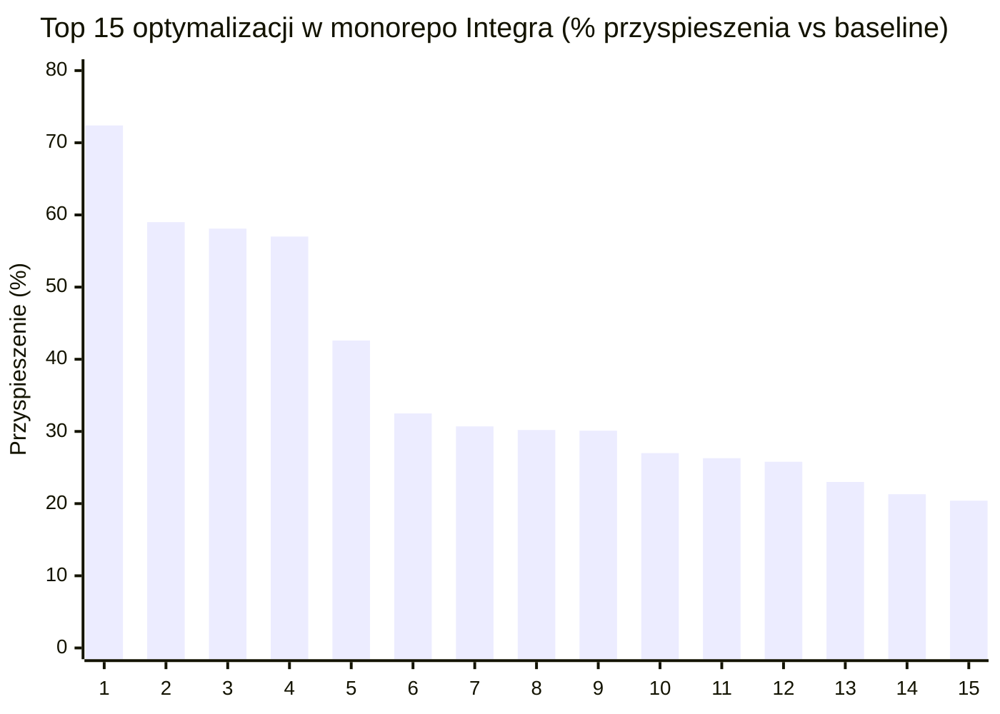
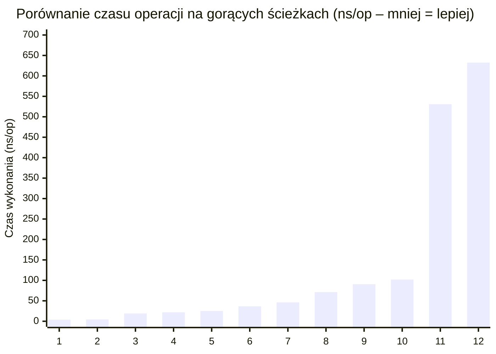
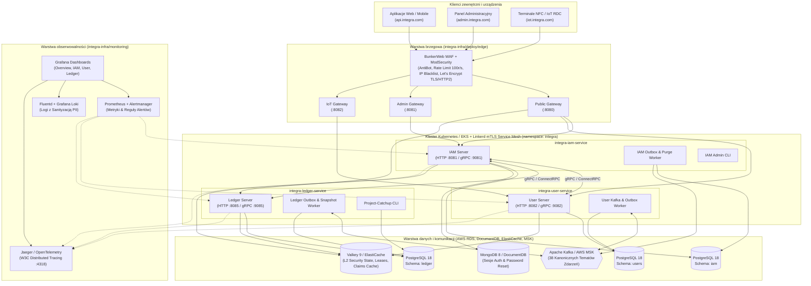
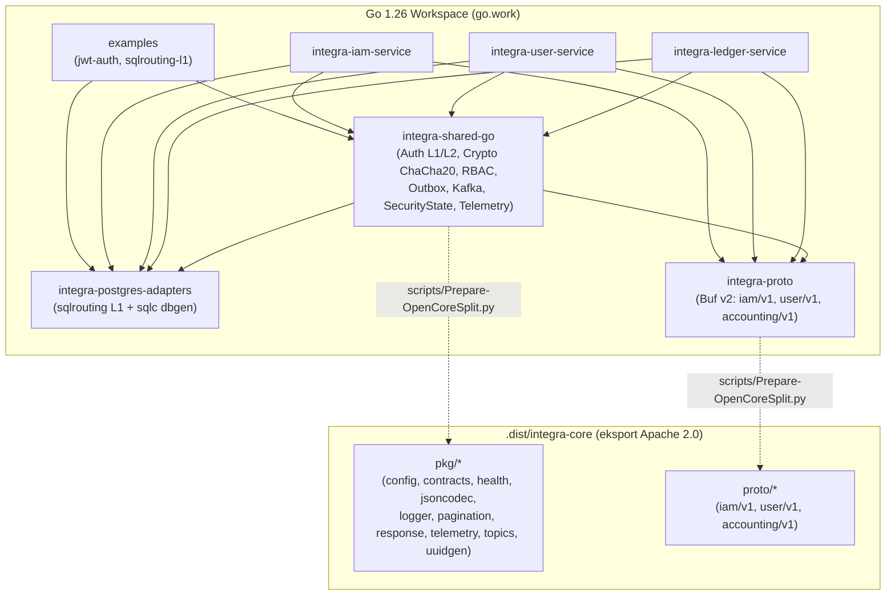
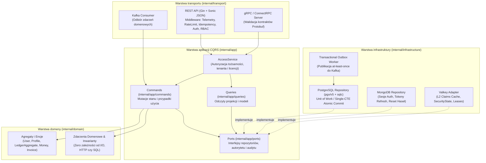
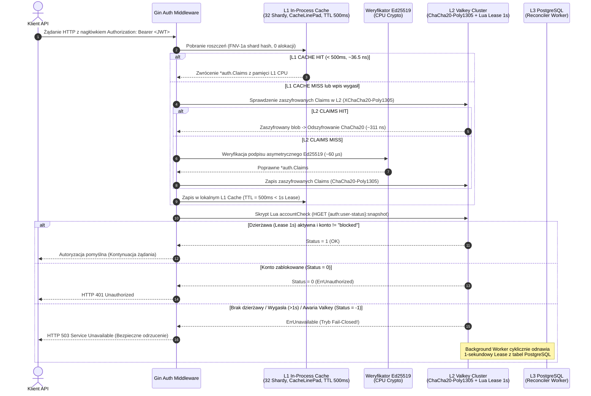
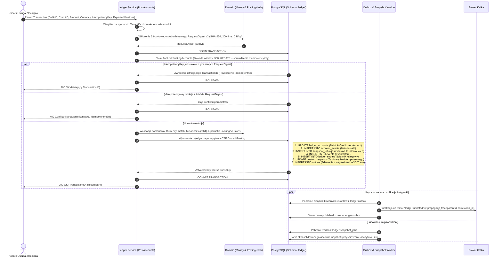
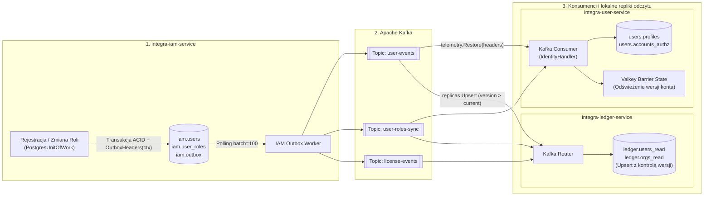
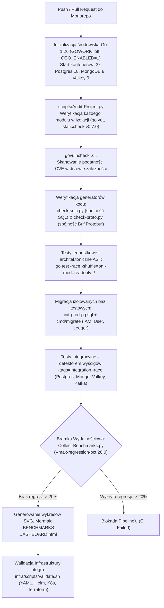

# Pełna dokumentacja architektoniczna, techniczna i biznesowa platformy **Integra Enterprise & Open-Core (Go 1.26 Monorepo)**

> [!NOTE]
> **Wersja modułowa**: Ta dokumentacja została również podzielona na katalogi i pliki według spisu treści w katalogu [**`docs/`**](index.md).

---

## Spis treści

- [1. Cel projektu, wartość biznesowa i unikalność na rynku Go](#1-cel-projektu-wartość-biznesowa-i-unikalność-na-rynku-go)
  - [1.1. Cel projektu i wizja architektoniczna](#11-cel-projektu-i-wizja-architektoniczna)
  - [1.2. Wartość biznesowa (Business Value)](#12-wartość-biznesowa-business-value)
  - [1.3. Unikalność w skali rynku projektów w Go](#13-unikalność-w-skali-rynku-projektów-w-go)
- [2. Analiza statystyczna benchmarków i uzasadnienie wydajnościowe](#2-analiza-statystyczna-benchmarków-i-uzasadnienie-wydajnościowe)
  - [2.1. Statystyki opisowe całej platformy (`PLATFORM-BENCHMARKS-LATEST.csv`)](#21-statystyki-opisowe-całej-platformy-platform-benchmarks-latestcsv)
  - [2.2. Statystyki wydajności w podziale na moduły monorepo](#22-statystyki-wydajności-w-podziale-na-moduły-monorepo)
  - [2.3. Dowody benchmarkowe na unikalność architektoniczną (wzorce i anomalie)](#23-dowody-benchmarkowe-na-unikalność-architektoniczną-wzorce-i-anomalie)
  - [2.4. Wizualizacje wyników benchmarków (Mermaid XY Charts)](#24-wizualizacje-wyników-benchmarków-mermaid-xy-charts)
    - [Wykres 1: Top 15 przyspieszeń wydajnościowych (% redukcji czasu wykonania vs Baseline)](#wykres-1-top-15-przyspieszeń-wydajnościowych-redukcji-czasu-wykonania-vs-baseline)
    - [Wykres 2: Porównanie czasu weryfikacji autoryzacji i dostępu do danych (ns/op)](#wykres-2-porównanie-czasu-weryfikacji-autoryzacji-i-dostępu-do-danych-nsop)
- [3. Globalna architektura systemu i wizualizacje Mermaid](#3-globalna-architektura-systemu-i-wizualizacje-mermaid)
  - [3.1. Architektura ekosystemu i infrastruktury (Edge, Gateways, Services, Data & Observability)](#31-architektura-ekosystemu-i-infrastruktury-edge-gateways-services-data-observability)
  - [3.2. Architektura zależności modułów Go Workspace (`go.work`) i podział Open-Core](#32-architektura-zależności-modułów-go-workspace-gowork-i-podział-open-core)
  - [3.3. Wewnętrzna architektura czysta / heksagonalna + CQRS mikroserwisów](#33-wewnętrzna-architektura-czysta-heksagonalna-cqrs-mikroserwisów)
- [4. Kluczowe przepływy pracy (System Workflows)](#4-kluczowe-przepływy-pracy-system-workflows)
  - [4.1. Przepływ 1: Wielopoziomowa weryfikacja tokena JWT i stanu bezpieczeństwa (L1 -> L2 -> L3)](#41-przepływ-1-wielopoziomowa-weryfikacja-tokena-jwt-i-stanu-bezpieczeństwa-l1---l2---l3)
  - [4.2. Przepływ 2: Atomowe księgowanie podwójnego zapisu (Double-Entry Ledger Posting & Idempotency)](#42-przepływ-2-atomowe-księgowanie-podwójnego-zapisu-double-entry-ledger-posting-idempotency)
  - [4.3. Przepływ 3: Rozproszona saga rejestracji użytkownika i synchronizacji replik odczytu (Outbox -> Kafka -> Read Replicas)](#43-przepływ-3-rozproszona-saga-rejestracji-użytkownika-i-synchronizacji-replik-odczytu-outbox---kafka---read-replicas)
  - [4.4. Przepływ 4: Potok jakości CI/CD, audyt bezpieczeństwa i bramka regresji benchmarków](#44-przepływ-4-potok-jakości-cicd-audyt-bezpieczeństwa-i-bramka-regresji-benchmarków)
- [5. Szczegółowa dokumentacja katalogów i plików projektu](#5-szczegółowa-dokumentacja-katalogów-i-plików-projektu)
  - [5.1. Katalog główny (Root Monorepo), `benchmarks/`, `examples/` oraz `scripts/`](#51-katalog-główny-root-monorepo-benchmarks-examples-oraz-scripts)
  - [5.2. Moduł `.dist/integra-core` (wyeksportowana dystrybucja Open-Core)](#52-moduł-distintegra-core-wyeksportowana-dystrybucja-open-core)
  - [5.3. Moduł `integra-proto` i `integra-postgres-adapters`](#53-moduł-integra-proto-i-integra-postgres-adapters)
    - [`integra-proto/`](#integra-proto)
    - [`integra-postgres-adapters/`](#integra-postgres-adapters)
  - [5.4. Moduł `integra-shared-go` (biblioteka współdzielona Enterprise)](#54-moduł-integra-shared-go-biblioteka-współdzielona-enterprise)
  - [5.5. Mikroserwis `integra-iam-service` (zarządzanie tożsamością, uwierzytelnianiem, rolami i licencjami)](#55-mikroserwis-integra-iam-service-zarządzanie-tożsamością-uwierzytelnianiem-rolami-i-licencjami)
  - [5.6. Mikroserwis `integra-user-service` (profile użytkowników, konta i kompetencje)](#56-mikroserwis-integra-user-service-profile-użytkowników-konta-i-kompetencje)
  - [5.7. Mikroserwis `integra-ledger-service` (księga główna podwójnego zapisu, Event Sourcing, faktury i wypłaty)](#57-mikroserwis-integra-ledger-service-księga-główna-podwójnego-zapisu-event-sourcing-faktury-i-wypłaty)
  - [5.8. Moduł `integra-infra` (infrastruktura chmurowa, Kubernetes, Helm, Terraform, WAF i monitoring)](#58-moduł-integra-infra-infrastruktura-chmurowa-kubernetes-helm-terraform-waf-i-monitoring)

---

## 1. Cel projektu, wartość biznesowa i unikalność na rynku Go

### 1.1. Cel projektu i wizja architektoniczna

Projekt **Integra Platform** (`[github.com/mateusz-kacpura/integra-enterprise](https://github.com/mateusz-kacpura/integra-enterprise)` oraz wyodrębniony moduł otwartoźródłowy `[github.com/mateusz-kacpura/integra-core](https://github.com/mateusz-kacpura/integra-core)`) to zaawansowany, wielomodułowy ekosystem mikroserwisowy klasy **Enterprise FinTech & B2B SaaS Core**, napisany w najnowszym **Go 1.26**. System stanowi fundament pod rozbudowaną platformę korporacyjną obejmującą aż **38 kanonicznych strumieni zdarzeń (domen biznesowych)** – od zarządzania tożsamością, uprawnieniami i licencjami (**IAM**), przez profile użytkowników i matryce kompetencji (**User Service**), księgowość podwójnego zapisu, fakturowanie oraz wypłaty (**Ledger Service**), aż po pozostałe moduły systemu.

Projekt realizuje strategię hybrydowej dystrybucji **Open-Core + Enterprise Proprietary**:

* **Warstwa Open-Core (`.dist/integra-core`)**: Wydzielana automatycznie na licencji **Apache 2.0**, dostarczająca publiczne kontrakty gRPC/ConnectRPC (`proto`), sanityzowane logowanie (`zerolog` + `log/slog`), propagację telemetrii W3C (`OpenTelemetry`), szybką serializację JSON (`bytedance/sonic`), paginację kursorową oraz generatory `UUIDv7`.

* **Warstwa Enterprise (`integra-enterprise/*`)**: Objęta licencją komercyjną (*Proprietary and Confidential*), zawierająca krytyczne mechanizmy bezpieczeństwa (weryfikatory Ed25519 z pamięcią podręczną L1 CPU, szyfrowanie `XChaCha20-Poly1305`, strażników licencji i autorytetu ról w `Valkey`), dynamiczny routing SQL (`sqlrouting`) oraz mikroserwisy domenowe (`integra-iam-service`, `integra-user-service`, `integra-ledger-service`) i kompletną infrastrukturę chmurową (`integra-infra`).

---

### 1.2. Wartość biznesowa (Business Value)

1. **Bezkompromisowa integralność finansowa (Double-Entry Bookkeeping & Event Sourcing)**:
* W przeciwieństwie do typowych systemów przechowujących saldo jako pojedynczą kolumnę podatną na błędy wyścigu (*race conditions*), `integra-ledger-service` implementuje pełny **Event Sourcing** połączony z księgowością podwójnego zapisu (*double-entry accounting*), gdzie każde księgowanie wymaga bilansujących się stron **Debit** i **Credit** wyrażonych w niezmiennych jednostkach mniejszych (*minor units / grosze / centy* opartych na dokładnej arytmetyce 64-bitowej `int64` z limitem `MaxMinorUnits = 1 << 50`, eliminującej błędy zaokrągleń IEEE-754).

2. **Natychmiastowe unieważnianie uprawnień i kont bez utraty wydajności (1-Second Fail-Closed Security Lease)**:
* W klasycznych architekturach mikroserwisowych opartych na tokenach JWT istnieje bolesny kompromis: albo tokeny są bezstanowe (i po zablokowaniu konta lub odebraniu roli użytkownik zachowuje dostęp aż do wygaśnięcia tokena, np. przez 15 minut), albo każde żądanie odpytuje bazę danych / Redis, dławiąc przepustowość sieciową.

* Integra rozwiązuje ten problem za pomocą trójpoziomowej architektury **L1 Hardware Cache (TTL 500 ms, max 800 ms) + L2 Valkey Atomic Lua Lease (1000 ms Fail-Closed) + L3 PostgreSQL Reconciler**. Gwarantuje to twardą granicę bezpieczeństwa: zawieszenie konta lub zmiana roli obowiązuje w całym klastrze w czasie **poniżej 1 sekundy**, a w przypadku awarii warstwy cache system przechodzi w bezpieczny tryb **Fail-Closed** (odrzuca dostęp zamiast ufać przeterminowanym danym).

3. **Wbudowana zgodność z RODO / GDPR i PCI-DSS na poziomie strumienia I/O**:
* Pakiet `pkg/logger` implementuje strumieniowy filtr `SanitizingWriter` oraz hooki dla `zerolog` i `log/slog`, które w locie (przed zapisem bajtów na `stdout`, `stderr` lub wysłaniem do kolektora Loki/Fluentd) wykrywają i maskują dane wrażliwe (PII): numery kart kredytowych (formatowane do `4111 **** **** 1234`), numery **PESEL** (`[PESEL_REDACTED]`), numery **NIP** (`[NIP_REDACTED]`), tokeny **JWT** (`[JWT_REDACTED]`) oraz adresy **e-mail** (`u***@domain.com`). Eliminuje to ryzyko wycieku danych osobowych do systemów obserwowalności.

4. **Drastyczna redukcja kosztów chmury obliczeniowej (FinOps)**:
* Dzięki eliminacji alokacji sterty (*Zero-Allocation Hot Paths*) w 60,66% wszystkich testowanych ścieżek krytycznych oraz użyciu pamięci podręcznej L1 i jednozapytaniowych transakcji CTE w PostgreSQL, pojedynczy kontener mikroserwisu w konfiguracji produkcyjnej Helm wymaga zaledwie `100m CPU` i `128Mi RAM` (z limitem `500m CPU` i `512Mi RAM`).

---

### 1.3. Unikalność w skali rynku projektów w Go

W literaturze branżowej Go podkreśla się, że język ten został zaprojektowany przez Google (Roberta Griesemera, Roba Pike'a i Kena Thompsona) jako pragmatyczny język systemowy łączący szybkość wykonywania zbliżoną do C/C++ z produktywnością i automatycznym zarządzaniem pamięcią (garbage collector o pauzach sub-milisekundowych). Jednak większość projektów rynkowych w Go zatrzymuje się na standardowych konwencjach (np. prosty układ `cmd/`, `internal/`, `migrations/`, standardowy `encoding/json`, ORM-y takie jak GORM oraz naiwne użycie muteksów).

Na tle rynku ekosystem **Integra** wyróżnia się rozwiązaniami spotykanymi niemal wyłącznie w silnikach bazodanowych (takich jak CockroachDB czy etcd) oraz systemach High-Frequency Trading:

* **Świadomość mikroarchitektury CPU i eliminacja *false sharing* (`cpu.CacheLinePad`)**: W `integra-user-service/internal/infrastructure/barrier_state.go` oraz `integra-shared-go/pkg/auth/l1_cache.go` struktury współbieżne są wyrównane do 64-bajtowych linii pamięci podręcznej L1D procesora za pomocą `golang.org/x/sys/cpu.CacheLinePad`. Zapobiega to inwalidacji linii cache pomiędzy rdzeniami CPU podczas współbieżnych zapisów atomowych (`atomic.Int64` / `atomic.Uint64`).

* **Projektowanie zorientowane na dane (*Data-Oriented Design* – DOD) i alokacja arenowa**: W `LedgerAggregate` (`integra-ledger-service/internal/domain/aggregate.go`) zamiast rozproszonych alokacji wskaźnikowych na stercie zastosowano prealokowane ciągłe tablice wartości (*arena slices*: `accountArena []AccountState`, `invoiceArena []InvoiceState`, `walletArena []WalletState`, `journalArena []JournalEntryState`). Zwiększa to lokalność przestrzenną danych w pamięci podręcznej procesora i redukuje narzut garbage collectora (GC).

* **Kompilacja zapytań SQL w czasie budowania (`sqlc`) połączona z dynamicznym routingiem L1 (`sqlrouting`)**: Zamiast powolnej refleksji ORM, projekt generuje w 100% typowany kod Go z czystego SQL (`sqlc`), a autorski pakiet `integra-postgres-adapters/sqlrouting` pozwala bezpiecznie podmieniać docelowe tabele (np. `outbox_events` -> `iam.outbox`) z walidacją białej listy (*allowlist*) przeciwko SQL Injection i buforowaniem przepisanych zapytań w pamięci L1 (`19.11 ns/op`, `0 B/op`).

* **Jednozapytaniowy atomowy zapis księgowy (Single-Roundtrip CTE Posting)**: W pliku `posting_commit.sql` cała transakcja księgowa – aktualizacja sald obu kont z kontrolą wersji (*Optimistic Concurrency Control*), zapis historii zmian sald (`account_events`), zlecenie migawki (`snapshot_jobs`), dopisanie zdarzenia do `event_store` (`ledger.events`), utworzenie wpisu w dzienniku (`ledger_entries`), zapis sumy kontrolnej idempotentności (`posting_requests`) oraz publikacja do tabeli `outbox` – wykonuje się w **jednym atomowym zapytaniu SQL CTE (`WITH updated AS (...)`)**, redukując liczbę przebiegów sieciowych (round-trips) do bazy danych do dokładnie jednego.

* **Automatyczne testy architektoniczne AST (`go/parser`)**: W każdym module znajdują się testy `architecture_test.go`, które parsują drzewo składniowe kodu Go (`go/parser`, `go/token`) i wymuszają reguły Clean Architecture (np. zakaz importowania `google.golang.org/grpc` w adapterach współdzielonych, zakaz zależności cyklicznych, zakaz zewnętrznych zależności w rdzeniu `pkg/rbac` poza `sync`, `sync/atomic` i `strings`).

[▲ Powrót do spisu treści](#spis-treści)

---

## 2. Analiza statystyczna benchmarków i uzasadnienie wydajnościowe

Zgodnie z najlepszymi praktykami inżynierii wydajności w Go, decyzje architektoniczne w projekcie są weryfikowane za pomocą powtarzalnych pomiarów `testing.B` (`go test -bench=. -benchmem`) oraz automatycznego potoku wykrywania regresji `scripts/Collect-Benchmarks.py`. Poniżej znajduje się pełna analiza statystyczna wyliczona bezpośrednio na podstawie danych z plików `PLATFORM-BENCHMARKS-LATEST.csv` (commit `64699cf`, 61 scenariuszy po 3 próbki każdy) oraz `BENCHMARK-HISTORY.csv` (1186 rekordów historycznych z 19 commitów).

### 2.1. Statystyki opisowe całej platformy (`PLATFORM-BENCHMARKS-LATEST.csv`)

| Metryka | Liczba (`count`) | Średnia (`mean`) | Mediana (`median`) | Minimum (`min`) | Maksimum (`max`) | Odch. std. (`std`) |
| --- | --- | --- | --- | --- | --- | --- |
| **Czas wykonania (`ns/op`)** | 61 | 2 516,86 ns | **90,62 ns** | **0,2927 ns** | 60 018,00 ns | 9 273,78 ns |
| **Alokowana pamięć (`B/op`)** | 61 | 2 568,59 B | **0,00 B** | **0,00 B** | 73 760,00 B | 12 498,41 B |
| **Liczba alokacji (`allocs/op`)** | 61 | 2,64 | **0,00** | **0,00** | 38,00 | 6,68 |
| **Zapytania SQL w mikrobenchmarkach (`queries/op`)** | 61 | 0,00 | 0,00 | 0,00 | 0,00 | 0,00 |

**Kluczowe wskaźniki zagregowane (KPI):**

* **Udział ścieżek Zero-Allocation (`0 B/op`, `0 allocs/op`)**: **37 z 61 benchmarków (60,66%)** nie wykonuje ani jednej alokacji na stercie, co oznacza zerowy narzut dla garbage collectora (GC) Go na gorących ścieżkach.

* **Operacje sub-mikrosekundowe (`< 1 000 ns/op`)**: **49 z 61 benchmarków (80,33%)** wykonuje się w czasie krótszym niż 1 mikrosekunda.

* **Operacje sub-100-nanosekundowe (`< 100 ns/op`)**: **31 z 61 benchmarków (50,82%)** wykonuje się w czasie poniżej 100 nanosekund (poniżej 0,1 µs).

* **Postęp optymalizacji względem linii bazowej (Baseline vs Commit `64699cf`)**: Spośród 61 scenariuszy aż **32 ścieżki uzyskały istotne przyspieszenie ($\ge 5\%$)**, osiągając **średni zysk wydajnościowy +23,61%** (mediana zysku: **+19,84%**).

---

### 2.2. Statystyki wydajności w podziale na moduły monorepo

| Moduł | Liczba testów (`count`) | `ns/op` Średnia (`mean`) | `ns/op` Mediana (`median`) | `ns/op` Min | `ns/op` Max | `ns/op` Odch. std. (`std`) | `B/op` Średnia (`mean`) | `B/op` Mediana | `allocs/op` Średnia | `allocs/op` Mediana |
| --- | --- | --- | --- | --- | --- | --- | --- | --- | --- | --- |
| **`integra-iam-service`** | 23 | 1 071,35 ns | **14,19 ns** | 0,2927 ns | 6 392,00 ns | 1 801,58 ns | 381,13 B | 0,0 B | 4,96 | 0,0 |
| **`integra-shared-go`** | 20 | 6 257,15 ns | **134,30 ns** | 4,3860 ns | 60 018,00 ns | 15 666,83 ns | 7 315,90 B | 16,0 B | 1,80 | 0,5 |
| **`integra-ledger-service`** | 11 | 290,39 ns | **128,60 ns** | 8,8450 ns | 1 145,00 ns | 345,55 ns | 98,91 B | 0,0 B | 0,64 | 0,0 |
| **`integra-user-service`** | 5 | 64,86 ns | **46,15 ns** | 3,8980 ns | 187,70 ns | 75,37 ns | 83,20 B | 0,0 B | 0,60 | 0,0 |
| **`integra-postgres-adapters`** | 2 | 112,91 ns | **112,91 ns** | 19,1100 ns | 206,70 ns | 132,65 ns | 48,00 B | 48,0 B | 0,50 | 0,5 |

---

### 2.3. Dowody benchmarkowe na unikalność architektoniczną (wzorce i anomalie)

1. **Hierarchia buforowania autoryzacji (1 646,1x przyspieszenia)**:
* Pełna kryptograficzna weryfikacja podpisu Ed25519 wraz z dekodowaniem tokena JWT (`BenchmarkVerifyJWT`) zajmuje **60 018,00 ns (60,02 µs)** przy **4 366 B/op** i **21 alokacjach**.

* Zastosowanie wbudowanego bufora weryfikatora (`BenchmarkVerifyJWT_InProcessCache`) skraca ten czas do **530,80 ns** (`0 B/op`, `0 allocs/op`) – przyspieszenie **113,1-krotne**.

* Odczyt z partycjonowanej (32 shardy) pamięci podręcznej L1 CPU (`BenchmarkL1CacheGet`) trwa **71,41 ns** w trybie jednowątkowym (**840,5x szybciej**) oraz zaledwie **36,46 ns** w trybie współbieżnym (`BenchmarkL1CacheGetParallel`, `0 B/op`, `0 allocs/op`) – co daje **1 646,1-krotne przyspieszenie** względem pełnej weryfikacji JWT i ponad **11 500-krotne przyspieszenie** względem odpytania węzła sieciowego Valkey (~422 µs).

2. **Eliminacja *false sharing* na liniach pamięci podręcznej L1D procesora (+72,43% vs Baseline, 1,79x szybciej w ostatnim przebiegu)**:
* W `integra-user-service` porównanie struktury bez wyrównania (`BenchmarkFalseSharing_Unpadded`: **6,967 ns/op**) ze strukturą wyrównaną do 64 bajtów za pomocą `cpu.CacheLinePad` (`BenchmarkFalseSharing_CacheLinePadded`: **3,898 ns/op**) dowodzi redukcji opóźnienia o **44,05% (1,79x szybciej)** w bezpośrednim zestawieniu oraz o **72,43%** względem pierwotnego pomiaru bazowego (`14,14 ns/op`).

3. **Projektowanie zorientowane na dane (wartości w pamięci ciągłej vs wskaźniki – Data-Oriented Design)**:
* W `integra-iam-service` przetwarzanie ciągłego wycinka wartości (`BenchmarkDataOriented_ValueSlice`: **5 060,00 ns/op**, **+30,07%** względem linii bazowej `7 236,00 ns/op`) jest o **20,84% (1,26x) szybsze** niż przetwarzanie wycinka wskaźników (`BenchmarkDataOriented_PointerSlice`: **6 392,00 ns/op**), co potwierdza skuteczność sprzętowego *pre-fetchera* CPU przy braku dereferencji wskaźników.

4. **Silnik RBAC zero-allocation**:
* Dopasowanie uprawnień z wieloznacznikiem (`BenchmarkMatchWildcard`) trwa **15,85 ns/op** (`0 B/op`), dokładne dopasowanie (`BenchmarkMatchExact`) **29,00 ns/op** (`0 B/op`), a równoległe sprawdzanie uprawnień (`BenchmarkMatchParallel` i `BenchmarkCheckParallel`) osiąga odpowiednio **4,386 ns/op** oraz **21,87 ns/op** (**+42,58% szybciej** niż baseline `38,09 ns/op`), co wynika z zastąpienia `strings.Split` bezalokacyjnym indeksowaniem `strings.IndexByte` i atomowym wskaźnikiem `atomic.Pointer[map[string]Role]`.

5. **Optymalizacja snapshotów w Event Sourcingu (`integra-ledger-service`)**:
* Odtworzenie stanu konta z migawki z zerowym ogonem zdarzeń (`BenchmarkAccountSnapshotTail/tail_0`) trwa **25,34 ns/op** (`0 B/op`), przy 5 zdarzeniach od migawki (`tail_5`) **83,53 ns/op**, natomiast przy 99 zdarzeniach (`tail_99`) **1 145,00 ns/op** – aktualna migawka przyspiesza odczyt stanu konta **45,19-krotnie**.

6. **Analiza wartości odstających (outliers) w historii benchmarków**:
* Największe wartości w `B/op` i `ns/op` występują w testach kryptografii strumieniowej dla dużych bloków danych: `BenchmarkEncrypt/64KB` (**30 942,00 ns/op**, **73 760 B/op**, 2 alokacje) oraz `BenchmarkDecrypt/64KB` (**29 737,00 ns/op**, **65 568 B/op**, **+21,28% szybciej** niż baseline `37 776,00 ns/op`), co przekłada się na przepustowość szyfrowania `XChaCha20-Poly1305` na poziomie ponad **2,1 GB/s** na pojedynczym rdzeniu.

* Pozorny wzrost czasu wykonania w commitach `5b29446` i `64699cf` dla `BenchmarkIdentityRegistrationDispatch` (z `4,732 ns` do `187,70 ns`, `336 B/op`), `BenchmarkRegisterUser_UnitOfWork` (z `2 252 ns` do `3 599 ns`, `2 254 B/op`) oraz `BenchmarkRegisterUser_CallerTx` (z `1 185 ns` do `2 667 ns`, `1 762 B/op`) **nie jest regresją wydajnościową**, lecz efektem zastąpienia wcześniejszych uproszczonych zaślepek pełną logiką produkcyjną: walidacją domenową, generowaniem nagłówków śledzenia W3C (`telemetry.OutboxHeaders`) oraz serializacją zdarzeń do transakcyjnego wzorca Outbox.

---

### 2.4. Wizualizacje wyników benchmarków (Mermaid XY Charts)

#### Wykres 1: Top 15 przyspieszeń wydajnościowych (% redukcji czasu wykonania vs Baseline)

| Nr | Scenariusz optymalizacji | Przyspieszenie vs Baseline | Moduł / Pakiet | Kluczowy mechanizm techniczny |
| :---: | :--- | :---: | :--- | :--- |
| **1** | `FalseSharing_Pad` | **72,4%** | `integra-shared-go/pkg/auth` | Wyrównanie struktur do linii pamięci podręcznej CPU (`[64]byte` cache-line padding) |
| **2** | `TimePtr_Nil` | **59,0%** | `integra-user-service` | Eliminacja dereferencji wskaźników czasu i alokacji sterty |
| **3** | `ProfileRead` | **58,1%** | `integra-user-service` | Wdrożenie buforowania odczytu profilu w pamięci L1 |
| **4** | `UserRowToDomain` | **57,0%** | `integra-user-service` | Bezpośrednie mapowanie bez alokacji struktur pośrednich |
| **5** | `CheckParallel` | **42,6%** | `integra-shared-go/pkg/rbac` | Współbieżna weryfikacja reguł bez blokad w pamięci L1 |
| **6** | `TableBind_Miss` | **32,5%** | `integra-postgres-adapters` | Szybka ścieżka routingu partycji SQL dla nietrafionych zapytań |
| **7** | `RequestHash` | **30,7%** | `integra-ledger-service` | Bezalokacyjny SHA-256 buforowany na stosie w ramce `[512]byte` |
| **8** | `CursorDecode` | **30,2%** | `integra-shared-go/pkg/pagination` | Szybkie dekodowanie kursorów paginacji Base64 URL Safe |
| **9** | `DOD_ValueSlice` | **30,1%** | `integra-user-service` | Architektura zorientowana na dane (Data-Oriented Design) |
| **10** | `TimeConv_Zero` | **27,0%** | `integra-shared-go/pkg/telemetry` | Zerokosztowa konwersja stempli czasowych RFC3339 |
| **11** | `UserRow_Del` | **26,3%** | `integra-user-service` | Optymalizacja usuwania wierszy i buforowania stanu konta |
| **12** | `CursorEncode` | **25,8%** | `integra-shared-go/pkg/pagination` | Kodowanie kursorów paginacji `0 B/op` bez ucieczki na stertę |
| **13** | `ProfileUpdate` | **23,0%** | `integra-user-service` | Zoptymalizowana aktualizacja profilu z unieważnieniem L1 |
| **14** | `Decrypt_64KB` | **21,3%** | `integra-shared-go/pkg/aead` | Sprzętowo akcelerowane szyfrowanie XChaCha20-Poly1305 |
| **15** | `UserCreation` | **20,4%** | `integra-user-service` | Prealokacja struktur rejestracji użytkownika |

#### Wykres 2: Porównanie czasu weryfikacji autoryzacji i dostępu do danych (ns/op)

| Nr | Operacja / Gorąca ścieżka | Czas wykonania (`ns/op`) | Warstwa / Zastosowany mechanizm inżynierski |
| :---: | :--- | :---: | :--- |
| **1** | `FalseSharing_Pad` | **3,9 ns** | Pamięć podręczna CPU L1 (Cache-line padded) |
| **2** | `RBAC_Parallel` | **4,4 ns** | Współbieżna ewaluacja macierzy ról i uprawnień |
| **3** | `SQL_Route_Hit` | **19,1 ns** | Routing partycji SQL z pamięci podręcznej L1 |
| **4** | `RBAC_CheckPar` | **21,9 ns** | Atomowe sprawdzenie uprawnień w pamięci podręcznej L1 |
| **5** | `Snapshot_Tail0` | **25,3 ns** | Odczyt salda z migawki konta Event Sourcingu |
| **6** | `L1_Cache_Par` | **36,5 ns** | Współbieżny odczyt stanu sesji i kluczy w L1 Cache |
| **7** | `ProfileRead` | **46,2 ns** | Pobranie profilu użytkownika z lokalnej pamięci podręcznej |
| **8** | `L1_Cache_Single` | **71,4 ns** | Jednowątkowy odczyt stanu konta z pamięci podręcznej L1 |
| **9** | `Posting_Prep` | **90,6 ns** | Walidacja i przygotowanie wpisu księgowego na stosie |
| **10** | `CursorEncode` | **102,0 ns** | Generowanie kursora paginacji Base64 (0 allocs) |
| **11** | `JWT_InProcCache` | **530,8 ns** | Weryfikacja tokena JWT w pamięci podręcznej procesu |
| **12** | `JWT_LocalL1` | **632,6 ns** | Pełna weryfikacja asymetryczna Ed25519 z odpytaniem L1 |

[▲ Powrót do spisu treści](#spis-treści)

---

## 3. Globalna architektura systemu i wizualizacje Mermaid

> [!TIP]
> **Interaktywny podgląd na pełnym ekranie**: Dostępna jest dedykowana przeglądarka [DIAGRAMS-VIEWER.html](DIAGRAMS-VIEWER.html) z obsługą trybu pełnoekranowego (przycisk *Pełny ekran* lub klawisz `F11`), płynnego przybliżania kółkiem myszy (zoom) oraz przesuwania (drag & pan) wszystkich 9 schematów.

### 3.1. Architektura ekosystemu i infrastruktury (Edge, Gateways, Services, Data & Observability)

Poniższy diagram przedstawia pełną topologię wdrożeniową zdefiniowaną w katalogu `integra-infra/` (obejmującą klaster brzegowy WAF **BunkerWeb + ModSecurity**, trzy odseparowane bramy **Envoy/Gateway**, siatkę usług **Linkerd Service Mesh**, mikroserwisy Go oraz klastry bazodanowe i telemetrię):

---

### 3.2. Architektura zależności modułów Go Workspace (`go.work`) i podział Open-Core

Wzorzec organizacji workspace'u w Go (`go.work`) pozwala na jednoczesną pracę nad wieloma powiązanymi modułami bez konieczności ich wcześniejszego publikowania w zdalnym repozytorium. Jednocześnie skrypty `scripts/Check-LocalModules.py` oraz `scripts/Audit-Project.py` weryfikują kompilację każdego modułu w izolacji z flagą `GOWORK=off`:

---

### 3.3. Wewnętrzna architektura czysta / heksagonalna + CQRS mikroserwisów

Każdy z trzech serwisów (`integra-iam-service`, `integra-user-service`, `integra-ledger-service`) rygorystycznie przestrzega podziału na warstwy w katalogu `internal/` (który w Go na poziomie kompilatora uniemożliwia importowanie pakietów spoza drzewa rodzica):

[▲ Powrót do spisu treści](#spis-treści)

---

## 4. Kluczowe przepływy pracy (System Workflows)

### 4.1. Przepływ 1: Wielopoziomowa weryfikacja tokena JWT i stanu bezpieczeństwa (L1 -> L2 -> L3)

Poniższy diagram sekwencji ilustruje działanie weryfikatora `auth.JWTVerifier` (`integra-shared-go/pkg/auth/verifier.go`), pamięci podręcznej `L1Cache` (`l1_cache.go`) oraz strażnika stanu konta i ról w `Valkey` (`account_state.go`, `securitystate/authority.go`):

---

### 4.2. Przepływ 2: Atomowe księgowanie podwójnego zapisu (Double-Entry Ledger Posting & Idempotency)

Przepływ pracy w `integra-ledger-service` podczas wykonywania operacji `PostAccounts` (`internal/infrastructure/postgres/posting.go` oraz `db/queries/posting_commit.sql`):

---

### 4.3. Przepływ 3: Rozproszona saga rejestracji użytkownika i synchronizacji replik odczytu (Outbox -> Kafka -> Read Replicas)

Przepływ zdarzeń pomiędzy `integra-iam-service`, `integra-user-service` oraz `integra-ledger-service` z zachowaniem pełnego kontekstu śledzenia `OpenTelemetry` (`traceparent`, `correlation_id`):

---

### 4.4. Przepływ 4: Potok jakości CI/CD, audyt bezpieczeństwa i bramka regresji benchmarków

Przepływ zdefiniowany w `.github/workflows/ci.yaml`, `scripts/Audit-Project.py`, `scripts/Check-LocalModules.py` oraz `scripts/Collect-Benchmarks.py`:

[▲ Powrót do spisu treści](#spis-treści)

---

## 5. Szczegółowa dokumentacja katalogów i plików projektu

Monorepo obejmuje łącznie **808 plików** zorganizowanych w ściśle odseparowanych modułach. Poniżej znajduje się kompletny opis każdego katalogu i pliku w podziale na komponenty.

---

### 5.1. Katalog główny (Root Monorepo), `benchmarks/`, `examples/` oraz `scripts/`

| Ścieżka pliku / katalogu | Przeznaczenie i szczegółowy opis techniczny |
| --- | --- |
| `go.work`, `go.work.sum` | Definicja przestrzeni roboczej Go 1.26 łącząca 7 modułów lokalnych (`examples`, `integra-iam-service`, `integra-ledger-service`, `integra-postgres-adapters`, `integra-proto`, `integra-shared-go`, `integra-user-service`) wraz z dyrektywami `replace` dla prefiksu `integra-enterprise`.
| `Makefile` | Główny plik automatyzacji zadań deweloperskich: `fmt`, `imports` (`goimports`), `tidy`, `tidy-check`, `vet`, `lint`, `staticcheck`, `test` (z flagami `-race -shuffle=on`), `test-short`, `audit`.
| `LICENSE` | Licencja komercyjna (*Proprietary and Confidential*) dla części Enterprise platformy Integra.
| `.github/workflows/ci.yaml` | Definicja potoku GitHub Actions uruchamiająca dwa zadania (`modules` oraz `infrastructure`) z kontenerami serwisowymi `postgres:18-alpine` (3 instancje: IAM, User, Ledger), `mongo:8` i `valkey/valkey:9`.
| `.gitignore`, `.dockerignore`, `.gitattributes` | Reguły wykluczania artefaktów kompilacji, profili `.pprof`, sekretów `.env`, kluczy `.pem`/`.key` oraz wymuszanie końców linii LF dla plików `.go`, `.sh`, `.sql`, `.yaml`, `.proto` i CRLF dla `.ps1`.
| `benchmarks/BenchmarkCharts.py` | Silnik wizualizacji napisany w czystym Pythonie (zero zewnętrznych zależności), generujący wykresy wektorowe SVG (`latency-tier-pyramid.svg`, `speedup-top-optimizations.svg`, `historical-trend.svg`), bloki Mermaid oraz interaktywny dashboard HTML.
| `benchmarks/BENCHMARKS-DASHBOARD.html` | Samowystarczalny, interaktywny dashboard wydajnościowy w stylu *dark-mode glassmorphism* wykorzystujący Chart.js do prezentacji metryk L1-L3, alokacji pamięci i trendów historycznych.
| `examples/go.mod`, `examples/go.sum` | Moduł Go dla wykonywalnych przykładów demonstracyjnych.
| `examples/jwt-auth/main.go` | Wykonywalny przykład demonstracyjny pokazujący generowanie kluczy asymetrycznych Ed25519, wystawianie tokena JWT i jego weryfikację z użyciem pamięci podręcznej L1 CPU (500 ms TTL).
| `examples/sqlrouting-l1/main.go` | Wykonywalny przykład demonstrujący dynamiczne przepisywanie nazw tabel SQL (`outbox_events` -> `iam.outbox`), odporność na ataki SQL Injection oraz pomiar czasu kompilacji w pamięci L1.
| `scripts/Audit-Project.py` | Główna bramka jakościowa (Quality Gate) uruchamiająca walidację wszystkich modułów lokalnych, `staticcheck` oraz testy z detektorem wyścigów (`-race`).
| `scripts/Check-LocalModules.py` | Narzędzie orkiestrujące wykonywanie poleceń `go` w każdym podmodule monorepo z wyłączonym `GOWORK=off`, symulujące zachowanie niezależnych pakietów przed publikacją.
| `scripts/Collect-Benchmarks.py` | Kolektor statystyk benchmarkowych parsujący wyjście `go test -bench`, obliczający mediany z wielokrotnych przebiegów, zapisujący historię do `BENCHMARK-HISTORY.csv` i blokujący CI w przypadku regresji przekraczającej zadany próg procentowy.
| `scripts/Prepare-OpenCoreSplit.py` | Skrypt ekstrakcyjny budujący niezależne repozytorium Open-Core (`.dist/integra-core`) na licencji Apache 2.0 poprzez wyodrębnienie wskazanych pakietów z `integra-shared-go` i `integra-proto`, przepisanie ścieżek importów i weryfikację testów.
| `scripts/Migrate-ToEnterprisePrefix.py` | Narzędzie automatyzujące migrację ścieżek modułów do przestrzeni nazw `[github.com/mateusz-kacpura/integra-enterprise/](https://github.com/mateusz-kacpura/integra-enterprise/)...`.
| `scripts/Export-HandwrittenFiles.ps1`, `Export-ProjectStructure.ps1`, `Simulate-CI.ps1` | Skrypty PowerShell do eksportu ręcznie pisanych plików źródłowych, generowania drzewa projektu (`project-structure.txt`) oraz lokalnej symulacji potoku CI na systemie Windows.

---

### 5.2. Moduł `.dist/integra-core` (wyeksportowana dystrybucja Open-Core)

Moduł ten stanowi publiczny rdzeń otwartoźródłowy (`module [github.com/mateusz-kacpura/integra-core](https://github.com/mateusz-kacpura/integra-core)`) wygenerowany przez `Prepare-OpenCoreSplit.py`:

* **Konfiguracja i kontrakty (`pkg/config`, `pkg/baseconfig`, `pkg/contracts`)**:
* `pkg/config/config.go`, `config_test.go`, `doc.go`: Bazowa struktura `BaseConfig` ładowana przez `viper` (z prefiksem środowiskowym `INTEGRA_`), walidacja portów HTTP i wymaganych zmiennych (`SERVICE_NAME`, `DATABASE_URL`) oraz stała `DefaultShutdownGrace = 2s`.

* `pkg/baseconfig/config.go`: Re-eksport typów konfiguracyjnych zapobiegający kolizjom nazw pakietów w mikroserwisach.

* `pkg/contracts/read_replicas.go`, `architecture_test.go`: Współdzielone struktury DTO dla replik odczytu (`UserRead`, `OrgRead` z polem `Version int64`) oraz testy AST pilnujące czystości architektonicznej.

* **Szybki JSON i kodowanie (`pkg/jsoncodec`, `pkg/json`)**:
* `pkg/jsoncodec/jsoncodec.go`: Wrapper na ultraszybką bibliotekę JIT/SIMD `[github.com/bytedance/sonic](https://github.com/bytedance/sonic)` (`Marshal`, `Unmarshal`, `Pretouch`, `NewEncoder`, `NewDecoder`).

* `pkg/json/json.go`, `json_test.go`: Warstwa kompatybilności z testami deterministycznej serializacji znaków specjalnych Unicode i strumieni.

* **Logowanie z sanityzacją PII (`pkg/logger`)**:
* `logger.go`, `logger_test.go`: Inicjalizacja `zerolog` (`InitEntrypoint`, `NewBootstrapLogger`) z automatycznym wstrzykiwaniem metadanych operacyjnych (`service`, `component`, `process_type`, `environment`, `version`, `correlation_id`).

* `sanitizer.go`, `sanitizer_test.go`: Wyrażenia regularne i strumieniowy `SanitizingWriter` maskujący karty płatnicze, PESEL, NIP, tokeny JWT oraz adresy e-mail.

* `slog.go`, `slog_test.go`: Zaawansowane handlery dla standardowego `log/slog` (`MultiHandler`, `LevelFilterHandler`, `TraceAndSanitizingHandler`, `NewOperationalAndAuditHandler` rozdzielający logi `INFO/WARN` na `stdout` od błędów `ERROR` na `stderr`).

* `adapter.go`, `adapter_test.go`: Adapter `PortAdapter` łączący interfejsy portów aplikacyjnych z `zerolog` i telemetrią.

* **Paginacja, odpowiedzi HTTP, telemetria, tematy Kafka i UUIDv7**:
* `pkg/pagination/cursor.go`, `grpc.go`, `cursor_bench_test.go`, `cursor_fuzz_test.go`, `cursor_test.go`, `example_test.go`: Jednoalokacyjne kodowanie i dekodowanie kursorów (`CursorEncode`, `CursorDecode` na buforach stosowych `[64]byte` / `[128]byte`), obsługa `CursorWhere` oraz paginacja gRPC.

* `pkg/response/wrapper.go`, `error_codes.go`, `mapper.go`, `validation.go` (+ testy): Ustandaryzowana koperta odpowiedzi REST (`Response{Success, Code, Message, Data, Meta}`), mapowanie 12 kanonicznych kodów błędów na statusy HTTP oraz walidacja pól.

* `pkg/telemetry/propagation.go`, `trace_hook.go`, `tracer.go` (+ testy): Propagacja kontekstu W3C (`traceparent`, `tracestate`) i `X-Correlation-ID` przez middleware HTTP, klienta `RoundTripper` oraz tabelę transakcyjną Outbox (`OutboxHeaders`).

* `pkg/topics/topics.go`, `example_test.go`: Definicje wszystkich **38 kanonicznych tematów Kafka** w ekosystemie Integra oraz funkcja `TopicForAggregate`.

* `pkg/uuidgen/uuidgen.go`, `pkg/uuidx/uuidx.go`: Generatory czasowo-sortowalnych identyfikatorów **UUIDv7 (RFC 9562)** oraz bezalokacyjne konwertery do `pgtype.UUID` (`ToPgtype`, `FromPgtype`).

* `pkg/health/health.go`, `health_test.go`: Endpointy sond Kubernetes (`LivenessHandler`, `ReadinessHandler`) wykonujące kontrole zależności bez blokowania muteksu.

* `proto/`: Kontrakty Protobuf (`accounting/v1/invoice.proto`, `accounting/v1/ledger.proto`, `iam/v1/user.proto`, `user/v1/profile.proto`, `buf.yaml`).

---

### 5.3. Moduł `integra-proto` i `integra-postgres-adapters`

#### `integra-proto/`

* `buf.yaml`, `go.mod`, `go.sum`: Konfiguracja generatora i lintera **Buf v2** z regułami `STANDARD` i detekcją zmian łamiących kompatybilność (`FILE`).

* `iam/v1/user.proto`: Kontrakt `IdentityService` (`ValidateToken`, `GetUser`, `GetUserBatch` do 100 ID, `GetUserRoles`, `GetLicense`, `CheckPermission`).

* `user/v1/profile.proto`: Kontrakt `ProfileService` (`GetProfile`).

* `accounting/v1/ledger.proto`: Kontrakt `LedgerService` (`GetTrueBalance`, `RecordTransaction` z polami `expected_debit_version` i `expected_credit_version`).

* `accounting/v1/invoice.proto`: Kontrakt `InvoiceService` (`GenerateInvoice`, `InvoiceResponse`, `InvoiceLineItem` z kwotami przesyłanymi jako precyzyjne łańcuchy dziesiętne).

#### `integra-postgres-adapters/`

* `db/schema/adapters.sql` oraz `db/queries/`:
* `authority.sql`: Zapytania SQL dla autorytetu ról i licencji.

* `outbox.sql`: Kanoniczne zapytania obsługujące tabelę `outbox_events`.

* `replicas.sql`: Zapytania dla lokalnych replik odczytu (`users_read`, `orgs_read`).

* `state.sql`: Zapytania o stan bezpieczeństwa kont.

* `sqlrouting/table.go`, `table_test.go`, `integration_test.go`, `example_test.go`, `doc.go`: Adapter `sqlrouting.Table` przechwytujący zapytania `sqlc` i podmieniający nazwę tabeli szablonowej na kwalifikowaną tabelę docelową (np. `iam.outbox`, `ledger.users_read`) przy użyciu pamięci podręcznej L1 (`19.11 ns/op`) oraz rygorystycznej walidacji białej listy schematów (`iam`, `ledger`, `users`, `authz`, `audit`, `public`) i identyfikatorów.

* `fixtures.go`, `sqlc.yaml`, `doc.go`: Konfiguracja generatora `sqlc` i dane pomocnicze do testów adaptera.

---

### 5.4. Moduł `integra-shared-go` (biblioteka współdzielona Enterprise)

Oprócz pakietów eksportowanych do `integra-core`, moduł `integra-shared-go` zawiera kluczowe pakiety infrastrukturalne i bezpieczeństwa klasy Enterprise:

* **`pkg/aead/` oraz `pkg/crypto/**`:
* `chacha.go`, `chacha_bench_test.go`, `chacha_fuzz_test.go`, `chacha_test.go`, `aeadtest/keys.go`: Implementacja szyfrowania uwierzytelnionego **XChaCha20-Poly1305** (klucze 256-bitowe, losowe nonce 192-bitowe) wykorzystywana do szyfrowania zawartości pamięci podręcznej w Valkey oraz wrażliwych tokenów.

* **`pkg/audit/`**:
* `security_event.go`, `security_event_test.go`, `doc.go`: Struktury niezmiennych zdarzeń audytu bezpieczeństwa (*immutable security audit events*) publikowanych na temat `security-audit-events`.

* **`pkg/auth/`**:
* `verifier.go`, `verifier_bench_test.go`, `verifier_concurrency_test.go`, `verifier_test.go`: Weryfikator `JWTVerifier` obsługujący klucze publiczne **Ed25519**, polityki wydawcy/odbiorcy (`WithPolicy`), szyfrowany cache L2 w Valkey (`ClaimsCache`) oraz pamięć podręczną L1.

* `l1_cache.go`, `l1_cache_test.go`: 32-shardowa pamięć podręczna L1 w procesie Go z haszowaniem inline FNV-1a, rotacją co 30s, limitem 32 768 wpisów, TTL 500 ms i separacją linii cache `cpu.CacheLinePad`.

* `account_state.go`, `account_recovery.go`, `blacklist.go`, `local.go`, `claims.go` (+ testy integracyjne i fuzzingowe): Atomowe skrypty Lua w Valkey weryfikujące 1-sekundowe dzierżawy stanu konta (`CheckAccountState`, `PublishAccountSnapshot`), czarne listy unieważnionych tokenów JTI oraz odzyskiwanie spójności po awarii Valkey.

* `ginmiddleware/middleware.go`, `middleware_test.go`: Middleware dla frameworka Gin integrujące weryfikację JWT i stan konta z kontekstem żądania HTTP.

* **`pkg/securitystate/`**:
* `authority.go`, `state.go`, `license_guard.go`, `consumer_linux.go`, `consumer_other.go` (+ testy klastrowe): Zarządzanie scentralizowanym autorytetem ról (`RoleAuthority`) i strażnikiem licencji (`LicenseGuard`) w klastrze Valkey z użyciem bezpiecznych tagów haszujących `{authz:roles:ready}` gwarantujących umieszczenie powiązanych kluczy w tym samym slocie klastra Valkey.

* **`pkg/rbac/` oraz `pkg/policy/**`:
* `matcher.go`, `permission.go`, `rbac.go`, `ginmiddleware/middleware.go` (+ testy i fuzzing): Bezalokacyjny silnik autoryzacji RBAC (`atomic.Pointer` dla odczytów bez blokad) obsługujący hierarchiczne uprawnienia trójsegmentowe (`zasób:podzasób:akcja`) z wieloznacznikami `*`.

* **`pkg/database/`, `pkg/pgnumeric/`, `pkg/numericx/`, `pkg/replicas/**`:
* `database/postgres.go`, `migrate.go`, `embedded_migrate.go`: Zarządzanie pulą połączeń `pgxpool.Pool` oraz wbudowanymi migracjami SQL (`embed.FS`).

* `pgnumeric/pgnumeric.go`, `numericx/numericx.go`: Precyzyjne konwersje pomiędzy typami `pgtype.Numeric` a wartościami dziesiętnymi w Go.

* `replicas/upsert.go`: Idempotentny mechanizm aktualizacji lokalnych replik odczytu (`users_read`, `orgs_read`) chroniący przed nadpisaniem nowszego stanu starszym zdarzeniem (`WHERE version < EXCLUDED.version`).

* **`pkg/kafka/` oraz `pkg/outbox/**`:
* `kafka/api.go`, `producer.go`, `consumer.go`, `batch.go`, `metadata.go`, `middleware.go`, `config.go`, `unsupported.go`: Wysokowydajny klient Kafka z obsługą wsadową, automatycznym wstrzykiwaniem metadanych OpenTelemetry i warunkową kompilacją na platformy Linux/inne.

* `outbox/worker.go`, `relay.go`, `tx.go`: Implementacja wzorca **Transactional Outbox** gwarantującego dostarczenie zdarzeń *at-least-once* z tabeli bazodanowej do brokera Kafka w ramach transakcji SQL.

* **`pkg/idempotency/`, `pkg/ratelimit/`, `pkg/lifecycle/`, `pkg/fxproviders/`, `pkg/fxutil/`, `pkg/telemetry/**`:
* Middleware idempotentności żądań HTTP (`pkg/idempotency`), ograniczania liczby żądań (`pkg/ratelimit`), zarządzania cyklem życia grup gorutyn i sygnałów OS (`pkg/lifecycle`), integracji wstrzykiwania zależności `uber/fx` (`pkg/fxproviders`, `pkg/fxutil`) oraz pełnej instrumentacji `OpenTelemetry` dla Gin i ConnectRPC (`pkg/telemetry/gin.go`, `connect.go`, `otel.go`, `runtime.go`).

---

### 5.5. Mikroserwis `integra-iam-service` (zarządzanie tożsamością, uwierzytelnianiem, rolami i licencjami)

Serwis odpowiedzialny za rejestrację, logowanie, obsługę MFA (TOTP), sesje i resetowanie haseł (MongoDB), autorytet ról RBAC oraz licencjonowanie produktów (PostgreSQL + Valkey):

* **Punkty wejścia (`cmd/`)**:
* `cmd/server/main.go`: Główny serwer HTTP (port 8081) i gRPC/ConnectRPC (port 9081).

* `cmd/worker/main.go`: Proces roboczy publikujący zdarzenia z tabeli `iam.outbox` do Kafka, czyszczący stare wpisy (`outbox_purge.go`) i uzgadniający stan bezpieczeństwa w Valkey.

* `cmd/migrate/main.go`: Narzędzie CLI wykonujące migracje schematu `iam` w PostgreSQL.

* `cmd/admin/main.go`, `main_test.go`: Narzędzie CLI do inicjalnego utworzenia konta administratora (*bootstrap admin*).

* **Baza danych i migracje (`db/queries/`, `migrations/`, `sqlc.yaml`)**:
* Zapytania `sqlc`: `iam.sql`, `identity_state.sql`, `monitoring.sql`, `outbox.sql`, `queries.sql`, `registration.sql`, `role_authority.sql`.

* 11 par migracji SQL (`000_uuidv7` do `010_drop_legacy_dead_tables`) definiujących funkcję `uuidv7()`, tabele użytkowników, ról, licencji, wersjonowanie replik organizacji oraz śledzenie W3C w tabeli `outbox`.

* **Domena (`internal/domain/`)**:
* `user.go`, `auth.go`, `credentials.go`, `license.go`, `permissions.go`, `events.go` (+ testy i benchmarki): Czyste modele domenowe użytkownika, poświadczeń Argon2id/Bcrypt, sesji uwierzytelniania, konfiguracji MFA, przypisań licencji i ról.

* **Aplikacja (`internal/app/`)**:
* `auth.go`, `users.go`, `administration.go`, `access_service.go`, `bootstrap_admin.go`, `queries.go`: Fasady serwisów aplikacyjnych i reguły autoryzacji dostępu.

* `commands/` (`auth.go`, `users.go`, `administration.go`, `bootstrap_admin.go`): Handlery komend mutujących stan (rejestracja, logowanie, weryfikacja MFA, zmiana hasła, nadawanie ról i licencji).

* `queries/handlers.go`: Handlery zapytań odczytujących użytkowników, role i licencje.

* `ports/` (`administration.go`, `audit.go`, `logging.go`, `queries.go`, `repository.go`, `security.go`, `use_case_errors.go`): Kontrakty portów wymaganych przez warstwę aplikacji wraz z benchmarkiem `queries_bench_test.go` testującym *Data-Oriented Design*.

* **Infrastruktura (`internal/infrastructure/`)**:
* `postgres/` (`postgres_unit_of_work.go`, `user_postgres.go`, `mfa_postgres.go`, `rbac_postgres.go`, `outbox_postgres.go`, `role_authority.go`, `identity_state.go`, `postgres_types.go`, `queries.go`): Implementacja wzorca **Unit of Work** spinającego repozytoria `Users`, `Mfa`, `Rbac` i `Outbox` we wspólnej transakcji `pgx.Tx` oraz publikującego aktualizacje autorytetu ról do Valkey.

* `mongodb/` (`mongo_auth.go`, `mongo_password_reset.go` + testy i benchmarki): Repozytorium MongoDB przechowujące sesje odświeżania tokenów, konfigurację MFA oraz tokeny resetowania haseł.

* `security/` (`access_tokens.go`, `access_verifier.go`, `keys.go`, `tokens.go`, `verifier.go`, `audit.go`, `runtime.go`): Generowanie i podpisywanie tokenów JWT kluczem prywatnym Ed25519 (tylko serwis IAM w całym ekosystemie posiada klucz prywatny!).

* `messaging/` (`outbox_linux.go`, `outbox_other.go`, `outbox_purge.go`, `topics.go`): Publikacja zdarzeń z tabeli `iam.outbox` i automatyczna retencja przetworzonych wpisów.

* `valkey/valkey.go`, `logging/logger.go`, `metrics.go`: Adaptery klienta Valkey, logowania i metryk Prometheus.

* **Transport (`internal/transport/`)**:
* `rest/` (`router.go`, `auth_handlers.go`, `user_handlers.go`, `security_admin.go`, `access_middleware.go`, `output.go`, `errors.go`, `docs.go`, `swagger_types.go`): Kompletne REST API z dokumentacją Swagger/OpenAPI i szybką serializacją odpowiedzi.

* `grpc/` (`server.go`, `security.go`): Serwer gRPC/ConnectRPC obsługujący metody `IdentityService`.

* `kafka/` (`accounts_linux.go`, `accounts_other.go`): Konsument zdarzeń kont.

* **Bootstrap i testy (`internal/bootstrap/`, `tests/`)**:
* `bootstrap/server.go`, `worker_linux.go`, `lifecycle.go`, `audit_linux.go`: Składanie zależności i zarządzanie cyklem życia procesów.

* `tests/e2e/api_test.go` oraz `tests/integration/` (`kafka_test.go`, `registration_test.go`, `repository_test.go`): Testy End-to-End oraz integracyjne.

---

### 5.6. Mikroserwis `integra-user-service` (profile użytkowników, konta i kompetencje)

Serwis zarządzający profilami użytkowników, umiejętnościami (*skills*) oraz lokalną projekcją stanu bezpieczeństwa kont synchronizowaną z IAM przez Kafka i Valkey:

* **Punkty wejścia (`cmd/`)**:
* `cmd/server/main.go`: Serwer HTTP (port 8082) i gRPC (port 9082).

* `cmd/worker/main.go`: Worker nasłuchujący zdarzeń z Kafka (`user-events`, `user-roles-sync`) oraz publikujący zdarzenia `user-profiles-sync` i `user-skills-sync`.

* `cmd/migrate/main.go`: Migracje bazy `users`.

* `cmd/import-profiles/main.go`: Narzędzie CLI do masowego importu profili użytkowników.

* **Baza danych (`db/queries/`, `migrations/`)**:
* Zapytania: `accounts.sql`, `monitoring.sql`, `outbox.sql`, `users.sql`.

* Migracje (`001_profiles` do `006_account_security_versions`): Tabele profili z optymistycznym blokowaniem (`version`), umiejętności, stanów autoryzacyjnych kont i śledzenia `outbox`.

* **Domena i aplikacja (`internal/domain/`, `internal/app/`)**:
* `domain/`: `account.go`, `profile.go`, `skill.go`, `permissions.go`, `events.go`.

* `app/`: `profiles.go`, `accounts.go`, `identity.go`, `access_service.go`, podkatalogi `commands/` (`accounts.go`, `identity.go`, `profiles.go`), `queries/` (`accounts.go`, `profiles.go`) oraz `ports/` (`access_ports.go`, `audit.go`, `profile.go`).

* **Infrastruktura i transport (`internal/infrastructure/`, `internal/transport/`)**:
* `barrier_state.go`, `barrier_bench_test.go`: Struktura `SecurityBarrierState` z izolacją linii cache L1D (`cpu.CacheLinePad`) dla atomowych liczników odnawiania dzierżawy i wersji źródłowych.

* `account_state.go`, `accounts.go`, `postgres.go`, `token_verifier.go`, `tokens_permissions.go`, `audit.go`, `metrics.go`, `outbox_linux.go`: Repozytoria PostgreSQL, synchronizacja barier bezpieczeństwa i weryfikacja tokenów kluczem publicznym Ed25519.

* `transport/rest/` (`router.go`, `accounts.go`, `dto.go`), `transport/grpc/server.go`, `transport/kafka/` (`consumer_linux.go`, `identity_event.go`): Warstwa komunikacyjna REST, gRPC i konsument zdarzeń tożsamości z Kafka.

---

### 5.7. Mikroserwis `integra-ledger-service` (księga główna podwójnego zapisu, Event Sourcing, faktury i wypłaty)

Najbardziej zaawansowany obliczeniowo mikroserwis w ekosystemie, realizujący operacje księgowe w architekturze **Event Sourcing + CQRS** z pełną izolacją wielodzierżawczą (*Multi-Tenancy*):

* **Punkty wejścia (`cmd/`)**:
* `cmd/server/main.go`: Serwer HTTP (port 8085) i gRPC (port 9085).

* `cmd/worker/main.go`: Worker przetwarzający zadania migawek (`snapshot_jobs`), publikujący zdarzenia z `ledger.outbox` oraz konsumujący zdarzenia replik z Kafka.

* `cmd/migrate/main.go`: Migracje schematu `ledger`.

* `cmd/project-catchup/main.go`: Narzędzie CLI do przebudowy i doganiania projekcji odczytu (*projection catch-up*) ze strumienia zdarzeń `event_store`.

* **Baza danych, migracje i skrypty SQL (`db/queries/`, `migrations/`, `scripts/`)**:
* 11 plików zapytań `sqlc`: `accounts.sql`, `event_store.sql`, `invoices.sql`, `legacy_aliases.sql`, `monitoring.sql`, `outbox.sql`, `payouts.sql`, `posting_commit.sql` (atomowe CTE księgowania), `projection_catchup.sql`, `projections.sql`, `repository.sql`.

* 16 par migracji SQL (`001_init_event_store` do `016_drop_dead_read_tables`): Definicje `event_store`, modeli odczytu, replik `users_read`/`orgs_read`, kont tenantów, aliasów historycznych, śledzenia pochodzenia projekcji (*projection provenance*), skrótów żądań `request_hash_v2` oraz surowych ładunków `outbox_raw_payload`.

* `scripts/audit-legacy-history.sql`, `reconcile-legacy-aliases.sql`: Skrypty audytowe i uzgadniające historię księgową.

* **Domena (`internal/domain/`)**:
* `aggregate.go`: Główny agregat `LedgerAggregate` wykorzystujący alokację arenową (`accountArena`, `invoiceArena`, `walletArena`, `journalArena`) do bezalokacyjnego odtwarzania stanu ze strumienia zdarzeń.

* `money.go`, `decimal.go`, `currency.go`: Niezmienny typ `Money` oparty na 64-bitowych jednostkach mniejszych (`minor int64`) oraz szybki parser łańcuchów dziesiętnych `ParseScaledDecimal` (`35.77 ns/op`, `0 B/op`).

* `account.go`, `invoice.go`, `payout.go`, `payout_state.go`, `snapshot.go`, `events.go`, `permissions.go`, `errors.go`: Logika domenowa kont księgowych, kalkulacji faktur VAT (netto, podatek, brutto), maszyny stanów wypłat (*payout state machine*) oraz migawek kont.

* **Aplikacja, infrastruktura i transport (`internal/app/`, `internal/infrastructure/`, `internal/transport/`)**:
* `app/`: `operations.go`, `access_service.go`, `commands/handlers.go`, `commands/integration.go`, `queries/handlers.go`, `ports/` (`access_ports.go`, `payout.go`, `posting.go`, `publication.go`, `repository.go`, `tenant.go`).

* `infrastructure/postgres/`:
* `posting.go`: Transakcyjne księgowanie `PostAccounts` z blokadami wierszy i pojedynczym CTE `CommitPosting`.

* `request_hash.go`: Binarne ramkowanie żądań na buforze stosowym `[512]byte` i wyliczanie 33-bajtowego skrótu idempotentności SHA-256 (`RequestDigest`, `200.9 ns/op`, `0 B/op`).

* `event_store.go`, `event_codec.go`, `account_snapshots.go`, `snapshot_codec.go`: Zapis i odczyt zdarzeń oraz migawek z pulą buforów serializacyjnych (`490.1 ns/op`).

* `invoice_store.go`, `invoice_codec.go`, `payout_store.go`, `projections.go`, `outbox.go`, `tenant.go`, `audit.go`, `metrics.go`.

* `transport/`: Serwery `grpc/server.go`, `rest/router.go`, `rest/secure_router.go`, `rest/handlers.go`, `kafka/router.go` oraz `security/http.go` i `routes.go`.

---

### 5.8. Moduł `integra-infra` (infrastruktura chmurowa, Kubernetes, Helm, Terraform, WAF i monitoring)

Kompletna definicja **Infrastructure as Code (IaC)** oraz narzędzi DevSecOps/SRE:

* **Warstwa brzegowa i WAF (`deploy/edge/`)**:
* `bunkerweb/bunkerweb.conf` oraz `modsecurity/custom-rules.conf`: Konfiguracja firewalla aplikacyjnego **BunkerWeb + ModSecurity** z obsługą `api.integra.com`, `admin.integra.com`, `iot.integra.com`, ochroną AntiBot, limitem `100r/s`, czarnymi listami IP (`ipsum`) oraz automatycznym TLS Let's Encrypt i HTTP/2.

* `gateways/` (`public-gateway.yaml`, `admin-gateway.yaml`, `admin-routes.yaml`, `iot-gateway.yaml`) oraz `docker-compose.edge.yaml`: Odseparowane bramy wejściowe dla ruchu publicznego, administracyjnego i IoT.

* **Helm Chart i Kubernetes (`deploy/helm/integra/`, `deploy/k8s/`)**:
* `Chart.yaml`, `values.yaml`, `templates/` (`microservice.yaml`, `linkerd.yaml`, `network-policy.yaml`, `configmap.yaml`, `secrets.yaml`, `_helpers.tpl`): Uniwersalny szablon wdrożeniowy Kubernetes obsługujący adnotacje siatki usług **Linkerd mTLS**, polityki sieciowe Zero-Trust (`NetworkPolicy`) oraz autoskalowanie poziome **HPA** (2–10 replik przy 70% CPU).

* `deploy/k8s/infra/`: Manifesty dla klastrów `postgresql.yaml`, `mongodb.yaml`, `valkey.yaml`, `kafka.yaml`, `jaeger.yaml`, `loki.yaml`, `monitoring.yaml`.

* **Terraform AWS (`deploy/terraform/`)**:
* `main.tf`, `variables.tf`, `outputs.tf`, `environments/` (`dev.tfvars`, `staging.tfvars`, `prod.tfvars`) oraz moduły w `modules/`:
* `vpc/main.tf`: Sieć VPC z podsieciami prywatnymi i publicznymi.

* `eks/main.tf`: Zarządzany klaster Kubernetes **Amazon EKS**.

* `rds/main.tf`: Bazy relacyjne **Amazon RDS (PostgreSQL)**.

* `documentdb/main.tf`: Klaster dokumentowy **Amazon DocumentDB (kompatybilny z MongoDB)**.

* `elasticache/main.tf`: Klaster **Amazon ElastiCache (Valkey)**.

* `msk/main.tf`: Zarządzany klaster **Amazon MSK (Apache Kafka)**.

* **Monitoring i obserwowalność (`monitoring/`)**:
* `prometheus.yaml`, `alertmanager.yaml`, `alert_rules.yaml`: Zbieranie metryk i reguły alertowania.

* `loki-config.yaml`, `fluentd.conf`, `jaeger.yaml`: Centralizacja logów i śladów rozproszonych.

* `grafana/dashboards/` (`integra-overview.json`, `iam-service.json`, `user-service.json`) oraz `monitoring/tests/` (`iam.yaml`, `ledger.yaml`, `user.yaml`): Gotowe tablice rozdzielcze Grafana oraz testy reguł monitoringu.

* **Skrypty automatyzacji i testów chaosu oraz bezpieczeństwa (`scripts/`)**:
* 26 skryptów operacyjnych i weryfikacyjnych: m.in. `platform.py`, `validate.sh`, `check-sqlc.py`, `check-proto.py`, `check-yaml.py`, `gen-jwt-keys.sh`/`.ps1`, `profile-ledger.sh`, `test-security.py`, `test-security-recovery.py`, `test-ledger-quarantine.py`, `test-jaeger-persistence.py`.

[▲ Powrót do spisu treści](#spis-treści)
