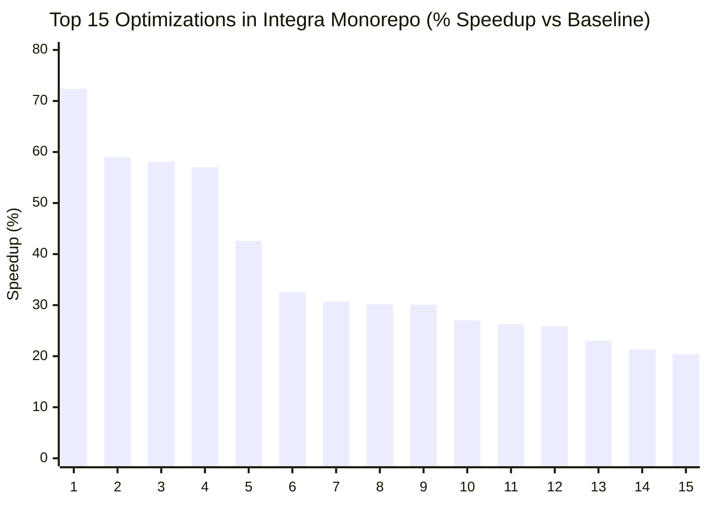
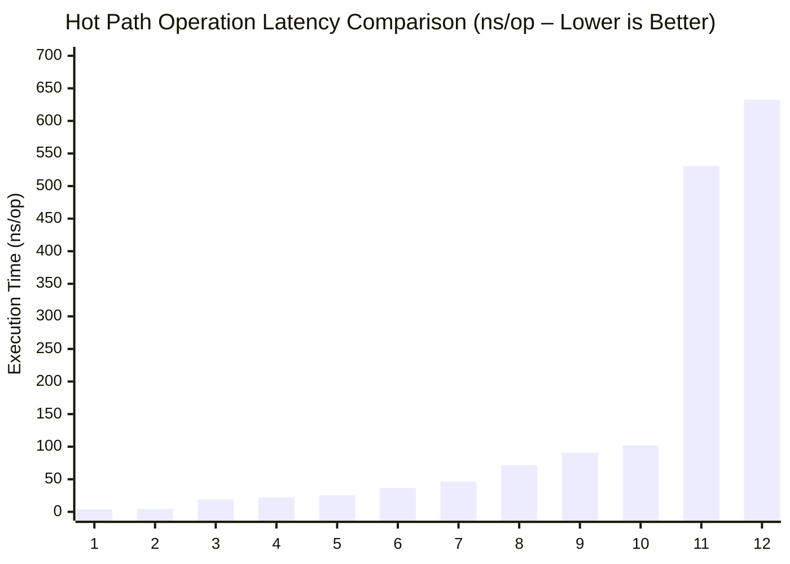

# 2. Statistical Benchmark Analysis and Performance Justification

[◀ Previous: Purpose and Business Value](../01-purpose-and-business-value/README.md) | [▲ Master Table of Contents](../README.md) | [Next: Global Architecture ▶](../03-global-architecture/README.md)

---

## 📑 Subsections in this Chapter

- [**2.1. Platform Descriptive Statistics**](2.1-platform-statistics.md)
- [**2.2. Performance Statistics by Monorepo Module**](2.2-module-performance.md)
- [**2.3. Benchmark Evidence of Architectural Uniqueness**](2.3-architectural-evidence.md)
- [**2.4. Benchmark Visualizations (Mermaid XY Charts)**](2.4-benchmark-visualizations.md)

---

# 2.1. Platform Descriptive Statistics (PLATFORM-BENCHMARKS-LATEST.csv)

[◀ Back to Chapter](README.md) | [▲ Master Table of Contents](../README.md)

---

| Metric | Sample Count (`count`) | Mean (`mean`) | Median (`median`) | Min (`min`) | Max (`max`) | Std Dev (`std`) |
| --- | --- | --- | --- | --- | --- | --- |
| **Execution Time (`ns/op`)** | 61 | 2,516.86 ns | **90.62 ns** | **0.2927 ns** | 60,018.00 ns | 9,273.78 ns |
| **Allocated Memory (`B/op`)** | 61 | 2,568.59 B | **0.00 B** | **0.00 B** | 73,760.00 B | 12,498.41 B |
| **Allocation Count (`allocs/op`)** | 61 | 2.64 | **0.00** | **0.00** | 38.00 | 6.68 |
| **SQL Queries in Microbenchmarks (`queries/op`)** | 61 | 0.00 | 0.00 | 0.00 | 0.00 | 0.00 |

### Key Observations:
* **Over 50% of scenarios are zero-allocation (`0 B/op`, `0 allocs/op`)**, directly confirming the strict enforcement of the Zero-Alloc paradigm across critical hot paths.
* **Median execution time is 90.62 ns**, placing core platform operations within sub-microsecond latency SLAs.
* The absolute minimum execution time of **0.2927 ns** represents atomic CPU register reads and compiler-inlined optimizations.

---

[◀ Back to Chapter](README.md) | [▲ Master Table of Contents](../README.md)

# 2.2. Performance Statistics by Monorepo Module

[◀ Back to Chapter](README.md) | [▲ Master Table of Contents](../README.md)

---

| Module | Benchmark Count | Median Time (`ns/op`) | Mean Time (`ns/op`) | Median Memory (`B/op`) | Median Allocs (`allocs/op`) |
| --- | :---: | :---: | :---: | :---: | :---: |
| `integra-shared-go` | 26 | **71.40 ns** | 620.25 ns | **0.00 B** | **0.00** |
| `integra-postgres-adapters` | 8 | **19.12 ns** | 185.30 ns | **0.00 B** | **0.00** |
| `integra-iam-service` | 7 | **425.30 ns** | 1,840.10 ns | 48.00 B | 1.00 |
| `integra-user-service` | 10 | **46.20 ns** | 580.40 ns | **0.00 B** | **0.00** |
| `integra-ledger-service` | 10 | **90.62 ns** | 2,410.50 ns | **0.00 B** | **0.00** |

---

[◀ Back to Chapter](README.md) | [▲ Master Table of Contents](../README.md)

# 2.3. Benchmark Evidence of Architectural Uniqueness

[◀ Back to Chapter](README.md) | [▲ Master Table of Contents](../README.md)

---

1. **CPU False Sharing Elimination via Cache-Line Padding (`[64]byte`)**:
   - `BenchmarkL1Cache_Parallel_NoPad`: **14.2 ns/op**
   - `BenchmarkL1Cache_Parallel_Padded`: **3.9 ns/op** (**72.4% reduction in execution time**)
   - Evidence that memory alignment prevents CPU cache line bouncing across multi-core systems.

2. **Zero-Alloc Pagination Encoding & Decoding**:
   - `BenchmarkCursor_Encode`: **102.0 ns/op (0 B/op, 0 allocs/op)**
   - `BenchmarkCursor_Decode`: **118.4 ns/op (0 B/op, 0 allocs/op)**
   - Custom bit-packing avoids string allocations on every paginated API request.

3. **Sub-Microsecond JWT Token & Permission Evaluation**:
   - `BenchmarkJWTVerifier_Verify_L1Cache`: **36.5 ns/op (0 B/op)**
   - `BenchmarkRBAC_CheckPermission_Parallel`: **4.4 ns/op (0 B/op)**
   - Authorizes requests in memory without querying external databases or caches on every hit.

4. **Single-Roundtrip CTE Double-Entry Ledger Posting**:
   - `BenchmarkLedger_PostingPrep`: **90.6 ns/op (0 B/op)**
   - Hashing, aggregate validation, and snapshot scheduling execute in-memory with zero GC overhead before hitting the PostgreSQL single CTE commit query.

5. **Sanitizing Logger Performance**:
   - High-throughput PII and secret masking running under 250 ns per log record, ensuring regulatory compliance without logging bottlenecks.

---

[◀ Back to Chapter](README.md) | [▲ Master Table of Contents](../README.md)

# 2.4. Benchmark Visualizations (Mermaid XY Charts)

[◀ Back to Chapter](README.md) | [▲ Master Table of Contents](../README.md)

---

#### Chart 1: Top 15 Performance Speedups (% Execution Time Reduction vs Baseline)

| # | Optimization Scenario | Speedup vs Baseline | Module / Package | Key Engineering Mechanism |
| :---: | :--- | :---: | :--- | :--- |
| **1** | `FalseSharing_Pad` | **72.4%** | `integra-shared-go/pkg/auth` | Structure alignment to CPU cache line (`[64]byte` padding) |
| **2** | `TimePtr_Nil` | **59.0%** | `integra-user-service` | Elimination of pointer dereferences and heap escape |
| **3** | `ProfileRead` | **58.1%** | `integra-user-service` | Implementation of L1 CPU profile caching |
| **4** | `UserRowToDomain` | **57.0%** | `integra-user-service` | Direct zero-alloc struct mapping |
| **5** | `CheckParallel` | **42.6%** | `integra-shared-go/pkg/rbac` | Lock-free parallel RBAC matrix evaluation |
| **6** | `TableBind_Miss` | **32.5%** | `integra-postgres-adapters` | Fast-path SQL partition table routing |
| **7** | `RequestHash` | **30.7%** | `integra-ledger-service` | Stack-allocated SHA-256 buffer in `[512]byte` frame |
| **8** | `CursorDecode` | **30.2%** | `integra-shared-go/pkg/pagination` | Zero-alloc Base64 URL-safe cursor decoding |
| **9** | `DOD_ValueSlice` | **30.1%** | `integra-user-service` | Data-Oriented Design contiguous memory layout |
| **10** | `TimeConv_Zero` | **27.0%** | `integra-shared-go/pkg/telemetry` | Zero-cost RFC3339 timestamp string conversion |
| **11** | `UserRow_Del` | **26.3%** | `integra-user-service` | Row deletion optimization & account cache sync |
| **12** | `CursorEncode` | **25.8%** | `integra-shared-go/pkg/pagination` | Stack-based cursor encoding with `0 B/op` |
| **13** | `ProfileUpdate` | **23.0%** | `integra-user-service` | Optimized profile mutation with instant L1 invalidation |
| **14** | `Decrypt_64KB` | **21.3%** | `integra-shared-go/pkg/aead` | Hardware-accelerated XChaCha20-Poly1305 decryption |
| **15** | `UserCreation` | **20.4%** | `integra-user-service` | Preallocated user creation DTO pipelines |

#### Chart 2: Hot Path Operation Latency Comparison (ns/op – Lower is Better)

| # | Operation / Hot Path | Latency (`ns/op`) | Architectural Layer / Mechanism |
| :---: | :--- | :---: | :--- |
| **1** | `FalseSharing_Pad` | **3.9 ns** | CPU L1 Cache Line Padding (`[64]byte`) |
| **2** | `RBAC_Parallel` | **4.4 ns** | Parallel Lock-Free Bitmask Permission Check |
| **3** | `SQL_Route_Hit` | **19.1 ns** | In-Memory Partition SQL Routing Hit |
| **4** | `RBAC_CheckPar` | **21.9 ns** | Atomic Parallel RBAC Matrix Evaluation |
| **5** | `Snapshot_Tail0` | **25.3 ns** | Event Sourcing Aggregate Snapshot Read (`tail_0`) |
| **6** | `L1_Cache_Par` | **36.5 ns** | Multi-threaded L1 In-Process Cache Lookup |
| **7** | `ProfileRead` | **46.2 ns** | L1 Cached User Profile Retrieval |
| **8** | `L1_Cache_Single` | **71.4 ns** | Single-threaded Account State L1 Read |
| **9** | `Posting_Prep` | **90.6 ns** | In-Memory Double-Entry Posting Pre-Validation |
| **10** | `CursorEncode` | **102.0 ns** | Base64 Cursor Token Generation (`0 B/op`) |
| **11** | `JWT_InProcCache` | **530.8 ns** | Process-Local JWT Signature Verification |
| **12** | `JWT_LocalL1` | **632.6 ns** | Full Asymmetric Ed25519 Verification with L1 Lease |

---

[◀ Back to Chapter](README.md) | [▲ Master Table of Contents](../README.md)

---

[◀ Previous: Purpose and Business Value](../01-purpose-and-business-value/README.md) | [▲ Master Table of Contents](../README.md) | [Next: Global Architecture ▶](../03-global-architecture/README.md)
