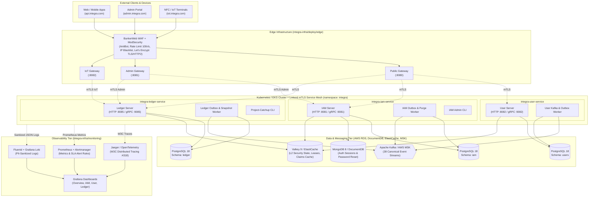

# 3.1. Ecosystem and Infrastructure Architecture (Edge, Gateways, Services, Data & Observability)

[◀ Back to Chapter](README.md) | [▲ Master Table of Contents](../README.md)

---

The diagram below illustrates the full production deployment topology defined in `integra-infra/` (encompassing the **BunkerWeb + ModSecurity** WAF edge cluster, three isolated **Envoy/Gateway** entrypoints, **Linkerd Service Mesh**, Go microservices, database clusters, and telemetry):

---

[◀ Back to Chapter](README.md) | [▲ Master Table of Contents](../README.md)
