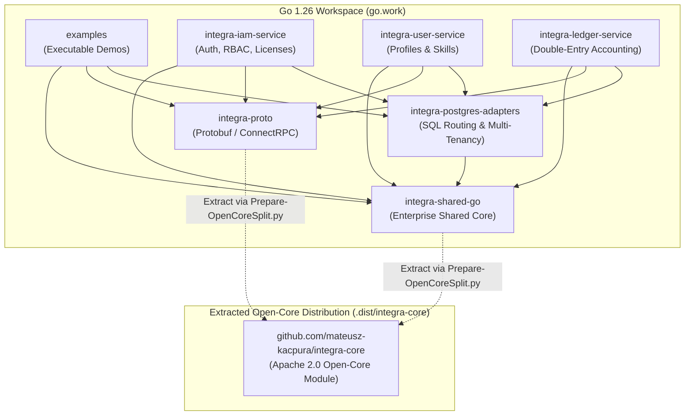

# 3.2. Go Workspace (`go.work`) Dependency Architecture and Open-Core Split

[◀ Back to Chapter](README.md) | [▲ Master Table of Contents](../README.md)

---

The diagram below details the module hierarchy inside the Go 1.26 Workspace (`go.work`) and the automated extraction barrier defining the Open-Core layer:

---

[◀ Back to Chapter](README.md) | [▲ Master Table of Contents](../README.md)
