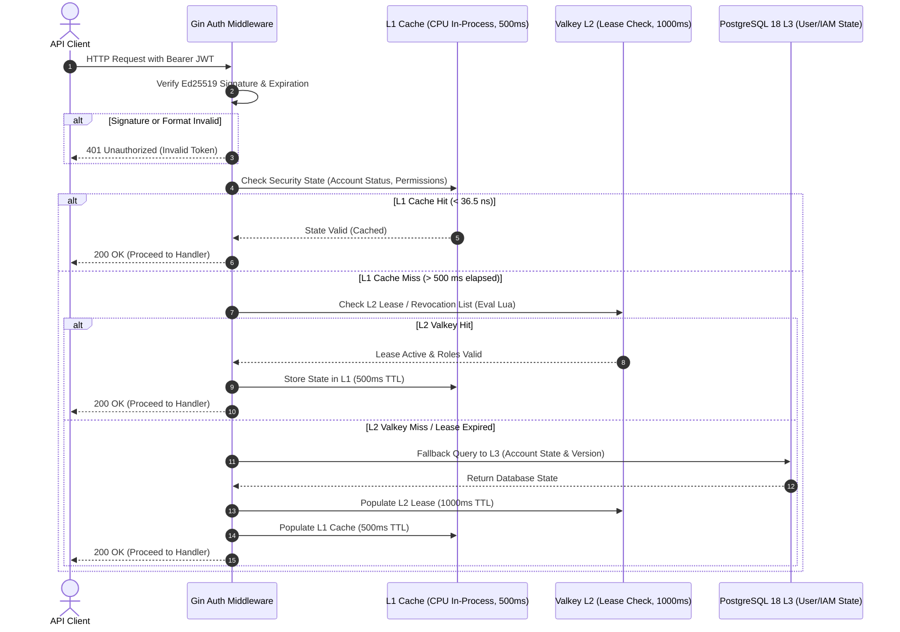

# 4.1. Workflow 1: Multi-Tier JWT Token and Security State Verification (L1 -> L2 -> L3)

[◀ Back to Chapter](README.md) | [▲ Master Table of Contents](../README.md)

---

---

[◀ Back to Chapter](README.md) | [▲ Master Table of Contents](../README.md)
