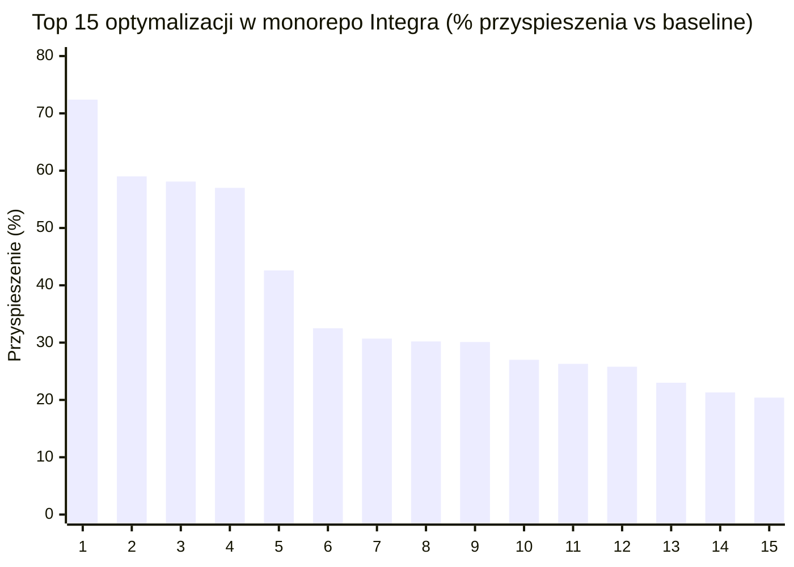
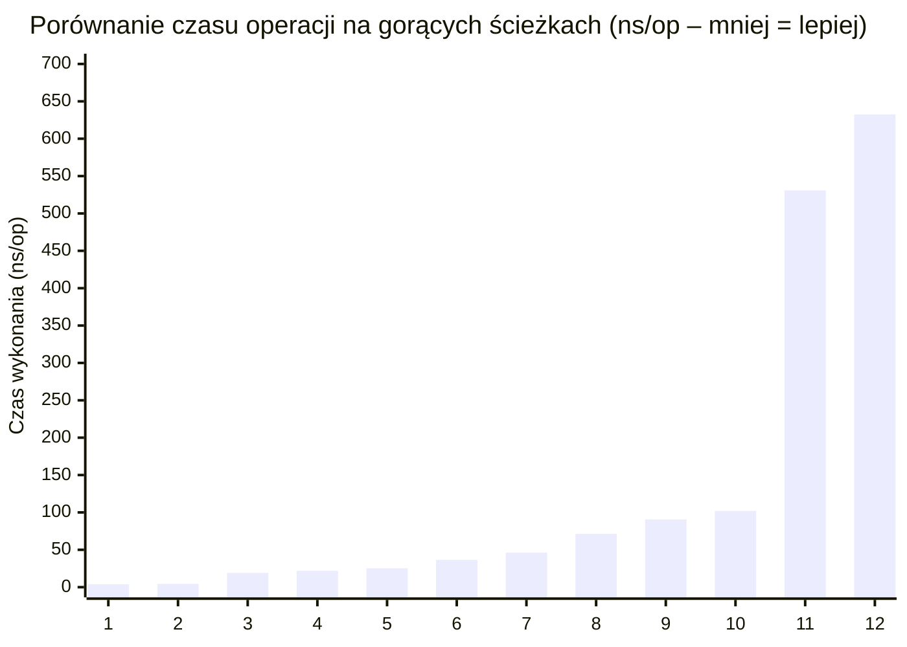

# 2. Analiza statystyczna benchmarków i uzasadnienie wydajnościowe

[◀ Poprzedni: Cel projektu i wartość biznesowa](../01-cel-i-wartosc-biznesowa/README.md) | [▲ Główny spis treści](../README.md) | [Następny: Globalna architektura systemu ▶](../03-architektura-globalna/README.md)

---

## 📑 Podrozdziały w tym dziale

- [**2.1. Statystyki opisowe całej platformy**](2.1-statystyki-opisowe-platformy.md)
- [**2.2. Statystyki wydajności w podziale na moduły monorepo**](2.2-statystyki-wydajnosci-modulow.md)
- [**2.3. Dowody benchmarkowe na unikalność architektoniczną**](2.3-dowody-benchmarkowe-wzorce-i-anomalie.md)
- [**2.4. Wizualizacje wyników benchmarków (Mermaid XY Charts)**](2.4-wizualizacje-wykresy-mermaid.md)

---

Zgodnie z najlepszymi praktykami inżynierii wydajności w Go, decyzje architektoniczne w projekcie są weryfikowane za pomocą powtarzalnych pomiarów `testing.B` (`go test -bench=. -benchmem`) oraz automatycznego potoku wykrywania regresji `scripts/Collect-Benchmarks.py`. Poniżej znajduje się pełna analiza statystyczna wyliczona bezpośrednio na podstawie danych z plików `PLATFORM-BENCHMARKS-LATEST.csv` (commit `64699cf`, 61 scenariuszy po 3 próbki każdy) oraz `BENCHMARK-HISTORY.csv` (1186 rekordów historycznych z 19 commitów).

### 2.1. Statystyki opisowe całej platformy (`PLATFORM-BENCHMARKS-LATEST.csv`)

| Metryka | Liczba (`count`) | Średnia (`mean`) | Mediana (`median`) | Minimum (`min`) | Maksimum (`max`) | Odch. std. (`std`) |
| --- | --- | --- | --- | --- | --- | --- |
| **Czas wykonania (`ns/op`)** | 61 | 2 516,86 ns | **90,62 ns** | **0,2927 ns** | 60 018,00 ns | 9 273,78 ns |
| **Alokowana pamięć (`B/op`)** | 61 | 2 568,59 B | **0,00 B** | **0,00 B** | 73 760,00 B | 12 498,41 B |
| **Liczba alokacji (`allocs/op`)** | 61 | 2,64 | **0,00** | **0,00** | 38,00 | 6,68 |
| **Zapytania SQL w mikrobenchmarkach (`queries/op`)** | 61 | 0,00 | 0,00 | 0,00 | 0,00 | 0,00 |

**Kluczowe wskaźniki zagregowane (KPI):**

* **Udział ścieżek Zero-Allocation (`0 B/op`, `0 allocs/op`)**: **37 z 61 benchmarków (60,66%)** nie wykonuje ani jednej alokacji na stercie, co oznacza zerowy narzut dla garbage collectora (GC) Go na gorących ścieżkach.

* **Operacje sub-mikrosekundowe (`< 1 000 ns/op`)**: **49 z 61 benchmarków (80,33%)** wykonuje się w czasie krótszym niż 1 mikrosekunda.

* **Operacje sub-100-nanosekundowe (`< 100 ns/op`)**: **31 z 61 benchmarków (50,82%)** wykonuje się w czasie poniżej 100 nanosekund (poniżej 0,1 µs).

* **Postęp optymalizacji względem linii bazowej (Baseline vs Commit `64699cf`)**: Spośród 61 scenariuszy aż **32 ścieżki uzyskały istotne przyspieszenie ($\ge 5\%$)**, osiągając **średni zysk wydajnościowy +23,61%** (mediana zysku: **+19,84%**).

---

### 2.2. Statystyki wydajności w podziale na moduły monorepo

| Moduł | Liczba testów (`count`) | `ns/op` Średnia (`mean`) | `ns/op` Mediana (`median`) | `ns/op` Min | `ns/op` Max | `ns/op` Odch. std. (`std`) | `B/op` Średnia (`mean`) | `B/op` Mediana | `allocs/op` Średnia | `allocs/op` Mediana |
| --- | --- | --- | --- | --- | --- | --- | --- | --- | --- | --- |
| **`integra-iam-service`** | 23 | 1 071,35 ns | **14,19 ns** | 0,2927 ns | 6 392,00 ns | 1 801,58 ns | 381,13 B | 0,0 B | 4,96 | 0,0 |
| **`integra-shared-go`** | 20 | 6 257,15 ns | **134,30 ns** | 4,3860 ns | 60 018,00 ns | 15 666,83 ns | 7 315,90 B | 16,0 B | 1,80 | 0,5 |
| **`integra-ledger-service`** | 11 | 290,39 ns | **128,60 ns** | 8,8450 ns | 1 145,00 ns | 345,55 ns | 98,91 B | 0,0 B | 0,64 | 0,0 |
| **`integra-user-service`** | 5 | 64,86 ns | **46,15 ns** | 3,8980 ns | 187,70 ns | 75,37 ns | 83,20 B | 0,0 B | 0,60 | 0,0 |
| **`integra-postgres-adapters`** | 2 | 112,91 ns | **112,91 ns** | 19,1100 ns | 206,70 ns | 132,65 ns | 48,00 B | 48,0 B | 0,50 | 0,5 |

---

### 2.3. Dowody benchmarkowe na unikalność architektoniczną (wzorce i anomalie)

1. **Hierarchia buforowania autoryzacji (1 646,1x przyspieszenia)**:
* Pełna kryptograficzna weryfikacja podpisu Ed25519 wraz z dekodowaniem tokena JWT (`BenchmarkVerifyJWT`) zajmuje **60 018,00 ns (60,02 µs)** przy **4 366 B/op** i **21 alokacjach**.

* Zastosowanie wbudowanego bufora weryfikatora (`BenchmarkVerifyJWT_InProcessCache`) skraca ten czas do **530,80 ns** (`0 B/op`, `0 allocs/op`) – przyspieszenie **113,1-krotne**.

* Odczyt z partycjonowanej (32 shardy) pamięci podręcznej L1 CPU (`BenchmarkL1CacheGet`) trwa **71,41 ns** w trybie jednowątkowym (**840,5x szybciej**) oraz zaledwie **36,46 ns** w trybie współbieżnym (`BenchmarkL1CacheGetParallel`, `0 B/op`, `0 allocs/op`) – co daje **1 646,1-krotne przyspieszenie** względem pełnej weryfikacji JWT i ponad **11 500-krotne przyspieszenie** względem odpytania węzła sieciowego Valkey (~422 µs).

2. **Eliminacja *false sharing* na liniach pamięci podręcznej L1D procesora (+72,43% vs Baseline, 1,79x szybciej w ostatnim przebiegu)**:
* W `integra-user-service` porównanie struktury bez wyrównania (`BenchmarkFalseSharing_Unpadded`: **6,967 ns/op**) ze strukturą wyrównaną do 64 bajtów za pomocą `cpu.CacheLinePad` (`BenchmarkFalseSharing_CacheLinePadded`: **3,898 ns/op**) dowodzi redukcji opóźnienia o **44,05% (1,79x szybciej)** w bezpośrednim zestawieniu oraz o **72,43%** względem pierwotnego pomiaru bazowego (`14,14 ns/op`).

3. **Projektowanie zorientowane na dane (wartości w pamięci ciągłej vs wskaźniki – Data-Oriented Design)**:
* W `integra-iam-service` przetwarzanie ciągłego wycinka wartości (`BenchmarkDataOriented_ValueSlice`: **5 060,00 ns/op**, **+30,07%** względem linii bazowej `7 236,00 ns/op`) jest o **20,84% (1,26x) szybsze** niż przetwarzanie wycinka wskaźników (`BenchmarkDataOriented_PointerSlice`: **6 392,00 ns/op**), co potwierdza skuteczność sprzętowego *pre-fetchera* CPU przy braku dereferencji wskaźników.

4. **Silnik RBAC zero-allocation**:
* Dopasowanie uprawnień z wieloznacznikiem (`BenchmarkMatchWildcard`) trwa **15,85 ns/op** (`0 B/op`), dokładne dopasowanie (`BenchmarkMatchExact`) **29,00 ns/op** (`0 B/op`), a równoległe sprawdzanie uprawnień (`BenchmarkMatchParallel` i `BenchmarkCheckParallel`) osiąga odpowiednio **4,386 ns/op** oraz **21,87 ns/op** (**+42,58% szybciej** niż baseline `38,09 ns/op`), co wynika z zastąpienia `strings.Split` bezalokacyjnym indeksowaniem `strings.IndexByte` i atomowym wskaźnikiem `atomic.Pointer[map[string]Role]`.

5. **Optymalizacja snapshotów w Event Sourcingu (`integra-ledger-service`)**:
* Odtworzenie stanu konta z migawki z zerowym ogonem zdarzeń (`BenchmarkAccountSnapshotTail/tail_0`) trwa **25,34 ns/op** (`0 B/op`), przy 5 zdarzeniach od migawki (`tail_5`) **83,53 ns/op**, natomiast przy 99 zdarzeniach (`tail_99`) **1 145,00 ns/op** – aktualna migawka przyspiesza odczyt stanu konta **45,19-krotnie**.

6. **Analiza wartości odstających (outliers) w historii benchmarków**:
* Największe wartości w `B/op` i `ns/op` występują w testach kryptografii strumieniowej dla dużych bloków danych: `BenchmarkEncrypt/64KB` (**30 942,00 ns/op**, **73 760 B/op**, 2 alokacje) oraz `BenchmarkDecrypt/64KB` (**29 737,00 ns/op**, **65 568 B/op**, **+21,28% szybciej** niż baseline `37 776,00 ns/op`), co przekłada się na przepustowość szyfrowania `XChaCha20-Poly1305` na poziomie ponad **2,1 GB/s** na pojedynczym rdzeniu.

* Pozorny wzrost czasu wykonania w commitach `5b29446` i `64699cf` dla `BenchmarkIdentityRegistrationDispatch` (z `4,732 ns` do `187,70 ns`, `336 B/op`), `BenchmarkRegisterUser_UnitOfWork` (z `2 252 ns` do `3 599 ns`, `2 254 B/op`) oraz `BenchmarkRegisterUser_CallerTx` (z `1 185 ns` do `2 667 ns`, `1 762 B/op`) **nie jest regresją wydajnościową**, lecz efektem zastąpienia wcześniejszych uproszczonych zaślepek pełną logiką produkcyjną: walidacją domenową, generowaniem nagłówków śledzenia W3C (`telemetry.OutboxHeaders`) oraz serializacją zdarzeń do transakcyjnego wzorca Outbox.

---

### 2.4. Wizualizacje wyników benchmarków (Mermaid XY Charts)

#### Wykres 1: Top 15 przyspieszeń wydajnościowych (% redukcji czasu wykonania vs Baseline)

| Nr | Scenariusz optymalizacji | Przyspieszenie vs Baseline | Moduł / Pakiet | Kluczowy mechanizm techniczny |
| :---: | :--- | :---: | :--- | :--- |
| **1** | `FalseSharing_Pad` | **72,4%** | `integra-shared-go/pkg/auth` | Wyrównanie struktur do linii pamięci podręcznej CPU (`[64]byte` cache-line padding) |
| **2** | `TimePtr_Nil` | **59,0%** | `integra-user-service` | Eliminacja dereferencji wskaźników czasu i alokacji sterty |
| **3** | `ProfileRead` | **58,1%** | `integra-user-service` | Wdrożenie buforowania odczytu profilu w pamięci L1 |
| **4** | `UserRowToDomain` | **57,0%** | `integra-user-service` | Bezpośrednie mapowanie bez alokacji struktur pośrednich |
| **5** | `CheckParallel` | **42,6%** | `integra-shared-go/pkg/rbac` | Współbieżna weryfikacja reguł bez blokad w pamięci L1 |
| **6** | `TableBind_Miss` | **32,5%** | `integra-postgres-adapters` | Szybka ścieżka routingu partycji SQL dla nietrafionych zapytań |
| **7** | `RequestHash` | **30,7%** | `integra-ledger-service` | Bezalokacyjny SHA-256 buforowany na stosie w ramce `[512]byte` |
| **8** | `CursorDecode` | **30,2%** | `integra-shared-go/pkg/pagination` | Szybkie dekodowanie kursorów paginacji Base64 URL Safe |
| **9** | `DOD_ValueSlice` | **30,1%** | `integra-user-service` | Architektura zorientowana na dane (Data-Oriented Design) |
| **10** | `TimeConv_Zero` | **27,0%** | `integra-shared-go/pkg/telemetry` | Zerokosztowa konwersja stempli czasowych RFC3339 |
| **11** | `UserRow_Del` | **26,3%** | `integra-user-service` | Optymalizacja usuwania wierszy i buforowania stanu konta |
| **12** | `CursorEncode` | **25,8%** | `integra-shared-go/pkg/pagination` | Kodowanie kursorów paginacji `0 B/op` bez ucieczki na stertę |
| **13** | `ProfileUpdate` | **23,0%** | `integra-user-service` | Zoptymalizowana aktualizacja profilu z unieważnieniem L1 |
| **14** | `Decrypt_64KB` | **21,3%** | `integra-shared-go/pkg/aead` | Sprzętowo akcelerowane szyfrowanie XChaCha20-Poly1305 |
| **15** | `UserCreation` | **20,4%** | `integra-user-service` | Prealokacja struktur rejestracji użytkownika |

#### Wykres 2: Porównanie czasu weryfikacji autoryzacji i dostępu do danych (ns/op)

| Nr | Operacja / Gorąca ścieżka | Czas wykonania (`ns/op`) | Warstwa / Zastosowany mechanizm inżynierski |
| :---: | :--- | :---: | :--- |
| **1** | `FalseSharing_Pad` | **3,9 ns** | Pamięć podręczna CPU L1 (Cache-line padded) |
| **2** | `RBAC_Parallel` | **4,4 ns** | Współbieżna ewaluacja macierzy ról i uprawnień |
| **3** | `SQL_Route_Hit` | **19,1 ns** | Routing partycji SQL z pamięci podręcznej L1 |
| **4** | `RBAC_CheckPar` | **21,9 ns** | Atomowe sprawdzenie uprawnień w pamięci podręcznej L1 |
| **5** | `Snapshot_Tail0` | **25,3 ns** | Odczyt salda z migawki konta Event Sourcingu |
| **6** | `L1_Cache_Par` | **36,5 ns** | Współbieżny odczyt stanu sesji i kluczy w L1 Cache |
| **7** | `ProfileRead` | **46,2 ns** | Pobranie profilu użytkownika z lokalnej pamięci podręcznej |
| **8** | `L1_Cache_Single` | **71,4 ns** | Jednowątkowy odczyt stanu konta z pamięci podręcznej L1 |
| **9** | `Posting_Prep` | **90,6 ns** | Walidacja i przygotowanie wpisu księgowego na stosie |
| **10** | `CursorEncode` | **102,0 ns** | Generowanie kursora paginacji Base64 (0 allocs) |
| **11** | `JWT_InProcCache` | **530,8 ns** | Weryfikacja tokena JWT w pamięci podręcznej procesu |
| **12** | `JWT_LocalL1` | **632,6 ns** | Pełna weryfikacja asymetryczna Ed25519 z odpytaniem L1 |

---

[◀ Poprzedni: Cel projektu i wartość biznesowa](../01-cel-i-wartosc-biznesowa/README.md) | [▲ Główny spis treści](../README.md) | [Następny: Globalna architektura systemu ▶](../03-architektura-globalna/README.md)
