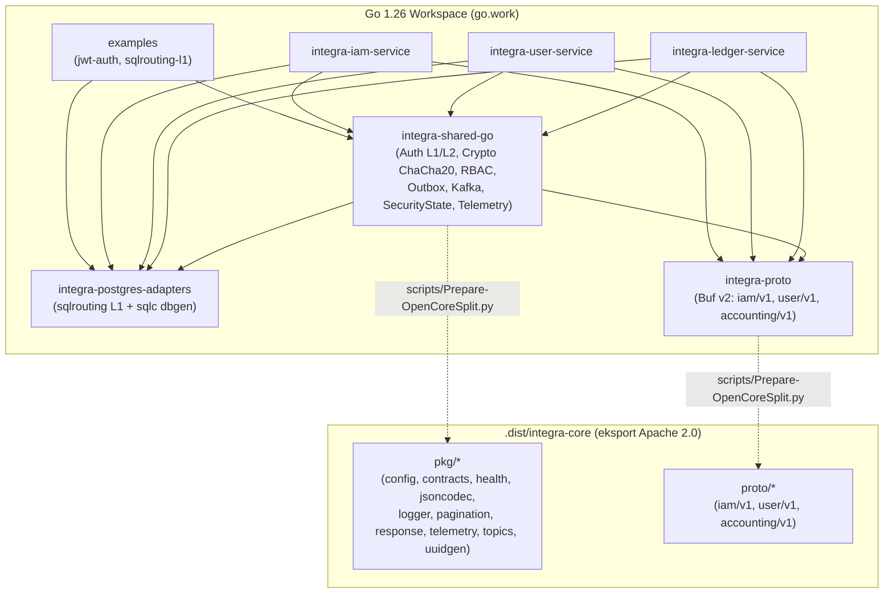

# 3.2. Architektura zależności modułów Go Workspace (`go.work`) i podział Open-Core

[◀ Powrót do rozdziału](README.md) | [▲ Główny spis treści](../README.md)

---

Wzorzec organizacji workspace'u w Go (`go.work`) pozwala na jednoczesną pracę nad wieloma powiązanymi modułami bez konieczności ich wcześniejszego publikowania w zdalnym repozytorium. Jednocześnie skrypty `scripts/Check-LocalModules.py` oraz `scripts/Audit-Project.py` weryfikują kompilację każdego modułu w izolacji z flagą `GOWORK=off`:

---

[◀ Powrót do rozdziału](README.md) | [▲ Główny spis treści](../README.md)
