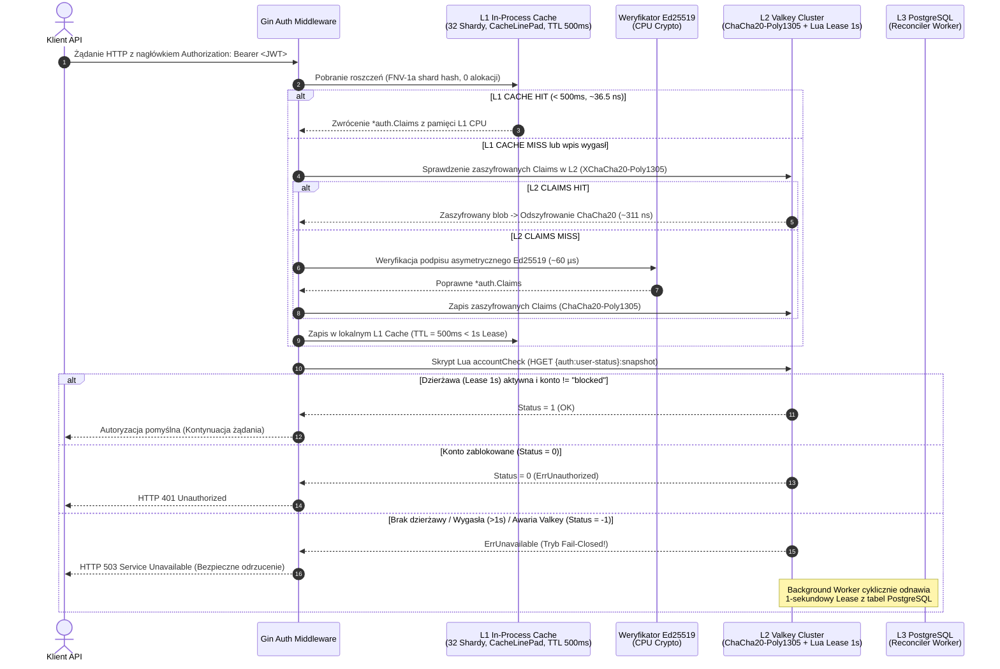

# 4.1. Przepływ 1: Wielopoziomowa weryfikacja tokena JWT i stanu bezpieczeństwa (L1 -> L2 -> L3)

[◀ Powrót do rozdziału](README.md) | [▲ Główny spis treści](../README.md)

---

Poniższy diagram sekwencji ilustruje działanie weryfikatora `auth.JWTVerifier` (`integra-shared-go/pkg/auth/verifier.go`), pamięci podręcznej `L1Cache` (`l1_cache.go`) oraz strażnika stanu konta i ról w `Valkey` (`account_state.go`, `securitystate/authority.go`):

---

[◀ Powrót do rozdziału](README.md) | [▲ Główny spis treści](../README.md)
