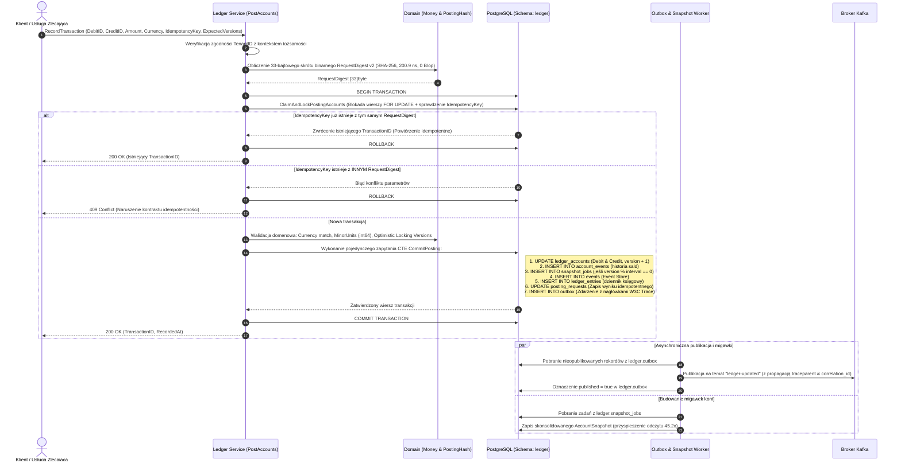

# 4.2. Przepływ 2: Atomowe księgowanie podwójnego zapisu (Double-Entry Ledger Posting & Idempotency)

[◀ Powrót do rozdziału](README.md) | [▲ Główny spis treści](../README.md)

---

Przepływ pracy w `integra-ledger-service` podczas wykonywania operacji `PostAccounts` (`internal/infrastructure/postgres/posting.go` oraz `db/queries/posting_commit.sql`):

---

[◀ Powrót do rozdziału](README.md) | [▲ Główny spis treści](../README.md)
